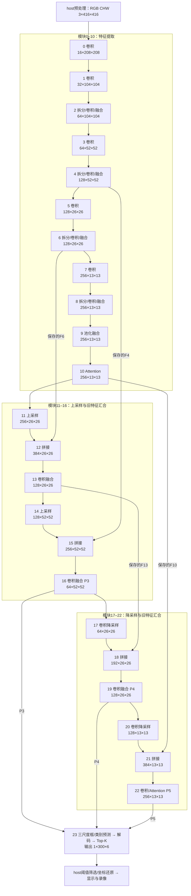

# YOLO26n完整计算与优化手册

更新：2026-10-26。当前实现：性能/诊断双镜像与按需缓存交接，PCIe协议2、诊断计时版号9（`whole_pipeline_v9`）。本页统一说明全部334个逻辑节点的计算、形状、实现和优化原理。第3节的张量offset是冻结图的原布局；启用图规划后实际offset和融合组按第4.6节重新生成，逻辑形状与节点编号不变。

当前包含UINT8输入、双缓冲和有界视频流水。最近实板通过配置为`m128/n32/pack25/compute0/graph11`、串行上传，30帧模型均值8.804265秒、连续完成间隔13.3193秒。启用整层FP16复用、首层查表复用及专用工作区整层交接，小块转置未被选中。相对该轮起点模型耗时减少约4.35%，出帧间隔仅少0.005秒，见第5节。重叠上传仍在请求校验处失败，根因未确定。当前host默认也使用上述pack25串行配置；验收通过后的日常演示使用与固件SHA匹配的保存配置。新版双镜像及本次缓存优化的实板收益尚未测得。

阅读顺序为“整帧连接 → 沿数据流逐模块逐节点计算 → 实现、优化与实测”。模块、节点和算子在同一条主线说明，共用规则仅在首次出现时解释。源码链接用于实际修改，操作、平台协议和完整历史证据仍保留在各自的专业资料中；它们不再承担第二份模型计算说明。

## 阅读导航

- [范围、符号与计算总量](#overview)
- [从输入到输出的数据流与24个模块](#architecture)
- [沿数据流逐模块、逐节点计算（含算子规则与实现）](#nodes)
- [当前实现、数据通路及优化原理](#implementation)
- [实测、计时含义与检测精度](#performance)
- [优化约束、验证及维护](#constraints)

<a id="overview"></a>

## 1. 范围、符号与计算总量

固定模型为YOLO26n、一对一分支、COCO80类，输入`[1,3,416,416]`，输出`[1,300,6]`。节点编号从0到333，共335个保留输出；同一算子可以在不同节点反复调用。逻辑张量为FP32或INT64；普通卷积交给AMU前，将输入和权重转为FP16，累加和输出仍是FP32。8层深度卷积和Attention矩阵乘使用RVV FP32。

### 1.1 形状怎样读

| 符号/布局 | 含义 |
|---|---|
| NCHW = [N,C,H,W] | N是图像批量，本图为1；C是特征通道，只有输入的3通道直接对应RGB；H/W是空间尺寸 |
| OIHW = [Cout,Cin/groups,Kh,Kw] | 每个输出通道各有一组卷积权重；Cout决定输出通道数 |
| [B,M,K] × [B,K,P] | B是独立矩阵组数，本图Attention的B=2对应两个头；M/K/P为矩阵维度，不代表图像批量 |
| [] | 单个标量，仍有1个元素；不是空张量 |
| axis | 从0开始的轴编号，例如NCHW的axis=1是通道轴 |
| tensor id | 图中逻辑张量编号；相同地址不一定是相同张量，arena会按生命期复用 |
| MAC | 一个数学乘积及其累加；这里用于统计工作量，不代表一次FMA或一次AMU指令 |

### 1.2 一帧实际覆盖的工作

| 项目 | 静态规模 |
|---|---:|
| 顶层模块 / 执行节点 / 算子类型 | 24 / 334 / 21 |
| 卷积乘加项 | 1,131,756,496 MAC |
| Attention BMM乘加项 | 10,967,424 MAC |
| 上述乘加项合计 | **1,142,723,920 MAC** |
| 若将一乘一加各计一次 | 2,285,447,840次运算，仅包含上述点积，不含bias/非线性/寻址/搬运 |
| 模型输入 / 最终候选 | 2,076,672 / 7,200字节 |
| 三尺度位置数 | 52×52 + 26×26 + 13×13 = 3549 |

MAC不能直接换算周期：一条AMU指令处理多项乘积，RVV各lane并行，而索引、FP16转换、边界补零、缓存维护、CRC及数据复制也需要时间。以下类型计数包含全部节点：

| 类型 | 节点数 | 点积MAC |
|---|---:|---:|
| CONV | 102 | 1,131,756,496 |
| SILU | 87 | 0 |
| SLICE | 28 | 0 |
| ADD | 21 | 0 |
| CONCAT | 24 | 0 |
| POOL | 3 | 0 |
| COPY | 32 | 0 |
| MUL | 3 | 0 |
| PERMUTE | 5 | 0 |
| EXPAND | 10 | 0 |
| BMM | 4 | 10,967,424 |
| SOFTMAX | 2 | 0 |
| NEAREST | 2 | 0 |
| SUB | 1 | 0 |
| SIGMOID | 1 | 0 |
| MAX | 1 | 0 |
| TOPK | 2 | 0 |
| GATHER | 3 | 0 |
| REMAINDER | 1 | 0 |
| CAST | 1 | 0 |
| FLOORDIV | 1 | 0 |

表内非点积算子的MAC=0只表示不按点积统计，绝不表示没有工作。复制、重排、池化和非线性都可能成为热点。

### 1.3 模型外的前后处理

Linux host解码视频，双线性等比例缩放、居中补114、BGR转RGB并排列为CHW UINT8，经PCIe写入519,168字节。板端首层按256项查表得到与原FP32除255后转FP16完全相同的值，不物化逻辑FP32输入。诊断图片入口仍接受2,076,672字节FP32。板端保留334个逻辑节点，包括解码和两次Top-K。host读取300×6 FP32候选，保留score>0.25，去补边、除缩放比例、裁剪坐标并绘框；字段为`x1,y1,x2,y2,score,class`，坐标对应416输入图；无NMS。

### 1.4 1×1卷积与向量并行的直观含义

若输入[1,32,H,W]、权重[64,32,1,1]，每个位置的32个数与一组32项权重点积后，再加该输出通道的bias，得到一个输出通道；共有64组不同权重及64个bias，因此得到[1,64,H,W]。空间位置不变，每组权重在所有位置共用，输出64通道是64种学习出的特征。

RVV的e32表示元素32位，m2表示两个向量寄存器组成一组，vl是本次实际有效元素数；不等于固定处理32个数，也不等于图像有32个通道。普通点运算常让lane处理相邻元素，深度卷积让lane处理相邻输出像素，BMM让lane处理相邻输出列。AMU的32×32分块与RVV的vl是不同概念。

<a id="architecture"></a>

## 2. 从输入到输出的数据流与24个模块

### 2.1 整帧连接与分支汇合

**执行次序按model.0到model.23推进；数据连接中有分支、保留旧输出和汇合。** 模块是对一组计算的命名，例如model.2包含节点004–015共12步，不是一条指令，也不等于一个算子。程序按依赖执行334个逻辑节点；开启融合后，某些中间节点不再独立计算或写回，但逻辑连接保持不变。下面的分支表示数据依赖，不表示硬件同时执行两条支路。

令`F0`表示model.0的输出，`F1`表示model.1的输出，依此类推。整帧从左向右、从上到下读：



图中`C×H×W`省略了固定批量1。实际连接可直接写成：

```text
F0 = M0(图片)；F1 = M1(F0)；…；F10 = M10(F9)
F11 = M11(F10)
F12 = Concat(F11, F6)； F13 = M13(F12)
F14 = M14(F13)
F15 = Concat(F14, F4)； F16 = M16(F15)
F17 = M17(F16)
F18 = Concat(F17, F13)；F19 = M19(F18)
F20 = M20(F19)
F21 = Concat(F20, F10)；F22 = M22(F21)
结果 = M23(F16, F19, F22)
```

因此F4必须保留到模块15，F6保留到12，F10保留到21；F13既给14又给18，F16既给17又给23，F19既给20又给23。沿这些消费者才能确定缓冲区最后使用时刻。所谓“往回取第6模块”是读取已保存的数据，不是重新运行第6模块。

逐模块的全部节点、具体算子和张量明细紧接在第3节；本节只给整帧连接，不再重复列模块表。

<a id="nodes"></a>
<a id="operators"></a>

## 3. 沿数据流逐模块、逐节点计算

每个节点均列全部有效输入/输出，包括权重和bias。`weights+offset`相对原始常量区，`arena+offset`相对特征区；以字节计，不是可直接用于JTAG的绝对地址。以下“张量字节”描述逻辑规模，**不是实际DDR流量**；AMU会读取启动生成的FP16块，而不是逐帧读取并转换所有原始FP32权重。消费者/最后使用来自当前静态图，包含COPY别名，不代表已批准改变内存规划。末次使用只统计图内节点；最终候选还必须保留到host读回完成。

导出时多个卷积复用了同一个SiLU对象，部分激活的导出名显示model.0.act；这里按实际连接归入所属模块，不表示跳回模块0。共24个模块、334个节点和335个保留输出。

**层级关系：模块包含节点；每个逻辑节点对应一次算子调用。** 同一种算子可以被多个节点调用，节点内部的循环、指令、类型转换和点积子步骤不再另算图节点。CONV节点包括bias；SiLU在图中另有节点。融合执行可以把二者合并为一次内核调度，逻辑编号仍保留。

以下紧凑记法用于写出每步计算：`C3(3→16,s2)`表示普通3×3卷积、bias、SiLU，输入/输出通道为3/16，步长2；`C1`为1×1同类操作。`L1`表示1×1卷积及bias，**没有SiLU**。默认步长1；3×3默认补边1，1×1补边0。`D3(C)`为C通道各自做3×3深度卷积及bias，SiLU在需要时另写。拆分/拼接均沿通道轴；`+`为相同位置逐元素相加。未注明改变时，H/W保持原值，批量均为1。

每个模块依次给出“输入及输出去向 → 内部计算 → 节点明细”。算子公式、默认执行入口和共用优化约束仅在该算子首次出现的模块解释一次；后续节点点击算子名称回查。节点表只保留本次调用独有的张量、参数及工作量。实现候选与配置选择集中在第4.6节，节点明细描述冻结图和默认数值路径。

<a id="module-0"></a>

### 3.1 model.0 · Conv · 节点000–001

**目的**：3×3、步长2；降采样并提取初级局部特征。

**输入与输出去向**：host提供RGB CHW UINT8 `[1,3,416,416]`；首层查表打包为FP16 → 3×3卷积、步长2、bias → `[1,16,208,208]` → SiLU → F0，交给模块1。节点000是卷积，001是SiLU；这两个算子属于同一模块。

<details>
<summary>本模块首次使用的算子规则与默认实现（按需展开）</summary>

<a id="op-conv"></a>

##### CONV（102个节点）

对每个输出位置，把同组输入通道的Kh×Kw邻域乘相应权重后累加，最后加该输出通道的bias。输出Hout=floor((Hin+2Ph−Kh)/Sh)+1，Wout同理；本图dilation=1。分组卷积中，输出通道所属组决定它能读取哪些输入通道。倍率1深度卷积为groups=Cin=Cout，每个输出只看一个输入通道。

普通卷积可写成W[M,K]×X[K,P]，M=Cout、K=Cin×Kh×Kw、P=Hout×Wout。AMU按M/K/P各最多32分块；深度卷积每像素九项，不作跨通道求和。数学求和式不能授权改变实际累加顺序或舍入规则。

###### 普通卷积的一个完整例子

节点16把`[1,64,104,104]`变为`[1,64,52,52]`，权重`[64,64,3,3]`，stride=2、pad=1。每个输出通道/位置都累加64×3×3=576个乘积，再加bias；一共64×52×52=173056个输出。当前每次为32个输出位置生成18个K32输入块，共18×32×32×2=36KiB，两个M32输出通道块共用，不先生成FP32 im2col。该层`99,680,256`个MAC只是点积规模，另有输入打包、bias和缓存工作。

**默认实现分支1**：启动FP16权重预打包；RVV FP32窗口gather与边缘mask；整数RNE直接打包N32输入；AMU K32顺序累加；整层RVV独立加bias。执行入口：`convolution → amu_pack_conv_input_rvv / amu_matmul_packed_fp16 → rvv_bias_channels`。源码：[accel_model.c](../yolo26_riscv/accel_model.c)、[amu.c](../yolo26_riscv/amu.c)、[amu_input_rvv.c](../yolo26_riscv/amu_input_rvv.c)。

**默认实现分支2**：启动FP16权重预打包；1x1跨通道直读/通用窗口masked gather；整数RNE；N32输入复用；AMU K32顺序累加；整层RVV独立加bias。执行入口：`convolution → amu_pack_conv_input_rvv / amu_matmul_packed_fp16 → rvv_bias_channels`。源码：[accel_model.c](../yolo26_riscv/accel_model.c)、[amu.c](../yolo26_riscv/amu.c)、[amu_input_rvv.c](../yolo26_riscv/amu_input_rvv.c)。

**默认实现分支3**：RVV m2按行直接读取3x3窗口；ky/kx九次独立乘加；最后独立加bias；整输出CLP交接，无im2col。执行入口：`convolution → rvv_depthwise3x3`。源码：[accel_model.c](../yolo26_riscv/accel_model.c)、[rvv_model_ops.c](../yolo26_riscv/rvv_model_ops.c)。

**共用优化约束**：按实测评估输入索引/打包及AMU调度。必须保持：FP16 RNE位模式一致；每输出K顺序/逐指令舍入/bias独立加法不变；CLP输出所有权交接。

**共用优化约束**：先测直接窗口，后续复用不得改变每输出累加顺序。必须保持：ky/kx顺序不变，不引入FMA；边界补零、尾VL及缓存交接。

<a id="op-silu"></a>

##### SILU（87个节点）

逐元素计算y=x×sigmoid(x)，形状不变，用非线性保留和抑制特征。当前用分段稳定公式及既有指数多项式近似，随后做FP32除法；近似系数和每一步乘、加、除顺序也是现有数值合同的一部分。 [指数逐步计算](#exp-detail)。

<a id="exp-detail"></a>

###### SiLU、Sigmoid、Softmax中的指数到底怎样计算

三者调用同一套非正输入指数近似。令z≤0，以下浮点步骤均使用FP32，各乘法和加减分别舍入，保持代码中的先后顺序：

```text
tiny = (z <= -80)
z = max(z, -80)
n = 向零取整(z * 1.4426950408889634 - 0.5)
r = z - float(n) * 0.693145751953125
r = r - float(n) * 0.000001428606765330187
p = 1 / 720
依次取a = [1/120, 1/24, 1/6, 1/2, 1, 1]：p = r * p + a
scale = 将整数位模式((n + 127) << 23)解释为FP32，也就是此范围的2^n
e = p * scale
若tiny成立，最后将e选为+0
```

系数在编译时按FP32保存，不能把上式当成FP64运算后只舍入一次。六次Horner步骤各是一乘一加，未使用FMA；即使tiny成立，当前向量代码也可能完成中间运算，最后再用掩码选择0。

- SiLU/Sigmoid先令z=−abs(x)，求e和denominator=1+e。SiLU在x≥0时用x/denominator，否则用(x×e)/denominator；Sigmoid在x≥0时用1/denominator，否则用e/denominator。当前SiLU向量路径先算x×e再选择分子。
- Softmax令z=x−行最大值，先写出全部e，再按元素顺序从+0累加sum，最后输出e/sum；没有采用向量无序归约。

因此此处的优化对象包括取数、范围缩减、类型转换、六次多项式乘加、除法、选择和缓存交接。替换为数学库exp、倒数近似、FMA或另一种求和顺序，都属于数值规则变更，不能只用“公式等价”认定输出逐位一致。

**默认实现**：RVV m2原FP32指数近似、乘法与除法；整缓冲区交接。执行入口：`rvv_nonlinear → exp_neg`。源码：[rvv_model_ops.c](../yolo26_riscv/rvv_model_ops.c)、[rvv_access.h](../yolo26_riscv/rvv_access.h)。

**共用优化约束**：测量指数/除法成本，不改变近似和运算顺序。必须保持：既有元素对应、FP32计算/整数语义及缓存交接。

</details>

#### 按顺序执行的节点

<a id="node-000"></a>

##### 节点000 · [CONV](#op-conv) · model.0.conv

| 角色 | 张量 / 形状 / 类型 | 元素 / 字节 | 存储 / 来源或消费者 |
|---|---|---:|---|
| 输入0 | T0 `[1,3,416,416]` FP32 | 519,168 / 2,076,672 | `arena+64`；来自host预处理 |
| 权重 | T1 `[16,3,3,3]` FP32 | 432 / 1,728 | `weights+0`；来自固定常量 |
| bias | T2 `[16]` FP32 | 16 / 64 | `weights+1728`；来自固定常量 |
| 输出0 | T3 `[1,16,208,208]` FP32 | 692,224 / 2,768,896 | `arena+2076800`；[节点001](#node-001)；根T3末次使用节点001 |

**计算与参数**：kernel=3×3，stride=(2, 2)，pad=(1, 1)，groups=1；每输出累加27个乘积，最后加bias。 矩阵M=16、K=27、P=43264，batch=1；每N32空间块的FP16输入为[1,32,32]，固定容量2048字节，权重预打包2048字节。

**点积规模**：18,690,048 MAC；不含bias、索引、转换、补边与缓存工作。

<a id="node-001"></a>

##### 节点001 · [SILU](#op-silu) · model.0.act

| 角色 | 张量 / 形状 / 类型 | 元素 / 字节 | 存储 / 来源或消费者 |
|---|---|---:|---|
| 输入0 | T3 `[1,16,208,208]` FP32 | 692,224 / 2,768,896 | `arena+2076800`；来自[节点000](#node-000) |
| 输出0 | T4 `[1,16,208,208]` FP32 | 692,224 / 2,768,896 | `arena+4845760`；[节点002](#node-002)；根T4末次使用节点002 |

**计算与参数**：Y=x×sigmoid(x)，692224个元素；沿用原指数近似、独立乘加与FP32除法。

<a id="module-1"></a>

### 3.2 model.1 · Conv · 节点002–003

**目的**：继续降采样并组合纹理。

**输入与输出去向**：读取F0 `[1,16,208,208]` → `C3(16→32,s2)` → F1 `[1,32,104,104]`，交给模块2。

#### 按顺序执行的节点

<a id="node-002"></a>

##### 节点002 · [CONV](#op-conv) · model.1.conv

| 角色 | 张量 / 形状 / 类型 | 元素 / 字节 | 存储 / 来源或消费者 |
|---|---|---:|---|
| 输入0 | T4 `[1,16,208,208]` FP32 | 692,224 / 2,768,896 | `arena+4845760`；来自[节点001](#node-001) |
| 权重 | T5 `[32,16,3,3]` FP32 | 4,608 / 18,432 | `weights+1792`；来自固定常量 |
| bias | T6 `[32]` FP32 | 32 / 128 | `weights+20224`；来自固定常量 |
| 输出0 | T7 `[1,32,104,104]` FP32 | 346,112 / 1,384,448 | `arena+64`；[节点003](#node-003)；根T7末次使用节点003 |

**计算与参数**：kernel=3×3，stride=(2, 2)，pad=(1, 1)，groups=1；每输出累加144个乘积，最后加bias。 矩阵M=32、K=144、P=10816，batch=1；每N32空间块的FP16输入为[5,32,32]，固定容量10240字节，权重预打包10240字节。

**点积规模**：49,840,128 MAC；不含bias、索引、转换、补边与缓存工作。

<a id="node-003"></a>

##### 节点003 · [SILU](#op-silu) · model.1（导出名：model.0.act）

| 角色 | 张量 / 形状 / 类型 | 元素 / 字节 | 存储 / 来源或消费者 |
|---|---|---:|---|
| 输入0 | T7 `[1,32,104,104]` FP32 | 346,112 / 1,384,448 | `arena+64`；来自[节点002](#node-002) |
| 输出0 | T8 `[1,32,104,104]` FP32 | 346,112 / 1,384,448 | `arena+1384576`；[节点004](#node-004)；根T8末次使用节点004 |

**计算与参数**：Y=x×sigmoid(x)，346112个元素；沿用原指数近似、独立乘加与FP32除法。

<a id="module-2"></a>

### 3.3 model.2 · C3k2 · 节点004–015

**目的**：拆分、Bottleneck、拼接和融合，兼顾直接信息与新特征。

**输入与输出去向**：读取F1 `[1,32,104,104]` → `C1(32→32)` → 按通道拆成a/b各16通道；b → `C3(16→8)` → `C3(8→16)` → 加原b得到d；`Concat(a,b,d)`成为48通道 → `C1(48→64)` → F2 `[1,64,104,104]`，交给模块3。a、b在后续拼接前一直保留。

<details>
<summary>本模块首次使用的算子规则与默认实现（按需展开）</summary>

<a id="op-slice"></a>

##### SLICE（28个节点）

沿axis保留[start,start+width)区间，其余轴不变。设outer=轴前维度乘积、inner=轴后维度乘积，第r段输出来自输入(r×axis_length+start)×inner处。当前仍复制到新输出；连续切片不自动等于已实现零拷贝。

**默认实现**：FP32用RVV m2分段复制，整段交接；其他类型标量。执行入口：`slice_fp32_rvv`。源码：[accel_model.c](../yolo26_riscv/accel_model.c)、[basic_rvv.c](../yolo26_riscv/basic_rvv.c)、[rvv_access.h](../yolo26_riscv/rvv_access.h)、[scalar_model.c](../yolo26_riscv/scalar_model.c)。

**共用优化约束**：零拷贝子视图需另外修改生命期和guard。必须保持：既有元素对应、FP32计算/整数语义及缓存交接。

<a id="op-add"></a>

##### ADD（21个节点）

按广播规则逐元素相加。本图21处的两路输入及输出形状均相同，例如[1,16,104,104]的同位置特征相加；通道和空间尺寸不变。不是对通道求和，也不是矩阵乘。

**默认实现**：同形状RVV m2连续相加；其他广播回退。执行入口：`rvv_binary_periodic`。源码：[accel_model.c](../yolo26_riscv/accel_model.c)、[rvv_model_ops.c](../yolo26_riscv/rvv_model_ops.c)、[rvv_access.h](../yolo26_riscv/rvv_access.h)。

**共用优化约束**：先测连续读取路径。必须保持：既有元素对应、FP32计算/整数语义及缓存交接。

<a id="op-concat"></a>

##### CONCAT（24个节点）

沿axis把多个输入依次拼接；其他轴必须一致，输出该轴长度为各输入长度之和。NCHW按通道拼接时只是把不同来源特征放在一起，混合通道的工作由后续卷积完成。

**默认实现**：RVV m2分段复制到输出；整输出交接一次。执行入口：`concat_fp32_rvv`。源码：[accel_model.c](../yolo26_riscv/accel_model.c)、[basic_rvv.c](../yolo26_riscv/basic_rvv.c)、[rvv_access.h](../yolo26_riscv/rvv_access.h)。

**共用优化约束**：生产者直接写目标布局需另评估生命期。必须保持：既有元素对应、FP32计算/整数语义及缓存交接。

</details>

#### 按顺序执行的节点

<a id="node-004"></a>

##### 节点004 · [CONV](#op-conv) · model.2.cv1.conv

| 角色 | 张量 / 形状 / 类型 | 元素 / 字节 | 存储 / 来源或消费者 |
|---|---|---:|---|
| 输入0 | T8 `[1,32,104,104]` FP32 | 346,112 / 1,384,448 | `arena+1384576`；来自[节点003](#node-003) |
| 权重 | T9 `[32,32,1,1]` FP32 | 1,024 / 4,096 | `weights+20352`；来自固定常量 |
| bias | T10 `[32]` FP32 | 32 / 128 | `weights+24448`；来自固定常量 |
| 输出0 | T11 `[1,32,104,104]` FP32 | 346,112 / 1,384,448 | `arena+64`；[节点005](#node-005)；根T11末次使用节点005 |

**计算与参数**：kernel=1×1，stride=(1, 1)，pad=(0, 0)，groups=1；每输出累加32个乘积，最后加bias。 矩阵M=32、K=32、P=10816，batch=1；每N32空间块的FP16输入为[1,32,32]，固定容量2048字节，权重预打包2048字节。

**点积规模**：11,075,584 MAC；不含bias、索引、转换、补边与缓存工作。

<a id="node-005"></a>

##### 节点005 · [SILU](#op-silu) · model.2（导出名：model.0.act）

| 角色 | 张量 / 形状 / 类型 | 元素 / 字节 | 存储 / 来源或消费者 |
|---|---|---:|---|
| 输入0 | T11 `[1,32,104,104]` FP32 | 346,112 / 1,384,448 | `arena+64`；来自[节点004](#node-004) |
| 输出0 | T12 `[1,32,104,104]` FP32 | 346,112 / 1,384,448 | `arena+1384576`；[节点006](#node-006)、[节点007](#node-007)；根T12末次使用节点007 |

**计算与参数**：Y=x×sigmoid(x)，346112个元素；沿用原指数近似、独立乘加与FP32除法。

<a id="node-006"></a>

##### 节点006 · [SLICE](#op-slice) · model.2

| 角色 | 张量 / 形状 / 类型 | 元素 / 字节 | 存储 / 来源或消费者 |
|---|---|---:|---|
| 输入0 | T12 `[1,32,104,104]` FP32 | 346,112 / 1,384,448 | `arena+1384576`；来自[节点005](#node-005) |
| 输出0 | T13 `[1,16,104,104]` FP32 | 173,056 / 692,224 | `arena+64`；[节点013](#node-013)；根T13末次使用节点013 |

**计算与参数**：axis=1，start=0，width=16，保留[0, 16)；outer=1，inner=10816，输出173056个元素。

<a id="node-007"></a>

##### 节点007 · [SLICE](#op-slice) · model.2

| 角色 | 张量 / 形状 / 类型 | 元素 / 字节 | 存储 / 来源或消费者 |
|---|---|---:|---|
| 输入0 | T12 `[1,32,104,104]` FP32 | 346,112 / 1,384,448 | `arena+1384576`；来自[节点005](#node-005) |
| 输出0 | T14 `[1,16,104,104]` FP32 | 173,056 / 692,224 | `arena+2769088`；[节点008](#node-008)、[节点012](#node-012)、[节点013](#node-013)；根T14末次使用节点013 |

**计算与参数**：axis=1，start=16，width=16，保留[16, 32)；outer=1，inner=10816，输出173056个元素。

<a id="node-008"></a>

##### 节点008 · [CONV](#op-conv) · model.2.m.0.cv1.conv

| 角色 | 张量 / 形状 / 类型 | 元素 / 字节 | 存储 / 来源或消费者 |
|---|---|---:|---|
| 输入0 | T14 `[1,16,104,104]` FP32 | 173,056 / 692,224 | `arena+2769088`；来自[节点007](#node-007) |
| 权重 | T15 `[8,16,3,3]` FP32 | 1,152 / 4,608 | `weights+24576`；来自固定常量 |
| bias | T16 `[8]` FP32 | 8 / 32 | `weights+29184`；来自固定常量 |
| 输出0 | T17 `[1,8,104,104]` FP32 | 86,528 / 346,112 | `arena+692352`；[节点009](#node-009)；根T17末次使用节点009 |

**计算与参数**：kernel=3×3，stride=(1, 1)，pad=(1, 1)，groups=1；每输出累加144个乘积，最后加bias。 矩阵M=8、K=144、P=10816，batch=1；每N32空间块的FP16输入为[5,32,32]，固定容量10240字节，权重预打包10240字节。

**点积规模**：12,460,032 MAC；不含bias、索引、转换、补边与缓存工作。

<a id="node-009"></a>

##### 节点009 · [SILU](#op-silu) · model.2（导出名：model.0.act）

| 角色 | 张量 / 形状 / 类型 | 元素 / 字节 | 存储 / 来源或消费者 |
|---|---|---:|---|
| 输入0 | T17 `[1,8,104,104]` FP32 | 86,528 / 346,112 | `arena+692352`；来自[节点008](#node-008) |
| 输出0 | T18 `[1,8,104,104]` FP32 | 86,528 / 346,112 | `arena+1038528`；[节点010](#node-010)；根T18末次使用节点010 |

**计算与参数**：Y=x×sigmoid(x)，86528个元素；沿用原指数近似、独立乘加与FP32除法。

<a id="node-010"></a>

##### 节点010 · [CONV](#op-conv) · model.2.m.0.cv2.conv

| 角色 | 张量 / 形状 / 类型 | 元素 / 字节 | 存储 / 来源或消费者 |
|---|---|---:|---|
| 输入0 | T18 `[1,8,104,104]` FP32 | 86,528 / 346,112 | `arena+1038528`；来自[节点009](#node-009) |
| 权重 | T19 `[16,8,3,3]` FP32 | 1,152 / 4,608 | `weights+29248`；来自固定常量 |
| bias | T20 `[16]` FP32 | 16 / 64 | `weights+33856`；来自固定常量 |
| 输出0 | T21 `[1,16,104,104]` FP32 | 173,056 / 692,224 | `arena+1384704`；[节点011](#node-011)；根T21末次使用节点011 |

**计算与参数**：kernel=3×3，stride=(1, 1)，pad=(1, 1)，groups=1；每输出累加72个乘积，最后加bias。 矩阵M=16、K=72、P=10816，batch=1；每N32空间块的FP16输入为[3,32,32]，固定容量6144字节，权重预打包6144字节。

**点积规模**：12,460,032 MAC；不含bias、索引、转换、补边与缓存工作。

<a id="node-011"></a>

##### 节点011 · [SILU](#op-silu) · model.2（导出名：model.0.act）

| 角色 | 张量 / 形状 / 类型 | 元素 / 字节 | 存储 / 来源或消费者 |
|---|---|---:|---|
| 输入0 | T21 `[1,16,104,104]` FP32 | 173,056 / 692,224 | `arena+1384704`；来自[节点010](#node-010) |
| 输出0 | T22 `[1,16,104,104]` FP32 | 173,056 / 692,224 | `arena+692352`；[节点012](#node-012)；根T22末次使用节点012 |

**计算与参数**：Y=x×sigmoid(x)，173056个元素；沿用原指数近似、独立乘加与FP32除法。

<a id="node-012"></a>

##### 节点012 · [ADD](#op-add) · model.2.m.0

| 角色 | 张量 / 形状 / 类型 | 元素 / 字节 | 存储 / 来源或消费者 |
|---|---|---:|---|
| 输入0 | T14 `[1,16,104,104]` FP32 | 173,056 / 692,224 | `arena+2769088`；来自[节点007](#node-007) |
| 输入1 | T22 `[1,16,104,104]` FP32 | 173,056 / 692,224 | `arena+692352`；来自[节点011](#node-011) |
| 输出0 | T23 `[1,16,104,104]` FP32 | 173,056 / 692,224 | `arena+1384640`；[节点013](#node-013)；根T23末次使用节点013 |

**计算与参数**：Y[i]=A[i]+broadcast(B)[i]；[1,16,104,104]与[1,16,104,104]→[1,16,104,104]，173056个逐元素运算；右侧与左侧同形状。

<a id="node-013"></a>

##### 节点013 · [CONCAT](#op-concat) · model.2

| 角色 | 张量 / 形状 / 类型 | 元素 / 字节 | 存储 / 来源或消费者 |
|---|---|---:|---|
| 输入0 | T13 `[1,16,104,104]` FP32 | 173,056 / 692,224 | `arena+64`；来自[节点006](#node-006) |
| 输入1 | T14 `[1,16,104,104]` FP32 | 173,056 / 692,224 | `arena+2769088`；来自[节点007](#node-007) |
| 输入2 | T23 `[1,16,104,104]` FP32 | 173,056 / 692,224 | `arena+1384640`；来自[节点012](#node-012) |
| 输出0 | T24 `[1,48,104,104]` FP32 | 519,168 / 2,076,672 | `arena+3461376`；[节点014](#node-014)；根T24末次使用节点014 |

**计算与参数**：axis=1，该轴依次合并16+16+16→48；其余轴不变，输出519168个元素。

<a id="node-014"></a>

##### 节点014 · [CONV](#op-conv) · model.2.cv2.conv

| 角色 | 张量 / 形状 / 类型 | 元素 / 字节 | 存储 / 来源或消费者 |
|---|---|---:|---|
| 输入0 | T24 `[1,48,104,104]` FP32 | 519,168 / 2,076,672 | `arena+3461376`；来自[节点013](#node-013) |
| 权重 | T25 `[64,48,1,1]` FP32 | 3,072 / 12,288 | `weights+33920`；来自固定常量 |
| bias | T26 `[64]` FP32 | 64 / 256 | `weights+46208`；来自固定常量 |
| 输出0 | T27 `[1,64,104,104]` FP32 | 692,224 / 2,768,896 | `arena+64`；[节点015](#node-015)；根T27末次使用节点015 |

**计算与参数**：kernel=1×1，stride=(1, 1)，pad=(0, 0)，groups=1；每输出累加48个乘积，最后加bias。 矩阵M=64、K=48、P=10816，batch=1；每N32空间块的FP16输入为[2,32,32]，固定容量4096字节，权重预打包8192字节。

**点积规模**：33,226,752 MAC；不含bias、索引、转换、补边与缓存工作。

<a id="node-015"></a>

##### 节点015 · [SILU](#op-silu) · model.2（导出名：model.0.act）

| 角色 | 张量 / 形状 / 类型 | 元素 / 字节 | 存储 / 来源或消费者 |
|---|---|---:|---|
| 输入0 | T27 `[1,64,104,104]` FP32 | 692,224 / 2,768,896 | `arena+64`；来自[节点014](#node-014) |
| 输出0 | T28 `[1,64,104,104]` FP32 | 692,224 / 2,768,896 | `arena+2769024`；[节点016](#node-016)；根T28末次使用节点016 |

**计算与参数**：Y=x×sigmoid(x)，692224个元素；沿用原指数近似、独立乘加与FP32除法。

<a id="module-3"></a>

### 3.4 model.3 · Conv · 节点016–017

**目的**：形成步长8特征。

**输入与输出去向**：读取F2 `[1,64,104,104]` → `C3(64→64,s2)` → F3 `[1,64,52,52]`，交给模块4。

#### 按顺序执行的节点

<a id="node-016"></a>

##### 节点016 · [CONV](#op-conv) · model.3.conv

| 角色 | 张量 / 形状 / 类型 | 元素 / 字节 | 存储 / 来源或消费者 |
|---|---|---:|---|
| 输入0 | T28 `[1,64,104,104]` FP32 | 692,224 / 2,768,896 | `arena+2769024`；来自[节点015](#node-015) |
| 权重 | T29 `[64,64,3,3]` FP32 | 36,864 / 147,456 | `weights+46464`；来自固定常量 |
| bias | T30 `[64]` FP32 | 64 / 256 | `weights+193920`；来自固定常量 |
| 输出0 | T31 `[1,64,52,52]` FP32 | 173,056 / 692,224 | `arena+64`；[节点017](#node-017)；根T31末次使用节点017 |

**计算与参数**：kernel=3×3，stride=(2, 2)，pad=(1, 1)，groups=1；每输出累加576个乘积，最后加bias。 矩阵M=64、K=576、P=2704，batch=1；每N32空间块的FP16输入为[18,32,32]，固定容量36864字节，权重预打包73728字节。

**点积规模**：99,680,256 MAC；不含bias、索引、转换、补边与缓存工作。

<a id="node-017"></a>

##### 节点017 · [SILU](#op-silu) · model.3（导出名：model.0.act）

| 角色 | 张量 / 形状 / 类型 | 元素 / 字节 | 存储 / 来源或消费者 |
|---|---|---:|---|
| 输入0 | T31 `[1,64,52,52]` FP32 | 173,056 / 692,224 | `arena+64`；来自[节点016](#node-016) |
| 输出0 | T32 `[1,64,52,52]` FP32 | 173,056 / 692,224 | `arena+692352`；[节点018](#node-018)；根T32末次使用节点018 |

**计算与参数**：Y=x×sigmoid(x)，173056个元素；沿用原指数近似、独立乘加与FP32除法。

<a id="module-4"></a>

### 3.5 model.4 · C3k2 · 节点018–029

**目的**：提取细尺度特征，供后续 P3 融合。

**输入与输出去向**：读取F3 `[1,64,52,52]` → `C1(64→64)` → 拆成a/b各32通道；b → `C3(32→16)` → `C3(16→32)` → 加原b得到d；`Concat(a,b,d)`成为96通道 → `C1(96→128)` → F4 `[1,128,52,52]`，交给模块5，并保留给模块15。

#### 按顺序执行的节点

<a id="node-018"></a>

##### 节点018 · [CONV](#op-conv) · model.4.cv1.conv

| 角色 | 张量 / 形状 / 类型 | 元素 / 字节 | 存储 / 来源或消费者 |
|---|---|---:|---|
| 输入0 | T32 `[1,64,52,52]` FP32 | 173,056 / 692,224 | `arena+692352`；来自[节点017](#node-017) |
| 权重 | T33 `[64,64,1,1]` FP32 | 4,096 / 16,384 | `weights+194176`；来自固定常量 |
| bias | T34 `[64]` FP32 | 64 / 256 | `weights+210560`；来自固定常量 |
| 输出0 | T35 `[1,64,52,52]` FP32 | 173,056 / 692,224 | `arena+64`；[节点019](#node-019)；根T35末次使用节点019 |

**计算与参数**：kernel=1×1，stride=(1, 1)，pad=(0, 0)，groups=1；每输出累加64个乘积，最后加bias。 矩阵M=64、K=64、P=2704，batch=1；每N32空间块的FP16输入为[2,32,32]，固定容量4096字节，权重预打包8192字节。

**点积规模**：11,075,584 MAC；不含bias、索引、转换、补边与缓存工作。

<a id="node-019"></a>

##### 节点019 · [SILU](#op-silu) · model.4（导出名：model.0.act）

| 角色 | 张量 / 形状 / 类型 | 元素 / 字节 | 存储 / 来源或消费者 |
|---|---|---:|---|
| 输入0 | T35 `[1,64,52,52]` FP32 | 173,056 / 692,224 | `arena+64`；来自[节点018](#node-018) |
| 输出0 | T36 `[1,64,52,52]` FP32 | 173,056 / 692,224 | `arena+692352`；[节点020](#node-020)、[节点021](#node-021)；根T36末次使用节点021 |

**计算与参数**：Y=x×sigmoid(x)，173056个元素；沿用原指数近似、独立乘加与FP32除法。

<a id="node-020"></a>

##### 节点020 · [SLICE](#op-slice) · model.4

| 角色 | 张量 / 形状 / 类型 | 元素 / 字节 | 存储 / 来源或消费者 |
|---|---|---:|---|
| 输入0 | T36 `[1,64,52,52]` FP32 | 173,056 / 692,224 | `arena+692352`；来自[节点019](#node-019) |
| 输出0 | T37 `[1,32,52,52]` FP32 | 86,528 / 346,112 | `arena+64`；[节点027](#node-027)；根T37末次使用节点027 |

**计算与参数**：axis=1，start=0，width=32，保留[0, 32)；outer=1，inner=2704，输出86528个元素。

<a id="node-021"></a>

##### 节点021 · [SLICE](#op-slice) · model.4

| 角色 | 张量 / 形状 / 类型 | 元素 / 字节 | 存储 / 来源或消费者 |
|---|---|---:|---|
| 输入0 | T36 `[1,64,52,52]` FP32 | 173,056 / 692,224 | `arena+692352`；来自[节点019](#node-019) |
| 输出0 | T38 `[1,32,52,52]` FP32 | 86,528 / 346,112 | `arena+1384640`；[节点022](#node-022)、[节点026](#node-026)、[节点027](#node-027)；根T38末次使用节点027 |

**计算与参数**：axis=1，start=32，width=32，保留[32, 64)；outer=1，inner=2704，输出86528个元素。

<a id="node-022"></a>

##### 节点022 · [CONV](#op-conv) · model.4.m.0.cv1.conv

| 角色 | 张量 / 形状 / 类型 | 元素 / 字节 | 存储 / 来源或消费者 |
|---|---|---:|---|
| 输入0 | T38 `[1,32,52,52]` FP32 | 86,528 / 346,112 | `arena+1384640`；来自[节点021](#node-021) |
| 权重 | T39 `[16,32,3,3]` FP32 | 4,608 / 18,432 | `weights+210816`；来自固定常量 |
| bias | T40 `[16]` FP32 | 16 / 64 | `weights+229248`；来自固定常量 |
| 输出0 | T41 `[1,16,52,52]` FP32 | 43,264 / 173,056 | `arena+346240`；[节点023](#node-023)；根T41末次使用节点023 |

**计算与参数**：kernel=3×3，stride=(1, 1)，pad=(1, 1)，groups=1；每输出累加288个乘积，最后加bias。 矩阵M=16、K=288、P=2704，batch=1；每N32空间块的FP16输入为[9,32,32]，固定容量18432字节，权重预打包18432字节。

**点积规模**：12,460,032 MAC；不含bias、索引、转换、补边与缓存工作。

<a id="node-023"></a>

##### 节点023 · [SILU](#op-silu) · model.4（导出名：model.0.act）

| 角色 | 张量 / 形状 / 类型 | 元素 / 字节 | 存储 / 来源或消费者 |
|---|---|---:|---|
| 输入0 | T41 `[1,16,52,52]` FP32 | 43,264 / 173,056 | `arena+346240`；来自[节点022](#node-022) |
| 输出0 | T42 `[1,16,52,52]` FP32 | 43,264 / 173,056 | `arena+519360`；[节点024](#node-024)；根T42末次使用节点024 |

**计算与参数**：Y=x×sigmoid(x)，43264个元素；沿用原指数近似、独立乘加与FP32除法。

<a id="node-024"></a>

##### 节点024 · [CONV](#op-conv) · model.4.m.0.cv2.conv

| 角色 | 张量 / 形状 / 类型 | 元素 / 字节 | 存储 / 来源或消费者 |
|---|---|---:|---|
| 输入0 | T42 `[1,16,52,52]` FP32 | 43,264 / 173,056 | `arena+519360`；来自[节点023](#node-023) |
| 权重 | T43 `[32,16,3,3]` FP32 | 4,608 / 18,432 | `weights+229312`；来自固定常量 |
| bias | T44 `[32]` FP32 | 32 / 128 | `weights+247744`；来自固定常量 |
| 输出0 | T45 `[1,32,52,52]` FP32 | 86,528 / 346,112 | `arena+692480`；[节点025](#node-025)；根T45末次使用节点025 |

**计算与参数**：kernel=3×3，stride=(1, 1)，pad=(1, 1)，groups=1；每输出累加144个乘积，最后加bias。 矩阵M=32、K=144、P=2704，batch=1；每N32空间块的FP16输入为[5,32,32]，固定容量10240字节，权重预打包10240字节。

**点积规模**：12,460,032 MAC；不含bias、索引、转换、补边与缓存工作。

<a id="node-025"></a>

##### 节点025 · [SILU](#op-silu) · model.4（导出名：model.0.act）

| 角色 | 张量 / 形状 / 类型 | 元素 / 字节 | 存储 / 来源或消费者 |
|---|---|---:|---|
| 输入0 | T45 `[1,32,52,52]` FP32 | 86,528 / 346,112 | `arena+692480`；来自[节点024](#node-024) |
| 输出0 | T46 `[1,32,52,52]` FP32 | 86,528 / 346,112 | `arena+346240`；[节点026](#node-026)；根T46末次使用节点026 |

**计算与参数**：Y=x×sigmoid(x)，86528个元素；沿用原指数近似、独立乘加与FP32除法。

<a id="node-026"></a>

##### 节点026 · [ADD](#op-add) · model.4.m.0

| 角色 | 张量 / 形状 / 类型 | 元素 / 字节 | 存储 / 来源或消费者 |
|---|---|---:|---|
| 输入0 | T38 `[1,32,52,52]` FP32 | 86,528 / 346,112 | `arena+1384640`；来自[节点021](#node-021) |
| 输入1 | T46 `[1,32,52,52]` FP32 | 86,528 / 346,112 | `arena+346240`；来自[节点025](#node-025) |
| 输出0 | T47 `[1,32,52,52]` FP32 | 86,528 / 346,112 | `arena+692416`；[节点027](#node-027)；根T47末次使用节点027 |

**计算与参数**：Y[i]=A[i]+broadcast(B)[i]；[1,32,52,52]与[1,32,52,52]→[1,32,52,52]，86528个逐元素运算；右侧与左侧同形状。

<a id="node-027"></a>

##### 节点027 · [CONCAT](#op-concat) · model.4

| 角色 | 张量 / 形状 / 类型 | 元素 / 字节 | 存储 / 来源或消费者 |
|---|---|---:|---|
| 输入0 | T37 `[1,32,52,52]` FP32 | 86,528 / 346,112 | `arena+64`；来自[节点020](#node-020) |
| 输入1 | T38 `[1,32,52,52]` FP32 | 86,528 / 346,112 | `arena+1384640`；来自[节点021](#node-021) |
| 输入2 | T47 `[1,32,52,52]` FP32 | 86,528 / 346,112 | `arena+692416`；来自[节点026](#node-026) |
| 输出0 | T48 `[1,96,52,52]` FP32 | 259,584 / 1,038,336 | `arena+1730816`；[节点028](#node-028)；根T48末次使用节点028 |

**计算与参数**：axis=1，该轴依次合并32+32+32→96；其余轴不变，输出259584个元素。

<a id="node-028"></a>

##### 节点028 · [CONV](#op-conv) · model.4.cv2.conv

| 角色 | 张量 / 形状 / 类型 | 元素 / 字节 | 存储 / 来源或消费者 |
|---|---|---:|---|
| 输入0 | T48 `[1,96,52,52]` FP32 | 259,584 / 1,038,336 | `arena+1730816`；来自[节点027](#node-027) |
| 权重 | T49 `[128,96,1,1]` FP32 | 12,288 / 49,152 | `weights+247872`；来自固定常量 |
| bias | T50 `[128]` FP32 | 128 / 512 | `weights+297024`；来自固定常量 |
| 输出0 | T51 `[1,128,52,52]` FP32 | 346,112 / 1,384,448 | `arena+64`；[节点029](#node-029)；根T51末次使用节点029 |

**计算与参数**：kernel=1×1，stride=(1, 1)，pad=(0, 0)，groups=1；每输出累加96个乘积，最后加bias。 矩阵M=128、K=96、P=2704，batch=1；每N32空间块的FP16输入为[3,32,32]，固定容量6144字节，权重预打包24576字节。

**点积规模**：33,226,752 MAC；不含bias、索引、转换、补边与缓存工作。

<a id="node-029"></a>

##### 节点029 · [SILU](#op-silu) · model.4（导出名：model.0.act）

| 角色 | 张量 / 形状 / 类型 | 元素 / 字节 | 存储 / 来源或消费者 |
|---|---|---:|---|
| 输入0 | T51 `[1,128,52,52]` FP32 | 346,112 / 1,384,448 | `arena+64`；来自[节点028](#node-028) |
| 输出0 | T52 `[1,128,52,52]` FP32 | 346,112 / 1,384,448 | `arena+1384576`；[节点030](#node-030)、[节点156](#node-156)；根T52末次使用节点156 |

**计算与参数**：Y=x×sigmoid(x)，346112个元素；沿用原指数近似、独立乘加与FP32除法。

<a id="module-5"></a>

### 3.6 model.5 · Conv · 节点030–031

**目的**：形成步长16特征。

**输入与输出去向**：读取F4 `[1,128,52,52]` → `C3(128→128,s2)` → F5 `[1,128,26,26]`，交给模块6。

#### 按顺序执行的节点

<a id="node-030"></a>

##### 节点030 · [CONV](#op-conv) · model.5.conv

| 角色 | 张量 / 形状 / 类型 | 元素 / 字节 | 存储 / 来源或消费者 |
|---|---|---:|---|
| 输入0 | T52 `[1,128,52,52]` FP32 | 346,112 / 1,384,448 | `arena+1384576`；来自[节点029](#node-029) |
| 权重 | T53 `[128,128,3,3]` FP32 | 147,456 / 589,824 | `weights+297536`；来自固定常量 |
| bias | T54 `[128]` FP32 | 128 / 512 | `weights+887360`；来自固定常量 |
| 输出0 | T55 `[1,128,26,26]` FP32 | 86,528 / 346,112 | `arena+64`；[节点031](#node-031)；根T55末次使用节点031 |

**计算与参数**：kernel=3×3，stride=(2, 2)，pad=(1, 1)，groups=1；每输出累加1152个乘积，最后加bias。 矩阵M=128、K=1152、P=676，batch=1；每N32空间块的FP16输入为[36,32,32]，固定容量73728字节，权重预打包294912字节。

**点积规模**：99,680,256 MAC；不含bias、索引、转换、补边与缓存工作。

<a id="node-031"></a>

##### 节点031 · [SILU](#op-silu) · model.5（导出名：model.0.act）

| 角色 | 张量 / 形状 / 类型 | 元素 / 字节 | 存储 / 来源或消费者 |
|---|---|---:|---|
| 输入0 | T55 `[1,128,26,26]` FP32 | 86,528 / 346,112 | `arena+64`；来自[节点030](#node-030) |
| 输出0 | T56 `[1,128,26,26]` FP32 | 86,528 / 346,112 | `arena+346240`；[节点032](#node-032)；根T56末次使用节点032 |

**计算与参数**：Y=x×sigmoid(x)，86528个元素；沿用原指数近似、独立乘加与FP32除法。

<a id="module-6"></a>

### 3.7 model.6 · C3k2 · 节点032–055

**目的**：通过 C3k 加强中尺度特征。

**输入与输出去向**：读取F5 `[1,128,26,26]`，执行下面的C3k外层及内部步骤：Cin=128、h=64、q=32、Cout=128，H=W=26；通道链为`128→128→拆64/64→内部32通道运算→拼接192→128`。输出F6 `[1,128,26,26]`，交给模块7，并保留给模块12。

**C3k内部步骤（后续模块8/13/16/19引用）。** 令输入b有`h`通道，`q=h/2`：

```text
r0 = C1(h→q)(b)
r1 = r0 + C3(q→q)(C3(q→q)(r0))
r2 = r1 + C3(q→q)(C3(q→q)(r1))
t  = C1(h→q)(b)                  # 从原b另走一条支路
d  = C1(h→h)(Concat(r2,t))        # q+q=h
```

两次残差变换顺序为r0→r1→r2；t读取原b。每个`C3`都含各自的bias和SiLU，权重互不共用。外层再执行：

```text
z = C1(Cin→2h)(输入)
a,b = z的前h通道、后h通道
d = 上述C3k(b)
输出 = C1(3h→Cout)(Concat(a,b,d))
```

#### 按顺序执行的节点

<a id="node-032"></a>

##### 节点032 · [CONV](#op-conv) · model.6.cv1.conv

| 角色 | 张量 / 形状 / 类型 | 元素 / 字节 | 存储 / 来源或消费者 |
|---|---|---:|---|
| 输入0 | T56 `[1,128,26,26]` FP32 | 86,528 / 346,112 | `arena+346240`；来自[节点031](#node-031) |
| 权重 | T57 `[128,128,1,1]` FP32 | 16,384 / 65,536 | `weights+887872`；来自固定常量 |
| bias | T58 `[128]` FP32 | 128 / 512 | `weights+953408`；来自固定常量 |
| 输出0 | T59 `[1,128,26,26]` FP32 | 86,528 / 346,112 | `arena+64`；[节点033](#node-033)；根T59末次使用节点033 |

**计算与参数**：kernel=1×1，stride=(1, 1)，pad=(0, 0)，groups=1；每输出累加128个乘积，最后加bias。 矩阵M=128、K=128、P=676，batch=1；每N32空间块的FP16输入为[4,32,32]，固定容量8192字节，权重预打包32768字节。

**点积规模**：11,075,584 MAC；不含bias、索引、转换、补边与缓存工作。

<a id="node-033"></a>

##### 节点033 · [SILU](#op-silu) · model.6（导出名：model.0.act）

| 角色 | 张量 / 形状 / 类型 | 元素 / 字节 | 存储 / 来源或消费者 |
|---|---|---:|---|
| 输入0 | T59 `[1,128,26,26]` FP32 | 86,528 / 346,112 | `arena+64`；来自[节点032](#node-032) |
| 输出0 | T60 `[1,128,26,26]` FP32 | 86,528 / 346,112 | `arena+346240`；[节点034](#node-034)、[节点035](#node-035)；根T60末次使用节点035 |

**计算与参数**：Y=x×sigmoid(x)，86528个元素；沿用原指数近似、独立乘加与FP32除法。

<a id="node-034"></a>

##### 节点034 · [SLICE](#op-slice) · model.6

| 角色 | 张量 / 形状 / 类型 | 元素 / 字节 | 存储 / 来源或消费者 |
|---|---|---:|---|
| 输入0 | T60 `[1,128,26,26]` FP32 | 86,528 / 346,112 | `arena+346240`；来自[节点033](#node-033) |
| 输出0 | T61 `[1,64,26,26]` FP32 | 43,264 / 173,056 | `arena+64`；[节点053](#node-053)；根T61末次使用节点053 |

**计算与参数**：axis=1，start=0，width=64，保留[0, 64)；outer=1，inner=676，输出43264个元素。

<a id="node-035"></a>

##### 节点035 · [SLICE](#op-slice) · model.6

| 角色 | 张量 / 形状 / 类型 | 元素 / 字节 | 存储 / 来源或消费者 |
|---|---|---:|---|
| 输入0 | T60 `[1,128,26,26]` FP32 | 86,528 / 346,112 | `arena+346240`；来自[节点033](#node-033) |
| 输出0 | T62 `[1,64,26,26]` FP32 | 43,264 / 173,056 | `arena+692416`；[节点036](#node-036)、[节点048](#node-048)、[节点053](#node-053)；根T62末次使用节点053 |

**计算与参数**：axis=1，start=64，width=64，保留[64, 128)；outer=1，inner=676，输出43264个元素。

<a id="node-036"></a>

##### 节点036 · [CONV](#op-conv) · model.6.m.0.cv1.conv

| 角色 | 张量 / 形状 / 类型 | 元素 / 字节 | 存储 / 来源或消费者 |
|---|---|---:|---|
| 输入0 | T62 `[1,64,26,26]` FP32 | 43,264 / 173,056 | `arena+692416`；来自[节点035](#node-035) |
| 权重 | T63 `[32,64,1,1]` FP32 | 2,048 / 8,192 | `weights+953920`；来自固定常量 |
| bias | T64 `[32]` FP32 | 32 / 128 | `weights+962112`；来自固定常量 |
| 输出0 | T65 `[1,32,26,26]` FP32 | 21,632 / 86,528 | `arena+173184`；[节点037](#node-037)；根T65末次使用节点037 |

**计算与参数**：kernel=1×1，stride=(1, 1)，pad=(0, 0)，groups=1；每输出累加64个乘积，最后加bias。 矩阵M=32、K=64、P=676，batch=1；每N32空间块的FP16输入为[2,32,32]，固定容量4096字节，权重预打包4096字节。

**点积规模**：1,384,448 MAC；不含bias、索引、转换、补边与缓存工作。

<a id="node-037"></a>

##### 节点037 · [SILU](#op-silu) · model.6（导出名：model.0.act）

| 角色 | 张量 / 形状 / 类型 | 元素 / 字节 | 存储 / 来源或消费者 |
|---|---|---:|---|
| 输入0 | T65 `[1,32,26,26]` FP32 | 21,632 / 86,528 | `arena+173184`；来自[节点036](#node-036) |
| 输出0 | T66 `[1,32,26,26]` FP32 | 21,632 / 86,528 | `arena+259776`；[节点038](#node-038)、[节点042](#node-042)；根T66末次使用节点042 |

**计算与参数**：Y=x×sigmoid(x)，21632个元素；沿用原指数近似、独立乘加与FP32除法。

<a id="node-038"></a>

##### 节点038 · [CONV](#op-conv) · model.6.m.0.m.0.cv1.conv

| 角色 | 张量 / 形状 / 类型 | 元素 / 字节 | 存储 / 来源或消费者 |
|---|---|---:|---|
| 输入0 | T66 `[1,32,26,26]` FP32 | 21,632 / 86,528 | `arena+259776`；来自[节点037](#node-037) |
| 权重 | T67 `[32,32,3,3]` FP32 | 9,216 / 36,864 | `weights+962240`；来自固定常量 |
| bias | T68 `[32]` FP32 | 32 / 128 | `weights+999104`；来自固定常量 |
| 输出0 | T69 `[1,32,26,26]` FP32 | 21,632 / 86,528 | `arena+173184`；[节点039](#node-039)；根T69末次使用节点039 |

**计算与参数**：kernel=3×3，stride=(1, 1)，pad=(1, 1)，groups=1；每输出累加288个乘积，最后加bias。 矩阵M=32、K=288、P=676，batch=1；每N32空间块的FP16输入为[9,32,32]，固定容量18432字节，权重预打包18432字节。

**点积规模**：6,230,016 MAC；不含bias、索引、转换、补边与缓存工作。

<a id="node-039"></a>

##### 节点039 · [SILU](#op-silu) · model.6（导出名：model.0.act）

| 角色 | 张量 / 形状 / 类型 | 元素 / 字节 | 存储 / 来源或消费者 |
|---|---|---:|---|
| 输入0 | T69 `[1,32,26,26]` FP32 | 21,632 / 86,528 | `arena+173184`；来自[节点038](#node-038) |
| 输出0 | T70 `[1,32,26,26]` FP32 | 21,632 / 86,528 | `arena+346368`；[节点040](#node-040)；根T70末次使用节点040 |

**计算与参数**：Y=x×sigmoid(x)，21632个元素；沿用原指数近似、独立乘加与FP32除法。

<a id="node-040"></a>

##### 节点040 · [CONV](#op-conv) · model.6.m.0.m.0.cv2.conv

| 角色 | 张量 / 形状 / 类型 | 元素 / 字节 | 存储 / 来源或消费者 |
|---|---|---:|---|
| 输入0 | T70 `[1,32,26,26]` FP32 | 21,632 / 86,528 | `arena+346368`；来自[节点039](#node-039) |
| 权重 | T71 `[32,32,3,3]` FP32 | 9,216 / 36,864 | `weights+999232`；来自固定常量 |
| bias | T72 `[32]` FP32 | 32 / 128 | `weights+1036096`；来自固定常量 |
| 输出0 | T73 `[1,32,26,26]` FP32 | 21,632 / 86,528 | `arena+173184`；[节点041](#node-041)；根T73末次使用节点041 |

**计算与参数**：kernel=3×3，stride=(1, 1)，pad=(1, 1)，groups=1；每输出累加288个乘积，最后加bias。 矩阵M=32、K=288、P=676，batch=1；每N32空间块的FP16输入为[9,32,32]，固定容量18432字节，权重预打包18432字节。

**点积规模**：6,230,016 MAC；不含bias、索引、转换、补边与缓存工作。

<a id="node-041"></a>

##### 节点041 · [SILU](#op-silu) · model.6（导出名：model.0.act）

| 角色 | 张量 / 形状 / 类型 | 元素 / 字节 | 存储 / 来源或消费者 |
|---|---|---:|---|
| 输入0 | T73 `[1,32,26,26]` FP32 | 21,632 / 86,528 | `arena+173184`；来自[节点040](#node-040) |
| 输出0 | T74 `[1,32,26,26]` FP32 | 21,632 / 86,528 | `arena+346368`；[节点042](#node-042)；根T74末次使用节点042 |

**计算与参数**：Y=x×sigmoid(x)，21632个元素；沿用原指数近似、独立乘加与FP32除法。

<a id="node-042"></a>

##### 节点042 · [ADD](#op-add) · model.6.m.0.m.0

| 角色 | 张量 / 形状 / 类型 | 元素 / 字节 | 存储 / 来源或消费者 |
|---|---|---:|---|
| 输入0 | T66 `[1,32,26,26]` FP32 | 21,632 / 86,528 | `arena+259776`；来自[节点037](#node-037) |
| 输入1 | T74 `[1,32,26,26]` FP32 | 21,632 / 86,528 | `arena+346368`；来自[节点041](#node-041) |
| 输出0 | T75 `[1,32,26,26]` FP32 | 21,632 / 86,528 | `arena+173184`；[节点043](#node-043)、[节点047](#node-047)；根T75末次使用节点047 |

**计算与参数**：Y[i]=A[i]+broadcast(B)[i]；[1,32,26,26]与[1,32,26,26]→[1,32,26,26]，21632个逐元素运算；右侧与左侧同形状。

<a id="node-043"></a>

##### 节点043 · [CONV](#op-conv) · model.6.m.0.m.1.cv1.conv

| 角色 | 张量 / 形状 / 类型 | 元素 / 字节 | 存储 / 来源或消费者 |
|---|---|---:|---|
| 输入0 | T75 `[1,32,26,26]` FP32 | 21,632 / 86,528 | `arena+173184`；来自[节点042](#node-042) |
| 权重 | T76 `[32,32,3,3]` FP32 | 9,216 / 36,864 | `weights+1036224`；来自固定常量 |
| bias | T77 `[32]` FP32 | 32 / 128 | `weights+1073088`；来自固定常量 |
| 输出0 | T78 `[1,32,26,26]` FP32 | 21,632 / 86,528 | `arena+259776`；[节点044](#node-044)；根T78末次使用节点044 |

**计算与参数**：kernel=3×3，stride=(1, 1)，pad=(1, 1)，groups=1；每输出累加288个乘积，最后加bias。 矩阵M=32、K=288、P=676，batch=1；每N32空间块的FP16输入为[9,32,32]，固定容量18432字节，权重预打包18432字节。

**点积规模**：6,230,016 MAC；不含bias、索引、转换、补边与缓存工作。

<a id="node-044"></a>

##### 节点044 · [SILU](#op-silu) · model.6（导出名：model.0.act）

| 角色 | 张量 / 形状 / 类型 | 元素 / 字节 | 存储 / 来源或消费者 |
|---|---|---:|---|
| 输入0 | T78 `[1,32,26,26]` FP32 | 21,632 / 86,528 | `arena+259776`；来自[节点043](#node-043) |
| 输出0 | T79 `[1,32,26,26]` FP32 | 21,632 / 86,528 | `arena+346368`；[节点045](#node-045)；根T79末次使用节点045 |

**计算与参数**：Y=x×sigmoid(x)，21632个元素；沿用原指数近似、独立乘加与FP32除法。

<a id="node-045"></a>

##### 节点045 · [CONV](#op-conv) · model.6.m.0.m.1.cv2.conv

| 角色 | 张量 / 形状 / 类型 | 元素 / 字节 | 存储 / 来源或消费者 |
|---|---|---:|---|
| 输入0 | T79 `[1,32,26,26]` FP32 | 21,632 / 86,528 | `arena+346368`；来自[节点044](#node-044) |
| 权重 | T80 `[32,32,3,3]` FP32 | 9,216 / 36,864 | `weights+1073216`；来自固定常量 |
| bias | T81 `[32]` FP32 | 32 / 128 | `weights+1110080`；来自固定常量 |
| 输出0 | T82 `[1,32,26,26]` FP32 | 21,632 / 86,528 | `arena+259776`；[节点046](#node-046)；根T82末次使用节点046 |

**计算与参数**：kernel=3×3，stride=(1, 1)，pad=(1, 1)，groups=1；每输出累加288个乘积，最后加bias。 矩阵M=32、K=288、P=676，batch=1；每N32空间块的FP16输入为[9,32,32]，固定容量18432字节，权重预打包18432字节。

**点积规模**：6,230,016 MAC；不含bias、索引、转换、补边与缓存工作。

<a id="node-046"></a>

##### 节点046 · [SILU](#op-silu) · model.6（导出名：model.0.act）

| 角色 | 张量 / 形状 / 类型 | 元素 / 字节 | 存储 / 来源或消费者 |
|---|---|---:|---|
| 输入0 | T82 `[1,32,26,26]` FP32 | 21,632 / 86,528 | `arena+259776`；来自[节点045](#node-045) |
| 输出0 | T83 `[1,32,26,26]` FP32 | 21,632 / 86,528 | `arena+346368`；[节点047](#node-047)；根T83末次使用节点047 |

**计算与参数**：Y=x×sigmoid(x)，21632个元素；沿用原指数近似、独立乘加与FP32除法。

<a id="node-047"></a>

##### 节点047 · [ADD](#op-add) · model.6.m.0.m.1

| 角色 | 张量 / 形状 / 类型 | 元素 / 字节 | 存储 / 来源或消费者 |
|---|---|---:|---|
| 输入0 | T75 `[1,32,26,26]` FP32 | 21,632 / 86,528 | `arena+173184`；来自[节点042](#node-042) |
| 输入1 | T83 `[1,32,26,26]` FP32 | 21,632 / 86,528 | `arena+346368`；来自[节点046](#node-046) |
| 输出0 | T84 `[1,32,26,26]` FP32 | 21,632 / 86,528 | `arena+259776`；[节点050](#node-050)；根T84末次使用节点050 |

**计算与参数**：Y[i]=A[i]+broadcast(B)[i]；[1,32,26,26]与[1,32,26,26]→[1,32,26,26]，21632个逐元素运算；右侧与左侧同形状。

<a id="node-048"></a>

##### 节点048 · [CONV](#op-conv) · model.6.m.0.cv2.conv

| 角色 | 张量 / 形状 / 类型 | 元素 / 字节 | 存储 / 来源或消费者 |
|---|---|---:|---|
| 输入0 | T62 `[1,64,26,26]` FP32 | 43,264 / 173,056 | `arena+692416`；来自[节点035](#node-035) |
| 权重 | T85 `[32,64,1,1]` FP32 | 2,048 / 8,192 | `weights+1110208`；来自固定常量 |
| bias | T86 `[32]` FP32 | 32 / 128 | `weights+1118400`；来自固定常量 |
| 输出0 | T87 `[1,32,26,26]` FP32 | 21,632 / 86,528 | `arena+173184`；[节点049](#node-049)；根T87末次使用节点049 |

**计算与参数**：kernel=1×1，stride=(1, 1)，pad=(0, 0)，groups=1；每输出累加64个乘积，最后加bias。 矩阵M=32、K=64、P=676，batch=1；每N32空间块的FP16输入为[2,32,32]，固定容量4096字节，权重预打包4096字节。

**点积规模**：1,384,448 MAC；不含bias、索引、转换、补边与缓存工作。

<a id="node-049"></a>

##### 节点049 · [SILU](#op-silu) · model.6（导出名：model.0.act）

| 角色 | 张量 / 形状 / 类型 | 元素 / 字节 | 存储 / 来源或消费者 |
|---|---|---:|---|
| 输入0 | T87 `[1,32,26,26]` FP32 | 21,632 / 86,528 | `arena+173184`；来自[节点048](#node-048) |
| 输出0 | T88 `[1,32,26,26]` FP32 | 21,632 / 86,528 | `arena+346368`；[节点050](#node-050)；根T88末次使用节点050 |

**计算与参数**：Y=x×sigmoid(x)，21632个元素；沿用原指数近似、独立乘加与FP32除法。

<a id="node-050"></a>

##### 节点050 · [CONCAT](#op-concat) · model.6.m.0

| 角色 | 张量 / 形状 / 类型 | 元素 / 字节 | 存储 / 来源或消费者 |
|---|---|---:|---|
| 输入0 | T84 `[1,32,26,26]` FP32 | 21,632 / 86,528 | `arena+259776`；来自[节点047](#node-047) |
| 输入1 | T88 `[1,32,26,26]` FP32 | 21,632 / 86,528 | `arena+346368`；来自[节点049](#node-049) |
| 输出0 | T89 `[1,64,26,26]` FP32 | 43,264 / 173,056 | `arena+432960`；[节点051](#node-051)；根T89末次使用节点051 |

**计算与参数**：axis=1，该轴依次合并32+32→64；其余轴不变，输出43264个元素。

<a id="node-051"></a>

##### 节点051 · [CONV](#op-conv) · model.6.m.0.cv3.conv

| 角色 | 张量 / 形状 / 类型 | 元素 / 字节 | 存储 / 来源或消费者 |
|---|---|---:|---|
| 输入0 | T89 `[1,64,26,26]` FP32 | 43,264 / 173,056 | `arena+432960`；来自[节点050](#node-050) |
| 权重 | T90 `[64,64,1,1]` FP32 | 4,096 / 16,384 | `weights+1118528`；来自固定常量 |
| bias | T91 `[64]` FP32 | 64 / 256 | `weights+1134912`；来自固定常量 |
| 输出0 | T92 `[1,64,26,26]` FP32 | 43,264 / 173,056 | `arena+173184`；[节点052](#node-052)；根T92末次使用节点052 |

**计算与参数**：kernel=1×1，stride=(1, 1)，pad=(0, 0)，groups=1；每输出累加64个乘积，最后加bias。 矩阵M=64、K=64、P=676，batch=1；每N32空间块的FP16输入为[2,32,32]，固定容量4096字节，权重预打包8192字节。

**点积规模**：2,768,896 MAC；不含bias、索引、转换、补边与缓存工作。

<a id="node-052"></a>

##### 节点052 · [SILU](#op-silu) · model.6（导出名：model.0.act）

| 角色 | 张量 / 形状 / 类型 | 元素 / 字节 | 存储 / 来源或消费者 |
|---|---|---:|---|
| 输入0 | T92 `[1,64,26,26]` FP32 | 43,264 / 173,056 | `arena+173184`；来自[节点051](#node-051) |
| 输出0 | T93 `[1,64,26,26]` FP32 | 43,264 / 173,056 | `arena+346304`；[节点053](#node-053)；根T93末次使用节点053 |

**计算与参数**：Y=x×sigmoid(x)，43264个元素；沿用原指数近似、独立乘加与FP32除法。

<a id="node-053"></a>

##### 节点053 · [CONCAT](#op-concat) · model.6

| 角色 | 张量 / 形状 / 类型 | 元素 / 字节 | 存储 / 来源或消费者 |
|---|---|---:|---|
| 输入0 | T61 `[1,64,26,26]` FP32 | 43,264 / 173,056 | `arena+64`；来自[节点034](#node-034) |
| 输入1 | T62 `[1,64,26,26]` FP32 | 43,264 / 173,056 | `arena+692416`；来自[节点035](#node-035) |
| 输入2 | T93 `[1,64,26,26]` FP32 | 43,264 / 173,056 | `arena+346304`；来自[节点052](#node-052) |
| 输出0 | T94 `[1,192,26,26]` FP32 | 129,792 / 519,168 | `arena+2769088`；[节点054](#node-054)；根T94末次使用节点054 |

**计算与参数**：axis=1，该轴依次合并64+64+64→192；其余轴不变，输出129792个元素。

<a id="node-054"></a>

##### 节点054 · [CONV](#op-conv) · model.6.cv2.conv

| 角色 | 张量 / 形状 / 类型 | 元素 / 字节 | 存储 / 来源或消费者 |
|---|---|---:|---|
| 输入0 | T94 `[1,192,26,26]` FP32 | 129,792 / 519,168 | `arena+2769088`；来自[节点053](#node-053) |
| 权重 | T95 `[128,192,1,1]` FP32 | 24,576 / 98,304 | `weights+1135168`；来自固定常量 |
| bias | T96 `[128]` FP32 | 128 / 512 | `weights+1233472`；来自固定常量 |
| 输出0 | T97 `[1,128,26,26]` FP32 | 86,528 / 346,112 | `arena+64`；[节点055](#node-055)；根T97末次使用节点055 |

**计算与参数**：kernel=1×1，stride=(1, 1)，pad=(0, 0)，groups=1；每输出累加192个乘积，最后加bias。 矩阵M=128、K=192、P=676，batch=1；每N32空间块的FP16输入为[6,32,32]，固定容量12288字节，权重预打包49152字节。

**点积规模**：16,613,376 MAC；不含bias、索引、转换、补边与缓存工作。

<a id="node-055"></a>

##### 节点055 · [SILU](#op-silu) · model.6（导出名：model.0.act）

| 角色 | 张量 / 形状 / 类型 | 元素 / 字节 | 存储 / 来源或消费者 |
|---|---|---:|---|
| 输入0 | T97 `[1,128,26,26]` FP32 | 86,528 / 346,112 | `arena+64`；来自[节点054](#node-054) |
| 输出0 | T98 `[1,128,26,26]` FP32 | 86,528 / 346,112 | `arena+346240`；[节点056](#node-056)、[节点130](#node-130)；根T98末次使用节点130 |

**计算与参数**：Y=x×sigmoid(x)，86528个元素；沿用原指数近似、独立乘加与FP32除法。

<a id="module-7"></a>

### 3.8 model.7 · Conv · 节点056–057

**目的**：形成步长32深层特征。

**输入与输出去向**：读取F6 `[1,128,26,26]` → `C3(128→256,s2)` → F7 `[1,256,13,13]`，交给模块8。

#### 按顺序执行的节点

<a id="node-056"></a>

##### 节点056 · [CONV](#op-conv) · model.7.conv

| 角色 | 张量 / 形状 / 类型 | 元素 / 字节 | 存储 / 来源或消费者 |
|---|---|---:|---|
| 输入0 | T98 `[1,128,26,26]` FP32 | 86,528 / 346,112 | `arena+346240`；来自[节点055](#node-055) |
| 权重 | T99 `[256,128,3,3]` FP32 | 294,912 / 1,179,648 | `weights+1233984`；来自固定常量 |
| bias | T100 `[256]` FP32 | 256 / 1,024 | `weights+2413632`；来自固定常量 |
| 输出0 | T101 `[1,256,13,13]` FP32 | 43,264 / 173,056 | `arena+64`；[节点057](#node-057)；根T101末次使用节点057 |

**计算与参数**：kernel=3×3，stride=(2, 2)，pad=(1, 1)，groups=1；每输出累加1152个乘积，最后加bias。 矩阵M=256、K=1152、P=169，batch=1；每N32空间块的FP16输入为[36,32,32]，固定容量73728字节，权重预打包589824字节。

**点积规模**：49,840,128 MAC；不含bias、索引、转换、补边与缓存工作。

<a id="node-057"></a>

##### 节点057 · [SILU](#op-silu) · model.7（导出名：model.0.act）

| 角色 | 张量 / 形状 / 类型 | 元素 / 字节 | 存储 / 来源或消费者 |
|---|---|---:|---|
| 输入0 | T101 `[1,256,13,13]` FP32 | 43,264 / 173,056 | `arena+64`；来自[节点056](#node-056) |
| 输出0 | T102 `[1,256,13,13]` FP32 | 43,264 / 173,056 | `arena+692416`；[节点058](#node-058)；根T102末次使用节点058 |

**计算与参数**：Y=x×sigmoid(x)，43264个元素；沿用原指数近似、独立乘加与FP32除法。

<a id="module-8"></a>

### 3.9 model.8 · C3k2 · 节点058–081

**目的**：组合较大范围的局部信息。

**输入与输出去向**：读取F7 `[1,256,13,13]`，按[模块6的C3k步骤](#module-6)计算，参数Cin=256、h=128、q=64、Cout=256，H=W=13；通道链为`256→256→拆128/128→内部64通道运算→拼接384→256`。输出F8 `[1,256,13,13]`，交给模块9。

#### 按顺序执行的节点

<a id="node-058"></a>

##### 节点058 · [CONV](#op-conv) · model.8.cv1.conv

| 角色 | 张量 / 形状 / 类型 | 元素 / 字节 | 存储 / 来源或消费者 |
|---|---|---:|---|
| 输入0 | T102 `[1,256,13,13]` FP32 | 43,264 / 173,056 | `arena+692416`；来自[节点057](#node-057) |
| 权重 | T103 `[256,256,1,1]` FP32 | 65,536 / 262,144 | `weights+2414656`；来自固定常量 |
| bias | T104 `[256]` FP32 | 256 / 1,024 | `weights+2676800`；来自固定常量 |
| 输出0 | T105 `[1,256,13,13]` FP32 | 43,264 / 173,056 | `arena+64`；[节点059](#node-059)；根T105末次使用节点059 |

**计算与参数**：kernel=1×1，stride=(1, 1)，pad=(0, 0)，groups=1；每输出累加256个乘积，最后加bias。 矩阵M=256、K=256、P=169，batch=1；每N32空间块的FP16输入为[8,32,32]，固定容量16384字节，权重预打包131072字节。

**点积规模**：11,075,584 MAC；不含bias、索引、转换、补边与缓存工作。

<a id="node-059"></a>

##### 节点059 · [SILU](#op-silu) · model.8（导出名：model.0.act）

| 角色 | 张量 / 形状 / 类型 | 元素 / 字节 | 存储 / 来源或消费者 |
|---|---|---:|---|
| 输入0 | T105 `[1,256,13,13]` FP32 | 43,264 / 173,056 | `arena+64`；来自[节点058](#node-058) |
| 输出0 | T106 `[1,256,13,13]` FP32 | 43,264 / 173,056 | `arena+692416`；[节点060](#node-060)、[节点061](#node-061)；根T106末次使用节点061 |

**计算与参数**：Y=x×sigmoid(x)，43264个元素；沿用原指数近似、独立乘加与FP32除法。

<a id="node-060"></a>

##### 节点060 · [SLICE](#op-slice) · model.8

| 角色 | 张量 / 形状 / 类型 | 元素 / 字节 | 存储 / 来源或消费者 |
|---|---|---:|---|
| 输入0 | T106 `[1,256,13,13]` FP32 | 43,264 / 173,056 | `arena+692416`；来自[节点059](#node-059) |
| 输出0 | T107 `[1,128,13,13]` FP32 | 21,632 / 86,528 | `arena+64`；[节点079](#node-079)；根T107末次使用节点079 |

**计算与参数**：axis=1，start=0，width=128，保留[0, 128)；outer=1，inner=169，输出21632个元素。

<a id="node-061"></a>

##### 节点061 · [SLICE](#op-slice) · model.8

| 角色 | 张量 / 形状 / 类型 | 元素 / 字节 | 存储 / 来源或消费者 |
|---|---|---:|---|
| 输入0 | T106 `[1,256,13,13]` FP32 | 43,264 / 173,056 | `arena+692416`；来自[节点059](#node-059) |
| 输出0 | T108 `[1,128,13,13]` FP32 | 21,632 / 86,528 | `arena+86656`；[节点062](#node-062)、[节点074](#node-074)、[节点079](#node-079)；根T108末次使用节点079 |

**计算与参数**：axis=1，start=128，width=128，保留[128, 256)；outer=1，inner=169，输出21632个元素。

<a id="node-062"></a>

##### 节点062 · [CONV](#op-conv) · model.8.m.0.cv1.conv

| 角色 | 张量 / 形状 / 类型 | 元素 / 字节 | 存储 / 来源或消费者 |
|---|---|---:|---|
| 输入0 | T108 `[1,128,13,13]` FP32 | 21,632 / 86,528 | `arena+86656`；来自[节点061](#node-061) |
| 权重 | T109 `[64,128,1,1]` FP32 | 8,192 / 32,768 | `weights+2677824`；来自固定常量 |
| bias | T110 `[64]` FP32 | 64 / 256 | `weights+2710592`；来自固定常量 |
| 输出0 | T111 `[1,64,13,13]` FP32 | 10,816 / 43,264 | `arena+173248`；[节点063](#node-063)；根T111末次使用节点063 |

**计算与参数**：kernel=1×1，stride=(1, 1)，pad=(0, 0)，groups=1；每输出累加128个乘积，最后加bias。 矩阵M=64、K=128、P=169，batch=1；每N32空间块的FP16输入为[4,32,32]，固定容量8192字节，权重预打包16384字节。

**点积规模**：1,384,448 MAC；不含bias、索引、转换、补边与缓存工作。

<a id="node-063"></a>

##### 节点063 · [SILU](#op-silu) · model.8（导出名：model.0.act）

| 角色 | 张量 / 形状 / 类型 | 元素 / 字节 | 存储 / 来源或消费者 |
|---|---|---:|---|
| 输入0 | T111 `[1,64,13,13]` FP32 | 10,816 / 43,264 | `arena+173248`；来自[节点062](#node-062) |
| 输出0 | T112 `[1,64,13,13]` FP32 | 10,816 / 43,264 | `arena+216576`；[节点064](#node-064)、[节点068](#node-068)；根T112末次使用节点068 |

**计算与参数**：Y=x×sigmoid(x)，10816个元素；沿用原指数近似、独立乘加与FP32除法。

<a id="node-064"></a>

##### 节点064 · [CONV](#op-conv) · model.8.m.0.m.0.cv1.conv

| 角色 | 张量 / 形状 / 类型 | 元素 / 字节 | 存储 / 来源或消费者 |
|---|---|---:|---|
| 输入0 | T112 `[1,64,13,13]` FP32 | 10,816 / 43,264 | `arena+216576`；来自[节点063](#node-063) |
| 权重 | T113 `[64,64,3,3]` FP32 | 36,864 / 147,456 | `weights+2710848`；来自固定常量 |
| bias | T114 `[64]` FP32 | 64 / 256 | `weights+2858304`；来自固定常量 |
| 输出0 | T115 `[1,64,13,13]` FP32 | 10,816 / 43,264 | `arena+173248`；[节点065](#node-065)；根T115末次使用节点065 |

**计算与参数**：kernel=3×3，stride=(1, 1)，pad=(1, 1)，groups=1；每输出累加576个乘积，最后加bias。 矩阵M=64、K=576、P=169，batch=1；每N32空间块的FP16输入为[18,32,32]，固定容量36864字节，权重预打包73728字节。

**点积规模**：6,230,016 MAC；不含bias、索引、转换、补边与缓存工作。

<a id="node-065"></a>

##### 节点065 · [SILU](#op-silu) · model.8（导出名：model.0.act）

| 角色 | 张量 / 形状 / 类型 | 元素 / 字节 | 存储 / 来源或消费者 |
|---|---|---:|---|
| 输入0 | T115 `[1,64,13,13]` FP32 | 10,816 / 43,264 | `arena+173248`；来自[节点064](#node-064) |
| 输出0 | T116 `[1,64,13,13]` FP32 | 10,816 / 43,264 | `arena+259904`；[节点066](#node-066)；根T116末次使用节点066 |

**计算与参数**：Y=x×sigmoid(x)，10816个元素；沿用原指数近似、独立乘加与FP32除法。

<a id="node-066"></a>

##### 节点066 · [CONV](#op-conv) · model.8.m.0.m.0.cv2.conv

| 角色 | 张量 / 形状 / 类型 | 元素 / 字节 | 存储 / 来源或消费者 |
|---|---|---:|---|
| 输入0 | T116 `[1,64,13,13]` FP32 | 10,816 / 43,264 | `arena+259904`；来自[节点065](#node-065) |
| 权重 | T117 `[64,64,3,3]` FP32 | 36,864 / 147,456 | `weights+2858560`；来自固定常量 |
| bias | T118 `[64]` FP32 | 64 / 256 | `weights+3006016`；来自固定常量 |
| 输出0 | T119 `[1,64,13,13]` FP32 | 10,816 / 43,264 | `arena+173248`；[节点067](#node-067)；根T119末次使用节点067 |

**计算与参数**：kernel=3×3，stride=(1, 1)，pad=(1, 1)，groups=1；每输出累加576个乘积，最后加bias。 矩阵M=64、K=576、P=169，batch=1；每N32空间块的FP16输入为[18,32,32]，固定容量36864字节，权重预打包73728字节。

**点积规模**：6,230,016 MAC；不含bias、索引、转换、补边与缓存工作。

<a id="node-067"></a>

##### 节点067 · [SILU](#op-silu) · model.8（导出名：model.0.act）

| 角色 | 张量 / 形状 / 类型 | 元素 / 字节 | 存储 / 来源或消费者 |
|---|---|---:|---|
| 输入0 | T119 `[1,64,13,13]` FP32 | 10,816 / 43,264 | `arena+173248`；来自[节点066](#node-066) |
| 输出0 | T120 `[1,64,13,13]` FP32 | 10,816 / 43,264 | `arena+259904`；[节点068](#node-068)；根T120末次使用节点068 |

**计算与参数**：Y=x×sigmoid(x)，10816个元素；沿用原指数近似、独立乘加与FP32除法。

<a id="node-068"></a>

##### 节点068 · [ADD](#op-add) · model.8.m.0.m.0

| 角色 | 张量 / 形状 / 类型 | 元素 / 字节 | 存储 / 来源或消费者 |
|---|---|---:|---|
| 输入0 | T112 `[1,64,13,13]` FP32 | 10,816 / 43,264 | `arena+216576`；来自[节点063](#node-063) |
| 输入1 | T120 `[1,64,13,13]` FP32 | 10,816 / 43,264 | `arena+259904`；来自[节点067](#node-067) |
| 输出0 | T121 `[1,64,13,13]` FP32 | 10,816 / 43,264 | `arena+173248`；[节点069](#node-069)、[节点073](#node-073)；根T121末次使用节点073 |

**计算与参数**：Y[i]=A[i]+broadcast(B)[i]；[1,64,13,13]与[1,64,13,13]→[1,64,13,13]，10816个逐元素运算；右侧与左侧同形状。

<a id="node-069"></a>

##### 节点069 · [CONV](#op-conv) · model.8.m.0.m.1.cv1.conv

| 角色 | 张量 / 形状 / 类型 | 元素 / 字节 | 存储 / 来源或消费者 |
|---|---|---:|---|
| 输入0 | T121 `[1,64,13,13]` FP32 | 10,816 / 43,264 | `arena+173248`；来自[节点068](#node-068) |
| 权重 | T122 `[64,64,3,3]` FP32 | 36,864 / 147,456 | `weights+3006272`；来自固定常量 |
| bias | T123 `[64]` FP32 | 64 / 256 | `weights+3153728`；来自固定常量 |
| 输出0 | T124 `[1,64,13,13]` FP32 | 10,816 / 43,264 | `arena+216576`；[节点070](#node-070)；根T124末次使用节点070 |

**计算与参数**：kernel=3×3，stride=(1, 1)，pad=(1, 1)，groups=1；每输出累加576个乘积，最后加bias。 矩阵M=64、K=576、P=169，batch=1；每N32空间块的FP16输入为[18,32,32]，固定容量36864字节，权重预打包73728字节。

**点积规模**：6,230,016 MAC；不含bias、索引、转换、补边与缓存工作。

<a id="node-070"></a>

##### 节点070 · [SILU](#op-silu) · model.8（导出名：model.0.act）

| 角色 | 张量 / 形状 / 类型 | 元素 / 字节 | 存储 / 来源或消费者 |
|---|---|---:|---|
| 输入0 | T124 `[1,64,13,13]` FP32 | 10,816 / 43,264 | `arena+216576`；来自[节点069](#node-069) |
| 输出0 | T125 `[1,64,13,13]` FP32 | 10,816 / 43,264 | `arena+259904`；[节点071](#node-071)；根T125末次使用节点071 |

**计算与参数**：Y=x×sigmoid(x)，10816个元素；沿用原指数近似、独立乘加与FP32除法。

<a id="node-071"></a>

##### 节点071 · [CONV](#op-conv) · model.8.m.0.m.1.cv2.conv

| 角色 | 张量 / 形状 / 类型 | 元素 / 字节 | 存储 / 来源或消费者 |
|---|---|---:|---|
| 输入0 | T125 `[1,64,13,13]` FP32 | 10,816 / 43,264 | `arena+259904`；来自[节点070](#node-070) |
| 权重 | T126 `[64,64,3,3]` FP32 | 36,864 / 147,456 | `weights+3153984`；来自固定常量 |
| bias | T127 `[64]` FP32 | 64 / 256 | `weights+3301440`；来自固定常量 |
| 输出0 | T128 `[1,64,13,13]` FP32 | 10,816 / 43,264 | `arena+216576`；[节点072](#node-072)；根T128末次使用节点072 |

**计算与参数**：kernel=3×3，stride=(1, 1)，pad=(1, 1)，groups=1；每输出累加576个乘积，最后加bias。 矩阵M=64、K=576、P=169，batch=1；每N32空间块的FP16输入为[18,32,32]，固定容量36864字节，权重预打包73728字节。

**点积规模**：6,230,016 MAC；不含bias、索引、转换、补边与缓存工作。

<a id="node-072"></a>

##### 节点072 · [SILU](#op-silu) · model.8（导出名：model.0.act）

| 角色 | 张量 / 形状 / 类型 | 元素 / 字节 | 存储 / 来源或消费者 |
|---|---|---:|---|
| 输入0 | T128 `[1,64,13,13]` FP32 | 10,816 / 43,264 | `arena+216576`；来自[节点071](#node-071) |
| 输出0 | T129 `[1,64,13,13]` FP32 | 10,816 / 43,264 | `arena+259904`；[节点073](#node-073)；根T129末次使用节点073 |

**计算与参数**：Y=x×sigmoid(x)，10816个元素；沿用原指数近似、独立乘加与FP32除法。

<a id="node-073"></a>

##### 节点073 · [ADD](#op-add) · model.8.m.0.m.1

| 角色 | 张量 / 形状 / 类型 | 元素 / 字节 | 存储 / 来源或消费者 |
|---|---|---:|---|
| 输入0 | T121 `[1,64,13,13]` FP32 | 10,816 / 43,264 | `arena+173248`；来自[节点068](#node-068) |
| 输入1 | T129 `[1,64,13,13]` FP32 | 10,816 / 43,264 | `arena+259904`；来自[节点072](#node-072) |
| 输出0 | T130 `[1,64,13,13]` FP32 | 10,816 / 43,264 | `arena+216576`；[节点076](#node-076)；根T130末次使用节点076 |

**计算与参数**：Y[i]=A[i]+broadcast(B)[i]；[1,64,13,13]与[1,64,13,13]→[1,64,13,13]，10816个逐元素运算；右侧与左侧同形状。

<a id="node-074"></a>

##### 节点074 · [CONV](#op-conv) · model.8.m.0.cv2.conv

| 角色 | 张量 / 形状 / 类型 | 元素 / 字节 | 存储 / 来源或消费者 |
|---|---|---:|---|
| 输入0 | T108 `[1,128,13,13]` FP32 | 21,632 / 86,528 | `arena+86656`；来自[节点061](#node-061) |
| 权重 | T131 `[64,128,1,1]` FP32 | 8,192 / 32,768 | `weights+3301696`；来自固定常量 |
| bias | T132 `[64]` FP32 | 64 / 256 | `weights+3334464`；来自固定常量 |
| 输出0 | T133 `[1,64,13,13]` FP32 | 10,816 / 43,264 | `arena+173248`；[节点075](#node-075)；根T133末次使用节点075 |

**计算与参数**：kernel=1×1，stride=(1, 1)，pad=(0, 0)，groups=1；每输出累加128个乘积，最后加bias。 矩阵M=64、K=128、P=169，batch=1；每N32空间块的FP16输入为[4,32,32]，固定容量8192字节，权重预打包16384字节。

**点积规模**：1,384,448 MAC；不含bias、索引、转换、补边与缓存工作。

<a id="node-075"></a>

##### 节点075 · [SILU](#op-silu) · model.8（导出名：model.0.act）

| 角色 | 张量 / 形状 / 类型 | 元素 / 字节 | 存储 / 来源或消费者 |
|---|---|---:|---|
| 输入0 | T133 `[1,64,13,13]` FP32 | 10,816 / 43,264 | `arena+173248`；来自[节点074](#node-074) |
| 输出0 | T134 `[1,64,13,13]` FP32 | 10,816 / 43,264 | `arena+259904`；[节点076](#node-076)；根T134末次使用节点076 |

**计算与参数**：Y=x×sigmoid(x)，10816个元素；沿用原指数近似、独立乘加与FP32除法。

<a id="node-076"></a>

##### 节点076 · [CONCAT](#op-concat) · model.8.m.0

| 角色 | 张量 / 形状 / 类型 | 元素 / 字节 | 存储 / 来源或消费者 |
|---|---|---:|---|
| 输入0 | T130 `[1,64,13,13]` FP32 | 10,816 / 43,264 | `arena+216576`；来自[节点073](#node-073) |
| 输入1 | T134 `[1,64,13,13]` FP32 | 10,816 / 43,264 | `arena+259904`；来自[节点075](#node-075) |
| 输出0 | T135 `[1,128,13,13]` FP32 | 21,632 / 86,528 | `arena+692416`；[节点077](#node-077)；根T135末次使用节点077 |

**计算与参数**：axis=1，该轴依次合并64+64→128；其余轴不变，输出21632个元素。

<a id="node-077"></a>

##### 节点077 · [CONV](#op-conv) · model.8.m.0.cv3.conv

| 角色 | 张量 / 形状 / 类型 | 元素 / 字节 | 存储 / 来源或消费者 |
|---|---|---:|---|
| 输入0 | T135 `[1,128,13,13]` FP32 | 21,632 / 86,528 | `arena+692416`；来自[节点076](#node-076) |
| 权重 | T136 `[128,128,1,1]` FP32 | 16,384 / 65,536 | `weights+3334720`；来自固定常量 |
| bias | T137 `[128]` FP32 | 128 / 512 | `weights+3400256`；来自固定常量 |
| 输出0 | T138 `[1,128,13,13]` FP32 | 21,632 / 86,528 | `arena+173248`；[节点078](#node-078)；根T138末次使用节点078 |

**计算与参数**：kernel=1×1，stride=(1, 1)，pad=(0, 0)，groups=1；每输出累加128个乘积，最后加bias。 矩阵M=128、K=128、P=169，batch=1；每N32空间块的FP16输入为[4,32,32]，固定容量8192字节，权重预打包32768字节。

**点积规模**：2,768,896 MAC；不含bias、索引、转换、补边与缓存工作。

<a id="node-078"></a>

##### 节点078 · [SILU](#op-silu) · model.8（导出名：model.0.act）

| 角色 | 张量 / 形状 / 类型 | 元素 / 字节 | 存储 / 来源或消费者 |
|---|---|---:|---|
| 输入0 | T138 `[1,128,13,13]` FP32 | 21,632 / 86,528 | `arena+173248`；来自[节点077](#node-077) |
| 输出0 | T139 `[1,128,13,13]` FP32 | 21,632 / 86,528 | `arena+692416`；[节点079](#node-079)；根T139末次使用节点079 |

**计算与参数**：Y=x×sigmoid(x)，21632个元素；沿用原指数近似、独立乘加与FP32除法。

<a id="node-079"></a>

##### 节点079 · [CONCAT](#op-concat) · model.8

| 角色 | 张量 / 形状 / 类型 | 元素 / 字节 | 存储 / 来源或消费者 |
|---|---|---:|---|
| 输入0 | T107 `[1,128,13,13]` FP32 | 21,632 / 86,528 | `arena+64`；来自[节点060](#node-060) |
| 输入1 | T108 `[1,128,13,13]` FP32 | 21,632 / 86,528 | `arena+86656`；来自[节点061](#node-061) |
| 输入2 | T139 `[1,128,13,13]` FP32 | 21,632 / 86,528 | `arena+692416`；来自[节点078](#node-078) |
| 输出0 | T140 `[1,384,13,13]` FP32 | 64,896 / 259,584 | `arena+779008`；[节点080](#node-080)；根T140末次使用节点080 |

**计算与参数**：axis=1，该轴依次合并128+128+128→384；其余轴不变，输出64896个元素。

<a id="node-080"></a>

##### 节点080 · [CONV](#op-conv) · model.8.cv2.conv

| 角色 | 张量 / 形状 / 类型 | 元素 / 字节 | 存储 / 来源或消费者 |
|---|---|---:|---|
| 输入0 | T140 `[1,384,13,13]` FP32 | 64,896 / 259,584 | `arena+779008`；来自[节点079](#node-079) |
| 权重 | T141 `[256,384,1,1]` FP32 | 98,304 / 393,216 | `weights+3400768`；来自固定常量 |
| bias | T142 `[256]` FP32 | 256 / 1,024 | `weights+3793984`；来自固定常量 |
| 输出0 | T143 `[1,256,13,13]` FP32 | 43,264 / 173,056 | `arena+64`；[节点081](#node-081)；根T143末次使用节点081 |

**计算与参数**：kernel=1×1，stride=(1, 1)，pad=(0, 0)，groups=1；每输出累加384个乘积，最后加bias。 矩阵M=256、K=384、P=169，batch=1；每N32空间块的FP16输入为[12,32,32]，固定容量24576字节，权重预打包196608字节。

**点积规模**：16,613,376 MAC；不含bias、索引、转换、补边与缓存工作。

<a id="node-081"></a>

##### 节点081 · [SILU](#op-silu) · model.8（导出名：model.0.act）

| 角色 | 张量 / 形状 / 类型 | 元素 / 字节 | 存储 / 来源或消费者 |
|---|---|---:|---|
| 输入0 | T143 `[1,256,13,13]` FP32 | 43,264 / 173,056 | `arena+64`；来自[节点080](#node-080) |
| 输出0 | T144 `[1,256,13,13]` FP32 | 43,264 / 173,056 | `arena+692416`；[节点082](#node-082)、[节点089](#node-089)；根T144末次使用节点089 |

**计算与参数**：Y=x×sigmoid(x)，43264个元素；沿用原指数近似、独立乘加与FP32除法。

<a id="module-9"></a>

### 3.10 model.9 · SPPF · 节点082–089

**目的**：连续池化，融合多种感受范围。

**输入与输出去向**：读取F8 `[1,256,13,13]` → `L1(256→128)`得到u（没有SiLU）；u → 5×5最大池化得到p1 → 再池化得到p2 → 再池化得到p3，步长1/补边2，四路都为`[1,128,13,13]`；`Concat(u,p1,p2,p3)`成为512通道 → `C1(512→256)` → 加原F8 → F9 `[1,256,13,13]`，交给模块10。三次池化逐次扩大观察范围。

<details>
<summary>本模块首次使用的算子规则与默认实现（按需展开）</summary>

<a id="op-pool"></a>

##### POOL（3个节点）

最大池化：对每个通道、每个空间位置，取Kh×Kw窗口最大值。当前3处均[1,128,13,13]、5×5/stride1/pad2，形状不变；连续三次扩大感受范围。越界候选按负无穷处理，不能补0；保留现有vfmax对正负零和NaN的处理规则。

**默认实现**：RVV沿空间位置并行，跨通道复用窗口索引；无效lane取负无穷。执行入口：`maxpool_fp32_rvv`。源码：[accel_model.c](../yolo26_riscv/accel_model.c)、[basic_rvv.c](../yolo26_riscv/basic_rvv.c)、[rvv_access.h](../yolo26_riscv/rvv_access.h)。

**共用优化约束**：先测空间并行路径，保留原ky/kx最大值语义。必须保持：既有元素对应、FP32计算/整数语义及缓存交接。

</details>

#### 按顺序执行的节点

<a id="node-082"></a>

##### 节点082 · [CONV](#op-conv) · model.9.cv1.conv

| 角色 | 张量 / 形状 / 类型 | 元素 / 字节 | 存储 / 来源或消费者 |
|---|---|---:|---|
| 输入0 | T144 `[1,256,13,13]` FP32 | 43,264 / 173,056 | `arena+692416`；来自[节点081](#node-081) |
| 权重 | T145 `[128,256,1,1]` FP32 | 32,768 / 131,072 | `weights+3795008`；来自固定常量 |
| bias | T146 `[128]` FP32 | 128 / 512 | `weights+3926080`；来自固定常量 |
| 输出0 | T147 `[1,128,13,13]` FP32 | 21,632 / 86,528 | `arena+64`；[节点083](#node-083)、[节点086](#node-086)；根T147末次使用节点086 |

**计算与参数**：kernel=1×1，stride=(1, 1)，pad=(0, 0)，groups=1；每输出累加256个乘积，最后加bias。 矩阵M=128、K=256、P=169，batch=1；每N32空间块的FP16输入为[8,32,32]，固定容量16384字节，权重预打包65536字节。

**点积规模**：5,537,792 MAC；不含bias、索引、转换、补边与缓存工作。

<a id="node-083"></a>

##### 节点083 · [POOL](#op-pool) · model.9.m

| 角色 | 张量 / 形状 / 类型 | 元素 / 字节 | 存储 / 来源或消费者 |
|---|---|---:|---|
| 输入0 | T147 `[1,128,13,13]` FP32 | 21,632 / 86,528 | `arena+64`；来自[节点082](#node-082) |
| 输出0 | T148 `[1,128,13,13]` FP32 | 21,632 / 86,528 | `arena+86656`；[节点084](#node-084)、[节点086](#node-086)；根T148末次使用节点086 |

**计算与参数**：逐通道窗口最大值，kernel=5×5，stride=(1, 1)，pad=(2, 2)；21632个输出，每输出最多25个窗口候选，越界用负无穷。

<a id="node-084"></a>

##### 节点084 · [POOL](#op-pool) · model.9.m

| 角色 | 张量 / 形状 / 类型 | 元素 / 字节 | 存储 / 来源或消费者 |
|---|---|---:|---|
| 输入0 | T148 `[1,128,13,13]` FP32 | 21,632 / 86,528 | `arena+86656`；来自[节点083](#node-083) |
| 输出0 | T150 `[1,128,13,13]` FP32 | 21,632 / 86,528 | `arena+173248`；[节点085](#node-085)、[节点086](#node-086)；根T150末次使用节点086 |

**计算与参数**：逐通道窗口最大值，kernel=5×5，stride=(1, 1)，pad=(2, 2)；21632个输出，每输出最多25个窗口候选，越界用负无穷。

<a id="node-085"></a>

##### 节点085 · [POOL](#op-pool) · model.9.m

| 角色 | 张量 / 形状 / 类型 | 元素 / 字节 | 存储 / 来源或消费者 |
|---|---|---:|---|
| 输入0 | T150 `[1,128,13,13]` FP32 | 21,632 / 86,528 | `arena+173248`；来自[节点084](#node-084) |
| 输出0 | T152 `[1,128,13,13]` FP32 | 21,632 / 86,528 | `arena+865536`；[节点086](#node-086)；根T152末次使用节点086 |

**计算与参数**：逐通道窗口最大值，kernel=5×5，stride=(1, 1)，pad=(2, 2)；21632个输出，每输出最多25个窗口候选，越界用负无穷。

<a id="node-086"></a>

##### 节点086 · [CONCAT](#op-concat) · model.9

| 角色 | 张量 / 形状 / 类型 | 元素 / 字节 | 存储 / 来源或消费者 |
|---|---|---:|---|
| 输入0 | T147 `[1,128,13,13]` FP32 | 21,632 / 86,528 | `arena+64`；来自[节点082](#node-082) |
| 输入1 | T148 `[1,128,13,13]` FP32 | 21,632 / 86,528 | `arena+86656`；来自[节点083](#node-083) |
| 输入2 | T150 `[1,128,13,13]` FP32 | 21,632 / 86,528 | `arena+173248`；来自[节点084](#node-084) |
| 输入3 | T152 `[1,128,13,13]` FP32 | 21,632 / 86,528 | `arena+865536`；来自[节点085](#node-085) |
| 输出0 | T154 `[1,512,13,13]` FP32 | 86,528 / 346,112 | `arena+952128`；[节点087](#node-087)；根T154末次使用节点087 |

**计算与参数**：axis=1，该轴依次合并128+128+128+128→512；其余轴不变，输出86528个元素。

<a id="node-087"></a>

##### 节点087 · [CONV](#op-conv) · model.9.cv2.conv

| 角色 | 张量 / 形状 / 类型 | 元素 / 字节 | 存储 / 来源或消费者 |
|---|---|---:|---|
| 输入0 | T154 `[1,512,13,13]` FP32 | 86,528 / 346,112 | `arena+952128`；来自[节点086](#node-086) |
| 权重 | T155 `[256,512,1,1]` FP32 | 131,072 / 524,288 | `weights+3926592`；来自固定常量 |
| bias | T156 `[256]` FP32 | 256 / 1,024 | `weights+4450880`；来自固定常量 |
| 输出0 | T157 `[1,256,13,13]` FP32 | 43,264 / 173,056 | `arena+64`；[节点088](#node-088)；根T157末次使用节点088 |

**计算与参数**：kernel=1×1，stride=(1, 1)，pad=(0, 0)，groups=1；每输出累加512个乘积，最后加bias。 矩阵M=256、K=512、P=169，batch=1；每N32空间块的FP16输入为[16,32,32]，固定容量32768字节，权重预打包262144字节。

**点积规模**：22,151,168 MAC；不含bias、索引、转换、补边与缓存工作。

<a id="node-088"></a>

##### 节点088 · [SILU](#op-silu) · model.9（导出名：model.0.act）

| 角色 | 张量 / 形状 / 类型 | 元素 / 字节 | 存储 / 来源或消费者 |
|---|---|---:|---|
| 输入0 | T157 `[1,256,13,13]` FP32 | 43,264 / 173,056 | `arena+64`；来自[节点087](#node-087) |
| 输出0 | T158 `[1,256,13,13]` FP32 | 43,264 / 173,056 | `arena+865536`；[节点089](#node-089)；根T158末次使用节点089 |

**计算与参数**：Y=x×sigmoid(x)，43264个元素；沿用原指数近似、独立乘加与FP32除法。

<a id="node-089"></a>

##### 节点089 · [ADD](#op-add) · model.9

| 角色 | 张量 / 形状 / 类型 | 元素 / 字节 | 存储 / 来源或消费者 |
|---|---|---:|---|
| 输入0 | T158 `[1,256,13,13]` FP32 | 43,264 / 173,056 | `arena+865536`；来自[节点088](#node-088) |
| 输入1 | T144 `[1,256,13,13]` FP32 | 43,264 / 173,056 | `arena+692416`；来自[节点081](#node-081) |
| 输出0 | T159 `[1,256,13,13]` FP32 | 43,264 / 173,056 | `arena+64`；[节点090](#node-090)；根T159末次使用节点090 |

**计算与参数**：Y[i]=A[i]+broadcast(B)[i]；[1,256,13,13]与[1,256,13,13]→[1,256,13,13]，43264个逐元素运算；右侧与左侧同形状。

<a id="module-10"></a>

### 3.11 model.10 · C2PSA · 节点090–128

**目的**：使用 Attention 建立不同位置之间的关系。

**输入与输出去向**：读取F9 `[1,256,13,13]` → `C1(256→256)` → 拆成a/b各`[1,128,13,13]`；a保留，b按下面六步执行PSA；`Concat(a,PSA(b))`成为256通道 → `C1(256→256)` → F10 `[1,256,13,13]`，交给模块11，并保留给模块21。

PSA变换记为`PSA(u)`，u形状固定`[1,128,13,13]`，按以下顺序计算：

1. `L1(128→256)(u)`得到`[1,256,13,13]`；按2个头重解释为`[1,2,128,169]`，在每头通道轴拆成Q/K/V，分别为`[1,2,32,169]`、`[1,2,32,169]`、`[1,2,64,169]`。
2. Q乘`1/sqrt(32)`并转置，形成`[2,169,32]`；乘K `[2,32,169]`，得到相关性`[2,169,169]`。
3. 对每个头、每个查询位置的169项做Softmax，得到A；每行表示该位置从169个位置取信息的权重。
4. 用V `[2,64,169]`乘A的转置`[2,169,169]`，得到`[2,64,169]`，恢复为`[1,128,13,13]`，记为v。
5. 将V另恢复为`[1,128,13,13]`并做`D3(128)`得到位置编码p；计算`L1(128→128)(v+p)`，再加原u得到r `[1,128,13,13]`。
6. r → `C1(128→256)` → `L1(256→128)` → 加r，得到PSA输出`[1,128,13,13]`。

这里的169就是13×13个位置；两个矩阵乘和Softmax负责跨位置的信息汇总，1×1卷积负责通道混合。Q/K/V投影、位置编码卷积和末尾线性投影均没有额外SiLU。

<details>
<summary>本模块首次使用的算子规则与默认实现（按需展开）</summary>

<a id="op-copy"></a>

##### COPY（32个节点）

保持扁平元素顺序，只改变逻辑形状或建立视图。例如把[1,2,169,32]解释成[2,169,32]；不移动轴。当前32处均同址共享存储，不复制数据；必须把所有别名的消费者计入根缓冲区生命期。

**默认实现**：同址直接返回；异址RVV复制。执行入口：`accel_model_node / OP_COPY：同址直接返回`。源码：[accel_model.c](../yolo26_riscv/accel_model.c)。

**共用优化约束**：当前图同址别名已实现。必须保持：既有元素对应、FP32计算/整数语义及缓存交接。

<a id="op-mul"></a>

##### MUL（3个节点）

按广播规则逐元素相乘。两个Attention节点把Q乘以1/sqrt(32)；解码节点用每位置的8/16/32步长缩放四个框坐标。不沿轴归约。

**默认实现**：RVV m2标量或连续尾部周期广播；不生成逐lane索引。执行入口：`rvv_binary_periodic`。源码：[accel_model.c](../yolo26_riscv/accel_model.c)、[rvv_model_ops.c](../yolo26_riscv/rvv_model_ops.c)、[rvv_access.h](../yolo26_riscv/rvv_access.h)。

**共用优化约束**：保留逐元素FP32乘法。必须保持：既有元素对应、FP32计算/整数语义及缓存交接。

<a id="op-permute"></a>

##### PERMUTE（5个节点）

按给定轴顺序改变排列并物化。例如[1,84,3549]按[0,2,1]变为[1,3549,84]，元素值不变但访问顺序改变。COPY只改形状解释，PERMUTE需要按新坐标读取旧位置。

**默认实现**：固定图均为末两轴转置：RVV跨步读、连续写；其他排列回退。执行入口：`rvv_transpose`。源码：[accel_model.c](../yolo26_riscv/accel_model.c)、[rvv_model_ops.c](../yolo26_riscv/rvv_model_ops.c)、[rvv_access.h](../yolo26_riscv/rvv_access.h)。

**共用优化约束**：更大转置分块需按实板访存测量。必须保持：既有元素对应、FP32计算/整数语义及缓存交接。

<a id="op-expand"></a>

##### EXPAND（10个节点）

右对齐输入与输出各轴，输入长度1的轴可重复到目标长度；其他维度必须一致。8处输入输出同形状，另外2处把[1,300,1]的索引展开到[1,300,80]或[1,300,4]。当前仍有物化输出，供后续Gather逐元素取索引。

**默认实现分支1**：8个同形状RVV整段复制；2个INT64末轴RVV重复，仍物化。执行入口：`rvv_copy_bytes`。源码：[accel_model.c](../yolo26_riscv/accel_model.c)、[rvv_model_ops.c](../yolo26_riscv/rvv_model_ops.c)、[rvv_access.h](../yolo26_riscv/rvv_access.h)、[scalar_model.c](../yolo26_riscv/scalar_model.c)。

**默认实现分支2**：8个同形状RVV整段复制；2个INT64末轴RVV重复，仍物化。执行入口：`rvv_repeat_i64`。源码：[accel_model.c](../yolo26_riscv/accel_model.c)、[rvv_model_ops.c](../yolo26_riscv/rvv_model_ops.c)、[rvv_access.h](../yolo26_riscv/rvv_access.h)、[scalar_model.c](../yolo26_riscv/scalar_model.c)。

**共用优化约束**：零拷贝或与Gather融合需另评估生命期。必须保持：既有元素对应、FP32计算/整数语义及缓存交接。

<a id="op-bmm"></a>

##### BMM（4个节点）

独立矩阵组中Y[b,m,p]=sum_k A[b,m,k]×B[b,k,p]。第一类[2,169,32]×[2,32,169]产生位置相关性；第二类[2,64,169]×[2,169,169]产生加权内容。B=2是两个头；各输出从+0开始，按K顺序独立乘、加，不使用FMA。

**默认实现**：RVV m2沿N并行，每4行复用B加载，K顺序独立乘法和加法。执行入口：`rvv_matmul_ordered`。源码：[rvv_model_ops.c](../yolo26_riscv/rvv_model_ops.c)、[rvv_access.h](../yolo26_riscv/rvv_access.h)。

**共用优化约束**：实板检查分块、寄存器与访存成本。必须保持：K顺序、独立乘法/加法、尾VL及数据对应不变。

<a id="op-softmax"></a>

##### SOFTMAX（2个节点）

沿最后一轴计算max，再计算exp(x−max)，按原标量顺序求和，最后逐元素除以和。形状不变，各行变成归一化权重。当前指数是既有近似；不能只凭数学等价改变归约顺序或替换近似。 [指数逐步计算](#exp-detail)。

**默认实现**：RVV m2原指数与归一化；逐行交接，标量求和顺序不变。执行入口：`rvv_softmax → exp_neg`。源码：[rvv_model_ops.c](../yolo26_riscv/rvv_model_ops.c)、[rvv_access.h](../yolo26_riscv/rvv_access.h)。

**共用优化约束**：归约或近似更改需另定数值方案。必须保持：既有元素对应、FP32计算/整数语义及缓存交接。

</details>

#### 按顺序执行的节点

<a id="node-090"></a>

##### 节点090 · [CONV](#op-conv) · model.10.cv1.conv

| 角色 | 张量 / 形状 / 类型 | 元素 / 字节 | 存储 / 来源或消费者 |
|---|---|---:|---|
| 输入0 | T159 `[1,256,13,13]` FP32 | 43,264 / 173,056 | `arena+64`；来自[节点089](#node-089) |
| 权重 | T160 `[256,256,1,1]` FP32 | 65,536 / 262,144 | `weights+4451904`；来自固定常量 |
| bias | T161 `[256]` FP32 | 256 / 1,024 | `weights+4714048`；来自固定常量 |
| 输出0 | T162 `[1,256,13,13]` FP32 | 43,264 / 173,056 | `arena+692416`；[节点091](#node-091)；根T162末次使用节点091 |

**计算与参数**：kernel=1×1，stride=(1, 1)，pad=(0, 0)，groups=1；每输出累加256个乘积，最后加bias。 矩阵M=256、K=256、P=169，batch=1；每N32空间块的FP16输入为[8,32,32]，固定容量16384字节，权重预打包131072字节。

**点积规模**：11,075,584 MAC；不含bias、索引、转换、补边与缓存工作。

<a id="node-091"></a>

##### 节点091 · [SILU](#op-silu) · model.10（导出名：model.0.act）

| 角色 | 张量 / 形状 / 类型 | 元素 / 字节 | 存储 / 来源或消费者 |
|---|---|---:|---|
| 输入0 | T162 `[1,256,13,13]` FP32 | 43,264 / 173,056 | `arena+692416`；来自[节点090](#node-090) |
| 输出0 | T163 `[1,256,13,13]` FP32 | 43,264 / 173,056 | `arena+64`；[节点092](#node-092)、[节点093](#node-093)；根T163末次使用节点093 |

**计算与参数**：Y=x×sigmoid(x)，43264个元素；沿用原指数近似、独立乘加与FP32除法。

<a id="node-092"></a>

##### 节点092 · [SLICE](#op-slice) · model.10

| 角色 | 张量 / 形状 / 类型 | 元素 / 字节 | 存储 / 来源或消费者 |
|---|---|---:|---|
| 输入0 | T163 `[1,256,13,13]` FP32 | 43,264 / 173,056 | `arena+64`；来自[节点091](#node-091) |
| 输出0 | T164 `[1,128,13,13]` FP32 | 21,632 / 86,528 | `arena+173184`；[节点126](#node-126)；根T164末次使用节点126 |

**计算与参数**：axis=1，start=0，width=128，保留[0, 128)；outer=1，inner=169，输出21632个元素。

<a id="node-093"></a>

##### 节点093 · [SLICE](#op-slice) · model.10

| 角色 | 张量 / 形状 / 类型 | 元素 / 字节 | 存储 / 来源或消费者 |
|---|---|---:|---|
| 输入0 | T163 `[1,256,13,13]` FP32 | 43,264 / 173,056 | `arena+64`；来自[节点091](#node-091) |
| 输出0 | T165 `[1,128,13,13]` FP32 | 21,632 / 86,528 | `arena+692416`；[节点094](#node-094)、[节点121](#node-121)；根T165末次使用节点121 |

**计算与参数**：axis=1，start=128，width=128，保留[128, 256)；outer=1，inner=169，输出21632个元素。

<a id="node-094"></a>

##### 节点094 · [CONV](#op-conv) · model.10.m.0.attn.qkv.conv

| 角色 | 张量 / 形状 / 类型 | 元素 / 字节 | 存储 / 来源或消费者 |
|---|---|---:|---|
| 输入0 | T165 `[1,128,13,13]` FP32 | 21,632 / 86,528 | `arena+692416`；来自[节点093](#node-093) |
| 权重 | T166 `[256,128,1,1]` FP32 | 32,768 / 131,072 | `weights+4715072`；来自固定常量 |
| bias | T167 `[256]` FP32 | 256 / 1,024 | `weights+4846144`；来自固定常量 |
| 输出0 | T168 `[1,256,13,13]` FP32 | 43,264 / 173,056 | `arena+64`；[节点095](#node-095)；根T168末次使用节点098 |

**计算与参数**：kernel=1×1，stride=(1, 1)，pad=(0, 0)，groups=1；每输出累加128个乘积，最后加bias。 矩阵M=256、K=128、P=169，batch=1；每N32空间块的FP16输入为[4,32,32]，固定容量8192字节，权重预打包65536字节。

**点积规模**：5,537,792 MAC；不含bias、索引、转换、补边与缓存工作。

<a id="node-095"></a>

##### 节点095 · [COPY](#op-copy) · model.10.m.0.attn

| 角色 | 张量 / 形状 / 类型 | 元素 / 字节 | 存储 / 来源或消费者 |
|---|---|---:|---|
| 输入0 | T168 `[1,256,13,13]` FP32 | 43,264 / 173,056 | `arena+64`；来自[节点094](#node-094) |
| 输出0 | T169 `[1,2,128,169]` FP32 | 43,264 / 173,056 | `arena+64`；[节点096](#node-096)、[节点097](#node-097)、[节点098](#node-098)；根T168末次使用节点098 |

**计算与参数**：保持43264个元素的扁平顺序，[1,256,13,13]→[1,2,128,169]；同址视图，额外物化读写为0，根张量T168。

<a id="node-096"></a>

##### 节点096 · [SLICE](#op-slice) · model.10.m.0.attn

| 角色 | 张量 / 形状 / 类型 | 元素 / 字节 | 存储 / 来源或消费者 |
|---|---|---:|---|
| 输入0 | T169 `[1,2,128,169]` FP32 | 43,264 / 173,056 | `arena+64`；来自[节点095](#node-095) |
| 输出0 | T170 `[1,2,32,169]` FP32 | 10,816 / 43,264 | `arena+259776`；[节点099](#node-099)；根T170末次使用节点099 |

**计算与参数**：axis=2，start=0，width=32，保留[0, 32)；outer=2，inner=169，输出10816个元素。

<a id="node-097"></a>

##### 节点097 · [SLICE](#op-slice) · model.10.m.0.attn

| 角色 | 张量 / 形状 / 类型 | 元素 / 字节 | 存储 / 来源或消费者 |
|---|---|---:|---|
| 输入0 | T169 `[1,2,128,169]` FP32 | 43,264 / 173,056 | `arena+64`；来自[节点095](#node-095) |
| 输出0 | T171 `[1,2,32,169]` FP32 | 10,816 / 43,264 | `arena+779008`；[节点103](#node-103)；根T171末次使用节点103 |

**计算与参数**：axis=2，start=32，width=32，保留[32, 64)；outer=2，inner=169，输出10816个元素。

<a id="node-098"></a>

##### 节点098 · [SLICE](#op-slice) · model.10.m.0.attn

| 角色 | 张量 / 形状 / 类型 | 元素 / 字节 | 存储 / 来源或消费者 |
|---|---|---:|---|
| 输入0 | T169 `[1,2,128,169]` FP32 | 43,264 / 173,056 | `arena+64`；来自[节点095](#node-095) |
| 输出0 | T172 `[1,2,64,169]` FP32 | 21,632 / 86,528 | `arena+822336`；[节点109](#node-109)、[节点116](#node-116)；根T172末次使用节点118 |

**计算与参数**：axis=2，start=64，width=64，保留[64, 128)；outer=2，inner=169，输出21632个元素。

<a id="node-099"></a>

##### 节点099 · [MUL](#op-mul) · model.10.m.0.attn

| 角色 | 张量 / 形状 / 类型 | 元素 / 字节 | 存储 / 来源或消费者 |
|---|---|---:|---|
| 输入0 | T170 `[1,2,32,169]` FP32 | 10,816 / 43,264 | `arena+259776`；来自[节点096](#node-096) |
| 输入1 | T173 `[]` FP32 | 1 / 4 | `weights+4847168`；来自固定常量 |
| 输出0 | T174 `[1,2,32,169]` FP32 | 10,816 / 43,264 | `arena+64`；[节点100](#node-100)；根T174末次使用节点100 |

**计算与参数**：Y[i]=A[i]×broadcast(B)[i]；[1,2,32,169]与[]→[1,2,32,169]，10816个逐元素运算；右侧为单个标量。

<a id="node-100"></a>

##### 节点100 · [PERMUTE](#op-permute) · model.10.m.0.attn

| 角色 | 张量 / 形状 / 类型 | 元素 / 字节 | 存储 / 来源或消费者 |
|---|---|---:|---|
| 输入0 | T174 `[1,2,32,169]` FP32 | 10,816 / 43,264 | `arena+64`；来自[节点099](#node-099) |
| 输出0 | T175 `[1,2,169,32]` FP32 | 10,816 / 43,264 | `arena+43392`；[节点101](#node-101)；根T175末次使用节点101 |

**计算与参数**：输出各轴依次对应输入轴[0, 1, 3, 2]；按新坐标读取原元素，共10816个元素，43264字节。

<a id="node-101"></a>

##### 节点101 · [EXPAND](#op-expand) · model.10.m.0.attn

| 角色 | 张量 / 形状 / 类型 | 元素 / 字节 | 存储 / 来源或消费者 |
|---|---|---:|---|
| 输入0 | T175 `[1,2,169,32]` FP32 | 10,816 / 43,264 | `arena+43392`；来自[节点100](#node-100) |
| 输出0 | T176 `[1,2,169,32]` FP32 | 10,816 / 43,264 | `arena+64`；[节点102](#node-102)；根T176末次使用节点105 |

**计算与参数**：按右对齐广播[1,2,169,32]→[1,2,169,32]，当前物化10816个FP32元素（43264字节）；输入索引在长度1的轴重复。

<a id="node-102"></a>

##### 节点102 · [COPY](#op-copy) · model.10.m.0.attn

| 角色 | 张量 / 形状 / 类型 | 元素 / 字节 | 存储 / 来源或消费者 |
|---|---|---:|---|
| 输入0 | T176 `[1,2,169,32]` FP32 | 10,816 / 43,264 | `arena+64`；来自[节点101](#node-101) |
| 输出0 | T177 `[2,169,32]` FP32 | 10,816 / 43,264 | `arena+64`；[节点105](#node-105)；根T176末次使用节点105 |

**计算与参数**：保持10816个元素的扁平顺序，[1,2,169,32]→[2,169,32]；同址视图，额外物化读写为0，根张量T176。

<a id="node-103"></a>

##### 节点103 · [EXPAND](#op-expand) · model.10.m.0.attn

| 角色 | 张量 / 形状 / 类型 | 元素 / 字节 | 存储 / 来源或消费者 |
|---|---|---:|---|
| 输入0 | T171 `[1,2,32,169]` FP32 | 10,816 / 43,264 | `arena+779008`；来自[节点097](#node-097) |
| 输出0 | T178 `[1,2,32,169]` FP32 | 10,816 / 43,264 | `arena+43392`；[节点104](#node-104)；根T178末次使用节点105 |

**计算与参数**：按右对齐广播[1,2,32,169]→[1,2,32,169]，当前物化10816个FP32元素（43264字节）；输入索引在长度1的轴重复。

<a id="node-104"></a>

##### 节点104 · [COPY](#op-copy) · model.10.m.0.attn

| 角色 | 张量 / 形状 / 类型 | 元素 / 字节 | 存储 / 来源或消费者 |
|---|---|---:|---|
| 输入0 | T178 `[1,2,32,169]` FP32 | 10,816 / 43,264 | `arena+43392`；来自[节点103](#node-103) |
| 输出0 | T179 `[2,32,169]` FP32 | 10,816 / 43,264 | `arena+43392`；[节点105](#node-105)；根T178末次使用节点105 |

**计算与参数**：保持10816个元素的扁平顺序，[1,2,32,169]→[2,32,169]；同址视图，额外物化读写为0，根张量T178。

<a id="node-105"></a>

##### 节点105 · [BMM](#op-bmm) · model.10.m.0.attn

| 角色 | 张量 / 形状 / 类型 | 元素 / 字节 | 存储 / 来源或消费者 |
|---|---|---:|---|
| 输入0 | T177 `[2,169,32]` FP32 | 10,816 / 43,264 | `arena+64`；来自[节点102](#node-102) |
| 输入1 | T179 `[2,32,169]` FP32 | 10,816 / 43,264 | `arena+43392`；来自[节点104](#node-104) |
| 输出0 | T180 `[2,169,169]` FP32 | 57,122 / 228,488 | `arena+908928`；[节点106](#node-106)；根T180末次使用节点107 |

**计算与参数**：Y[b,m,p]=Σk A[b,m,k]×B[b,k,p]；B=2、M=169、K=32、P=169，每个输出32个乘积；不加bias。

**点积规模**：1,827,904 MAC；不含bias、索引、转换、补边与缓存工作。

<a id="node-106"></a>

##### 节点106 · [COPY](#op-copy) · model.10.m.0.attn

| 角色 | 张量 / 形状 / 类型 | 元素 / 字节 | 存储 / 来源或消费者 |
|---|---|---:|---|
| 输入0 | T180 `[2,169,169]` FP32 | 57,122 / 228,488 | `arena+908928`；来自[节点105](#node-105) |
| 输出0 | T181 `[1,2,169,169]` FP32 | 57,122 / 228,488 | `arena+908928`；[节点107](#node-107)；根T180末次使用节点107 |

**计算与参数**：保持57122个元素的扁平顺序，[2,169,169]→[1,2,169,169]；同址视图，额外物化读写为0，根张量T180。

<a id="node-107"></a>

##### 节点107 · [SOFTMAX](#op-softmax) · model.10.m.0.attn

| 角色 | 张量 / 形状 / 类型 | 元素 / 字节 | 存储 / 来源或消费者 |
|---|---|---:|---|
| 输入0 | T181 `[1,2,169,169]` FP32 | 57,122 / 228,488 | `arena+908928`；来自[节点106](#node-106) |
| 输出0 | T182 `[1,2,169,169]` FP32 | 57,122 / 228,488 | `arena+1137536`；[节点108](#node-108)；根T182末次使用节点108 |

**计算与参数**：axis=3（最后一轴），338行×169项；每行依次做最大值、原指数近似、顺序求和、归一化，输出形状不变。

<a id="node-108"></a>

##### 节点108 · [PERMUTE](#op-permute) · model.10.m.0.attn

| 角色 | 张量 / 形状 / 类型 | 元素 / 字节 | 存储 / 来源或消费者 |
|---|---|---:|---|
| 输入0 | T182 `[1,2,169,169]` FP32 | 57,122 / 228,488 | `arena+1137536`；来自[节点107](#node-107) |
| 输出0 | T183 `[1,2,169,169]` FP32 | 57,122 / 228,488 | `arena+908928`；[节点111](#node-111)；根T183末次使用节点111 |

**计算与参数**：输出各轴依次对应输入轴[0, 1, 3, 2]；按新坐标读取原元素，共57122个元素，228488字节。

<a id="node-109"></a>

##### 节点109 · [EXPAND](#op-expand) · model.10.m.0.attn

| 角色 | 张量 / 形状 / 类型 | 元素 / 字节 | 存储 / 来源或消费者 |
|---|---|---:|---|
| 输入0 | T172 `[1,2,64,169]` FP32 | 21,632 / 86,528 | `arena+822336`；来自[节点098](#node-098) |
| 输出0 | T184 `[1,2,64,169]` FP32 | 21,632 / 86,528 | `arena+64`；[节点110](#node-110)；根T184末次使用节点113 |

**计算与参数**：按右对齐广播[1,2,64,169]→[1,2,64,169]，当前物化21632个FP32元素（86528字节）；输入索引在长度1的轴重复。

<a id="node-110"></a>

##### 节点110 · [COPY](#op-copy) · model.10.m.0.attn

| 角色 | 张量 / 形状 / 类型 | 元素 / 字节 | 存储 / 来源或消费者 |
|---|---|---:|---|
| 输入0 | T184 `[1,2,64,169]` FP32 | 21,632 / 86,528 | `arena+64`；来自[节点109](#node-109) |
| 输出0 | T185 `[2,64,169]` FP32 | 21,632 / 86,528 | `arena+64`；[节点113](#node-113)；根T184末次使用节点113 |

**计算与参数**：保持21632个元素的扁平顺序，[1,2,64,169]→[2,64,169]；同址视图，额外物化读写为0，根张量T184。

<a id="node-111"></a>

##### 节点111 · [EXPAND](#op-expand) · model.10.m.0.attn

| 角色 | 张量 / 形状 / 类型 | 元素 / 字节 | 存储 / 来源或消费者 |
|---|---|---:|---|
| 输入0 | T183 `[1,2,169,169]` FP32 | 57,122 / 228,488 | `arena+908928`；来自[节点108](#node-108) |
| 输出0 | T186 `[1,2,169,169]` FP32 | 57,122 / 228,488 | `arena+1137536`；[节点112](#node-112)；根T186末次使用节点113 |

**计算与参数**：按右对齐广播[1,2,169,169]→[1,2,169,169]，当前物化57122个FP32元素（228488字节）；输入索引在长度1的轴重复。

<a id="node-112"></a>

##### 节点112 · [COPY](#op-copy) · model.10.m.0.attn

| 角色 | 张量 / 形状 / 类型 | 元素 / 字节 | 存储 / 来源或消费者 |
|---|---|---:|---|
| 输入0 | T186 `[1,2,169,169]` FP32 | 57,122 / 228,488 | `arena+1137536`；来自[节点111](#node-111) |
| 输出0 | T187 `[2,169,169]` FP32 | 57,122 / 228,488 | `arena+1137536`；[节点113](#node-113)；根T186末次使用节点113 |

**计算与参数**：保持57122个元素的扁平顺序，[1,2,169,169]→[2,169,169]；同址视图，额外物化读写为0，根张量T186。

<a id="node-113"></a>

##### 节点113 · [BMM](#op-bmm) · model.10.m.0.attn

| 角色 | 张量 / 形状 / 类型 | 元素 / 字节 | 存储 / 来源或消费者 |
|---|---|---:|---|
| 输入0 | T185 `[2,64,169]` FP32 | 21,632 / 86,528 | `arena+64`；来自[节点110](#node-110) |
| 输入1 | T187 `[2,169,169]` FP32 | 57,122 / 228,488 | `arena+1137536`；来自[节点112](#node-112) |
| 输出0 | T188 `[2,64,169]` FP32 | 21,632 / 86,528 | `arena+908928`；[节点114](#node-114)；根T188末次使用节点119 |

**计算与参数**：Y[b,m,p]=Σk A[b,m,k]×B[b,k,p]；B=2、M=64、K=169、P=169，每个输出169个乘积；不加bias。

**点积规模**：3,655,808 MAC；不含bias、索引、转换、补边与缓存工作。

<a id="node-114"></a>

##### 节点114 · [COPY](#op-copy) · model.10.m.0.attn

| 角色 | 张量 / 形状 / 类型 | 元素 / 字节 | 存储 / 来源或消费者 |
|---|---|---:|---|
| 输入0 | T188 `[2,64,169]` FP32 | 21,632 / 86,528 | `arena+908928`；来自[节点113](#node-113) |
| 输出0 | T189 `[1,2,64,169]` FP32 | 21,632 / 86,528 | `arena+908928`；[节点115](#node-115)；根T188末次使用节点119 |

**计算与参数**：保持21632个元素的扁平顺序，[2,64,169]→[1,2,64,169]；同址视图，额外物化读写为0，根张量T188。

<a id="node-115"></a>

##### 节点115 · [COPY](#op-copy) · model.10.m.0.attn

| 角色 | 张量 / 形状 / 类型 | 元素 / 字节 | 存储 / 来源或消费者 |
|---|---|---:|---|
| 输入0 | T189 `[1,2,64,169]` FP32 | 21,632 / 86,528 | `arena+908928`；来自[节点114](#node-114) |
| 输出0 | T190 `[1,128,13,13]` FP32 | 21,632 / 86,528 | `arena+908928`；[节点119](#node-119)；根T188末次使用节点119 |

**计算与参数**：保持21632个元素的扁平顺序，[1,2,64,169]→[1,128,13,13]；同址视图，额外物化读写为0，根张量T188。

<a id="node-116"></a>

##### 节点116 · [COPY](#op-copy) · model.10.m.0.attn

| 角色 | 张量 / 形状 / 类型 | 元素 / 字节 | 存储 / 来源或消费者 |
|---|---|---:|---|
| 输入0 | T172 `[1,2,64,169]` FP32 | 21,632 / 86,528 | `arena+822336`；来自[节点098](#node-098) |
| 输出0 | T191 `[1,2,64,169]` FP32 | 21,632 / 86,528 | `arena+822336`；[节点117](#node-117)；根T172末次使用节点118 |

**计算与参数**：保持21632个元素的扁平顺序，[1,2,64,169]→[1,2,64,169]；同址视图，额外物化读写为0，根张量T172。

<a id="node-117"></a>

##### 节点117 · [COPY](#op-copy) · model.10.m.0.attn

| 角色 | 张量 / 形状 / 类型 | 元素 / 字节 | 存储 / 来源或消费者 |
|---|---|---:|---|
| 输入0 | T191 `[1,2,64,169]` FP32 | 21,632 / 86,528 | `arena+822336`；来自[节点116](#node-116) |
| 输出0 | T192 `[1,128,13,13]` FP32 | 21,632 / 86,528 | `arena+822336`；[节点118](#node-118)；根T172末次使用节点118 |

**计算与参数**：保持21632个元素的扁平顺序，[1,2,64,169]→[1,128,13,13]；同址视图，额外物化读写为0，根张量T172。

<a id="node-118"></a>

##### 节点118 · [CONV](#op-conv) · model.10.m.0.attn.pe.conv

| 角色 | 张量 / 形状 / 类型 | 元素 / 字节 | 存储 / 来源或消费者 |
|---|---|---:|---|
| 输入0 | T192 `[1,128,13,13]` FP32 | 21,632 / 86,528 | `arena+822336`；来自[节点117](#node-117) |
| 权重 | T193 `[128,1,3,3]` FP32 | 1,152 / 4,608 | `weights+4847232`；来自固定常量 |
| bias | T194 `[128]` FP32 | 128 / 512 | `weights+4851840`；来自固定常量 |
| 输出0 | T195 `[1,128,13,13]` FP32 | 21,632 / 86,528 | `arena+64`；[节点119](#node-119)；根T195末次使用节点119 |

**计算与参数**：kernel=3×3，stride=(1, 1)，pad=(1, 1)，groups=128；每输出累加9个乘积，最后加bias。 每个输出通道只访问同组输入；本节点为倍率1深度卷积。

**点积规模**：194,688 MAC；不含bias、索引、转换、补边与缓存工作。

<a id="node-119"></a>

##### 节点119 · [ADD](#op-add) · model.10.m.0.attn

| 角色 | 张量 / 形状 / 类型 | 元素 / 字节 | 存储 / 来源或消费者 |
|---|---|---:|---|
| 输入0 | T190 `[1,128,13,13]` FP32 | 21,632 / 86,528 | `arena+908928`；来自[节点115](#node-115) |
| 输入1 | T195 `[1,128,13,13]` FP32 | 21,632 / 86,528 | `arena+64`；来自[节点118](#node-118) |
| 输出0 | T196 `[1,128,13,13]` FP32 | 21,632 / 86,528 | `arena+779008`；[节点120](#node-120)；根T196末次使用节点120 |

**计算与参数**：Y[i]=A[i]+broadcast(B)[i]；[1,128,13,13]与[1,128,13,13]→[1,128,13,13]，21632个逐元素运算；右侧与左侧同形状。

<a id="node-120"></a>

##### 节点120 · [CONV](#op-conv) · model.10.m.0.attn.proj.conv

| 角色 | 张量 / 形状 / 类型 | 元素 / 字节 | 存储 / 来源或消费者 |
|---|---|---:|---|
| 输入0 | T196 `[1,128,13,13]` FP32 | 21,632 / 86,528 | `arena+779008`；来自[节点119](#node-119) |
| 权重 | T197 `[128,128,1,1]` FP32 | 16,384 / 65,536 | `weights+4852352`；来自固定常量 |
| bias | T198 `[128]` FP32 | 128 / 512 | `weights+4917888`；来自固定常量 |
| 输出0 | T199 `[1,128,13,13]` FP32 | 21,632 / 86,528 | `arena+64`；[节点121](#node-121)；根T199末次使用节点121 |

**计算与参数**：kernel=1×1，stride=(1, 1)，pad=(0, 0)，groups=1；每输出累加128个乘积，最后加bias。 矩阵M=128、K=128、P=169，batch=1；每N32空间块的FP16输入为[4,32,32]，固定容量8192字节，权重预打包32768字节。

**点积规模**：2,768,896 MAC；不含bias、索引、转换、补边与缓存工作。

<a id="node-121"></a>

##### 节点121 · [ADD](#op-add) · model.10.m.0

| 角色 | 张量 / 形状 / 类型 | 元素 / 字节 | 存储 / 来源或消费者 |
|---|---|---:|---|
| 输入0 | T165 `[1,128,13,13]` FP32 | 21,632 / 86,528 | `arena+692416`；来自[节点093](#node-093) |
| 输入1 | T199 `[1,128,13,13]` FP32 | 21,632 / 86,528 | `arena+64`；来自[节点120](#node-120) |
| 输出0 | T200 `[1,128,13,13]` FP32 | 21,632 / 86,528 | `arena+779008`；[节点122](#node-122)、[节点125](#node-125)；根T200末次使用节点125 |

**计算与参数**：Y[i]=A[i]+broadcast(B)[i]；[1,128,13,13]与[1,128,13,13]→[1,128,13,13]，21632个逐元素运算；右侧与左侧同形状。

<a id="node-122"></a>

##### 节点122 · [CONV](#op-conv) · model.10.m.0.ffn.0.conv

| 角色 | 张量 / 形状 / 类型 | 元素 / 字节 | 存储 / 来源或消费者 |
|---|---|---:|---|
| 输入0 | T200 `[1,128,13,13]` FP32 | 21,632 / 86,528 | `arena+779008`；来自[节点121](#node-121) |
| 权重 | T201 `[256,128,1,1]` FP32 | 32,768 / 131,072 | `weights+4918400`；来自固定常量 |
| bias | T202 `[256]` FP32 | 256 / 1,024 | `weights+5049472`；来自固定常量 |
| 输出0 | T203 `[1,256,13,13]` FP32 | 43,264 / 173,056 | `arena+64`；[节点123](#node-123)；根T203末次使用节点123 |

**计算与参数**：kernel=1×1，stride=(1, 1)，pad=(0, 0)，groups=1；每输出累加128个乘积，最后加bias。 矩阵M=256、K=128、P=169，batch=1；每N32空间块的FP16输入为[4,32,32]，固定容量8192字节，权重预打包65536字节。

**点积规模**：5,537,792 MAC；不含bias、索引、转换、补边与缓存工作。

<a id="node-123"></a>

##### 节点123 · [SILU](#op-silu) · model.10（导出名：model.0.act）

| 角色 | 张量 / 形状 / 类型 | 元素 / 字节 | 存储 / 来源或消费者 |
|---|---|---:|---|
| 输入0 | T203 `[1,256,13,13]` FP32 | 43,264 / 173,056 | `arena+64`；来自[节点122](#node-122) |
| 输出0 | T204 `[1,256,13,13]` FP32 | 43,264 / 173,056 | `arena+865600`；[节点124](#node-124)；根T204末次使用节点124 |

**计算与参数**：Y=x×sigmoid(x)，43264个元素；沿用原指数近似、独立乘加与FP32除法。

<a id="node-124"></a>

##### 节点124 · [CONV](#op-conv) · model.10.m.0.ffn.1.conv

| 角色 | 张量 / 形状 / 类型 | 元素 / 字节 | 存储 / 来源或消费者 |
|---|---|---:|---|
| 输入0 | T204 `[1,256,13,13]` FP32 | 43,264 / 173,056 | `arena+865600`；来自[节点123](#node-123) |
| 权重 | T205 `[128,256,1,1]` FP32 | 32,768 / 131,072 | `weights+5050496`；来自固定常量 |
| bias | T206 `[128]` FP32 | 128 / 512 | `weights+5181568`；来自固定常量 |
| 输出0 | T207 `[1,128,13,13]` FP32 | 21,632 / 86,528 | `arena+64`；[节点125](#node-125)；根T207末次使用节点125 |

**计算与参数**：kernel=1×1，stride=(1, 1)，pad=(0, 0)，groups=1；每输出累加256个乘积，最后加bias。 矩阵M=128、K=256、P=169，batch=1；每N32空间块的FP16输入为[8,32,32]，固定容量16384字节，权重预打包65536字节。

**点积规模**：5,537,792 MAC；不含bias、索引、转换、补边与缓存工作。

<a id="node-125"></a>

##### 节点125 · [ADD](#op-add) · model.10.m.0

| 角色 | 张量 / 形状 / 类型 | 元素 / 字节 | 存储 / 来源或消费者 |
|---|---|---:|---|
| 输入0 | T200 `[1,128,13,13]` FP32 | 21,632 / 86,528 | `arena+779008`；来自[节点121](#node-121) |
| 输入1 | T207 `[1,128,13,13]` FP32 | 21,632 / 86,528 | `arena+64`；来自[节点124](#node-124) |
| 输出0 | T208 `[1,128,13,13]` FP32 | 21,632 / 86,528 | `arena+692416`；[节点126](#node-126)；根T208末次使用节点126 |

**计算与参数**：Y[i]=A[i]+broadcast(B)[i]；[1,128,13,13]与[1,128,13,13]→[1,128,13,13]，21632个逐元素运算；右侧与左侧同形状。

<a id="node-126"></a>

##### 节点126 · [CONCAT](#op-concat) · model.10

| 角色 | 张量 / 形状 / 类型 | 元素 / 字节 | 存储 / 来源或消费者 |
|---|---|---:|---|
| 输入0 | T164 `[1,128,13,13]` FP32 | 21,632 / 86,528 | `arena+173184`；来自[节点092](#node-092) |
| 输入1 | T208 `[1,128,13,13]` FP32 | 21,632 / 86,528 | `arena+692416`；来自[节点125](#node-125) |
| 输出0 | T209 `[1,256,13,13]` FP32 | 43,264 / 173,056 | `arena+64`；[节点127](#node-127)；根T209末次使用节点127 |

**计算与参数**：axis=1，该轴依次合并128+128→256；其余轴不变，输出43264个元素。

<a id="node-127"></a>

##### 节点127 · [CONV](#op-conv) · model.10.cv2.conv

| 角色 | 张量 / 形状 / 类型 | 元素 / 字节 | 存储 / 来源或消费者 |
|---|---|---:|---|
| 输入0 | T209 `[1,256,13,13]` FP32 | 43,264 / 173,056 | `arena+64`；来自[节点126](#node-126) |
| 权重 | T210 `[256,256,1,1]` FP32 | 65,536 / 262,144 | `weights+5182080`；来自固定常量 |
| bias | T211 `[256]` FP32 | 256 / 1,024 | `weights+5444224`；来自固定常量 |
| 输出0 | T212 `[1,256,13,13]` FP32 | 43,264 / 173,056 | `arena+692416`；[节点128](#node-128)；根T212末次使用节点128 |

**计算与参数**：kernel=1×1，stride=(1, 1)，pad=(0, 0)，groups=1；每输出累加256个乘积，最后加bias。 矩阵M=256、K=256、P=169，batch=1；每N32空间块的FP16输入为[8,32,32]，固定容量16384字节，权重预打包131072字节。

**点积规模**：11,075,584 MAC；不含bias、索引、转换、补边与缓存工作。

<a id="node-128"></a>

##### 节点128 · [SILU](#op-silu) · model.10（导出名：model.0.act）

| 角色 | 张量 / 形状 / 类型 | 元素 / 字节 | 存储 / 来源或消费者 |
|---|---|---:|---|
| 输入0 | T212 `[1,256,13,13]` FP32 | 43,264 / 173,056 | `arena+692416`；来自[节点127](#node-127) |
| 输出0 | T213 `[1,256,13,13]` FP32 | 43,264 / 173,056 | `arena+64`；[节点129](#node-129)、[节点210](#node-210)；根T213末次使用节点210 |

**计算与参数**：Y=x×sigmoid(x)，43264个元素；沿用原指数近似、独立乘加与FP32除法。

<a id="module-11"></a>

### 3.12 model.11 · Upsample · 节点129–129

**目的**：上采样，与第6层对齐。

**输入与输出去向**：读取F10 `[1,256,13,13]`，每个值复制到2×2范围，最近邻上采样为F11 `[1,256,26,26]`，交给模块12。

<details>
<summary>本模块首次使用的算子规则与默认实现（按需展开）</summary>

<a id="op-nearest"></a>

##### NEAREST（2个节点）

最近邻上采样：Y[n,c,y,x]=X[n,c,floor(y/Sh),floor(x/Sw)]。本图Sh=Sw=2，每个输入像素复制成2×2块；没有插值乘加，输出H/W各翻倍，元素量增至4倍。

**默认实现**：宽度2倍用RVV寄存器重复后连续写入；输出行复用。执行入口：`nearest_fp32_rvv`。源码：[accel_model.c](../yolo26_riscv/accel_model.c)、[basic_rvv.c](../yolo26_riscv/basic_rvv.c)、[rvv_access.h](../yolo26_riscv/rvv_access.h)。

**共用优化约束**：与Concat融合需另评估布局。必须保持：既有元素对应、FP32计算/整数语义及缓存交接。

</details>

#### 按顺序执行的节点

<a id="node-129"></a>

##### 节点129 · [NEAREST](#op-nearest) · model.11

| 角色 | 张量 / 形状 / 类型 | 元素 / 字节 | 存储 / 来源或消费者 |
|---|---|---:|---|
| 输入0 | T213 `[1,256,13,13]` FP32 | 43,264 / 173,056 | `arena+64`；来自[节点128](#node-128) |
| 输出0 | T214 `[1,256,26,26]` FP32 | 173,056 / 692,224 | `arena+2769088`；[节点130](#node-130)；根T214末次使用节点130 |

**计算与参数**：Sh=2、Sw=2；Y[n,c,y,x]=X[n,c,y//Sh,x//Sw]，复制位模式，43264→173056个元素。

<a id="module-12"></a>

### 3.13 model.12 · Concat · 节点130–130

**目的**：合并深层上下文和中尺度特征。

**输入与输出去向**：读取F11 `[1,256,26,26]`和保存的F6 `[1,128,26,26]`，按通道顺序拼接256+128，得到F12 `[1,384,26,26]`，交给模块13。拼接不计算通道加权和；后面的卷积才混合两路特征。

#### 按顺序执行的节点

<a id="node-130"></a>

##### 节点130 · [CONCAT](#op-concat) · model.12

| 角色 | 张量 / 形状 / 类型 | 元素 / 字节 | 存储 / 来源或消费者 |
|---|---|---:|---|
| 输入0 | T214 `[1,256,26,26]` FP32 | 173,056 / 692,224 | `arena+2769088`；来自[节点129](#node-129) |
| 输入1 | T98 `[1,128,26,26]` FP32 | 86,528 / 346,112 | `arena+346240`；来自[节点055](#node-055) |
| 输出0 | T215 `[1,384,26,26]` FP32 | 259,584 / 1,038,336 | `arena+3461376`；[节点131](#node-131)；根T215末次使用节点131 |

**计算与参数**：axis=1，该轴依次合并256+128→384；其余轴不变，输出259584个元素。

<a id="module-13"></a>

### 3.14 model.13 · C3k2 · 节点131–154

**目的**：混合拼接结果并控制通道数。

**输入与输出去向**：读取F12 `[1,384,26,26]`，按[模块6的C3k步骤](#module-6)计算，参数Cin=384、h=64、q=32、Cout=128，H=W=26；通道链为`384→128→拆64/64→内部32通道运算→拼接192→128`。输出F13 `[1,128,26,26]`，交给模块14，并保留给模块18。

#### 按顺序执行的节点

<a id="node-131"></a>

##### 节点131 · [CONV](#op-conv) · model.13.cv1.conv

| 角色 | 张量 / 形状 / 类型 | 元素 / 字节 | 存储 / 来源或消费者 |
|---|---|---:|---|
| 输入0 | T215 `[1,384,26,26]` FP32 | 259,584 / 1,038,336 | `arena+3461376`；来自[节点130](#node-130) |
| 权重 | T216 `[128,384,1,1]` FP32 | 49,152 / 196,608 | `weights+5445248`；来自固定常量 |
| bias | T217 `[128]` FP32 | 128 / 512 | `weights+5641856`；来自固定常量 |
| 输出0 | T218 `[1,128,26,26]` FP32 | 86,528 / 346,112 | `arena+173184`；[节点132](#node-132)；根T218末次使用节点132 |

**计算与参数**：kernel=1×1，stride=(1, 1)，pad=(0, 0)，groups=1；每输出累加384个乘积，最后加bias。 矩阵M=128、K=384、P=676，batch=1；每N32空间块的FP16输入为[12,32,32]，固定容量24576字节，权重预打包98304字节。

**点积规模**：33,226,752 MAC；不含bias、索引、转换、补边与缓存工作。

<a id="node-132"></a>

##### 节点132 · [SILU](#op-silu) · model.13（导出名：model.0.act）

| 角色 | 张量 / 形状 / 类型 | 元素 / 字节 | 存储 / 来源或消费者 |
|---|---|---:|---|
| 输入0 | T218 `[1,128,26,26]` FP32 | 86,528 / 346,112 | `arena+173184`；来自[节点131](#node-131) |
| 输出0 | T219 `[1,128,26,26]` FP32 | 86,528 / 346,112 | `arena+519360`；[节点133](#node-133)、[节点134](#node-134)；根T219末次使用节点134 |

**计算与参数**：Y=x×sigmoid(x)，86528个元素；沿用原指数近似、独立乘加与FP32除法。

<a id="node-133"></a>

##### 节点133 · [SLICE](#op-slice) · model.13

| 角色 | 张量 / 形状 / 类型 | 元素 / 字节 | 存储 / 来源或消费者 |
|---|---|---:|---|
| 输入0 | T219 `[1,128,26,26]` FP32 | 86,528 / 346,112 | `arena+519360`；来自[节点132](#node-132) |
| 输出0 | T220 `[1,64,26,26]` FP32 | 43,264 / 173,056 | `arena+173184`；[节点152](#node-152)；根T220末次使用节点152 |

**计算与参数**：axis=1，start=0，width=64，保留[0, 64)；outer=1，inner=676，输出43264个元素。

<a id="node-134"></a>

##### 节点134 · [SLICE](#op-slice) · model.13

| 角色 | 张量 / 形状 / 类型 | 元素 / 字节 | 存储 / 来源或消费者 |
|---|---|---:|---|
| 输入0 | T219 `[1,128,26,26]` FP32 | 86,528 / 346,112 | `arena+519360`；来自[节点132](#node-132) |
| 输出0 | T221 `[1,64,26,26]` FP32 | 43,264 / 173,056 | `arena+865536`；[节点135](#node-135)、[节点147](#node-147)、[节点152](#node-152)；根T221末次使用节点152 |

**计算与参数**：axis=1，start=64，width=64，保留[64, 128)；outer=1，inner=676，输出43264个元素。

<a id="node-135"></a>

##### 节点135 · [CONV](#op-conv) · model.13.m.0.cv1.conv

| 角色 | 张量 / 形状 / 类型 | 元素 / 字节 | 存储 / 来源或消费者 |
|---|---|---:|---|
| 输入0 | T221 `[1,64,26,26]` FP32 | 43,264 / 173,056 | `arena+865536`；来自[节点134](#node-134) |
| 权重 | T222 `[32,64,1,1]` FP32 | 2,048 / 8,192 | `weights+5642368`；来自固定常量 |
| bias | T223 `[32]` FP32 | 32 / 128 | `weights+5650560`；来自固定常量 |
| 输出0 | T224 `[1,32,26,26]` FP32 | 21,632 / 86,528 | `arena+346304`；[节点136](#node-136)；根T224末次使用节点136 |

**计算与参数**：kernel=1×1，stride=(1, 1)，pad=(0, 0)，groups=1；每输出累加64个乘积，最后加bias。 矩阵M=32、K=64、P=676，batch=1；每N32空间块的FP16输入为[2,32,32]，固定容量4096字节，权重预打包4096字节。

**点积规模**：1,384,448 MAC；不含bias、索引、转换、补边与缓存工作。

<a id="node-136"></a>

##### 节点136 · [SILU](#op-silu) · model.13（导出名：model.0.act）

| 角色 | 张量 / 形状 / 类型 | 元素 / 字节 | 存储 / 来源或消费者 |
|---|---|---:|---|
| 输入0 | T224 `[1,32,26,26]` FP32 | 21,632 / 86,528 | `arena+346304`；来自[节点135](#node-135) |
| 输出0 | T225 `[1,32,26,26]` FP32 | 21,632 / 86,528 | `arena+432896`；[节点137](#node-137)、[节点141](#node-141)；根T225末次使用节点141 |

**计算与参数**：Y=x×sigmoid(x)，21632个元素；沿用原指数近似、独立乘加与FP32除法。

<a id="node-137"></a>

##### 节点137 · [CONV](#op-conv) · model.13.m.0.m.0.cv1.conv

| 角色 | 张量 / 形状 / 类型 | 元素 / 字节 | 存储 / 来源或消费者 |
|---|---|---:|---|
| 输入0 | T225 `[1,32,26,26]` FP32 | 21,632 / 86,528 | `arena+432896`；来自[节点136](#node-136) |
| 权重 | T226 `[32,32,3,3]` FP32 | 9,216 / 36,864 | `weights+5650688`；来自固定常量 |
| bias | T227 `[32]` FP32 | 32 / 128 | `weights+5687552`；来自固定常量 |
| 输出0 | T228 `[1,32,26,26]` FP32 | 21,632 / 86,528 | `arena+346304`；[节点138](#node-138)；根T228末次使用节点138 |

**计算与参数**：kernel=3×3，stride=(1, 1)，pad=(1, 1)，groups=1；每输出累加288个乘积，最后加bias。 矩阵M=32、K=288、P=676，batch=1；每N32空间块的FP16输入为[9,32,32]，固定容量18432字节，权重预打包18432字节。

**点积规模**：6,230,016 MAC；不含bias、索引、转换、补边与缓存工作。

<a id="node-138"></a>

##### 节点138 · [SILU](#op-silu) · model.13（导出名：model.0.act）

| 角色 | 张量 / 形状 / 类型 | 元素 / 字节 | 存储 / 来源或消费者 |
|---|---|---:|---|
| 输入0 | T228 `[1,32,26,26]` FP32 | 21,632 / 86,528 | `arena+346304`；来自[节点137](#node-137) |
| 输出0 | T229 `[1,32,26,26]` FP32 | 21,632 / 86,528 | `arena+519488`；[节点139](#node-139)；根T229末次使用节点139 |

**计算与参数**：Y=x×sigmoid(x)，21632个元素；沿用原指数近似、独立乘加与FP32除法。

<a id="node-139"></a>

##### 节点139 · [CONV](#op-conv) · model.13.m.0.m.0.cv2.conv

| 角色 | 张量 / 形状 / 类型 | 元素 / 字节 | 存储 / 来源或消费者 |
|---|---|---:|---|
| 输入0 | T229 `[1,32,26,26]` FP32 | 21,632 / 86,528 | `arena+519488`；来自[节点138](#node-138) |
| 权重 | T230 `[32,32,3,3]` FP32 | 9,216 / 36,864 | `weights+5687680`；来自固定常量 |
| bias | T231 `[32]` FP32 | 32 / 128 | `weights+5724544`；来自固定常量 |
| 输出0 | T232 `[1,32,26,26]` FP32 | 21,632 / 86,528 | `arena+346304`；[节点140](#node-140)；根T232末次使用节点140 |

**计算与参数**：kernel=3×3，stride=(1, 1)，pad=(1, 1)，groups=1；每输出累加288个乘积，最后加bias。 矩阵M=32、K=288、P=676，batch=1；每N32空间块的FP16输入为[9,32,32]，固定容量18432字节，权重预打包18432字节。

**点积规模**：6,230,016 MAC；不含bias、索引、转换、补边与缓存工作。

<a id="node-140"></a>

##### 节点140 · [SILU](#op-silu) · model.13（导出名：model.0.act）

| 角色 | 张量 / 形状 / 类型 | 元素 / 字节 | 存储 / 来源或消费者 |
|---|---|---:|---|
| 输入0 | T232 `[1,32,26,26]` FP32 | 21,632 / 86,528 | `arena+346304`；来自[节点139](#node-139) |
| 输出0 | T233 `[1,32,26,26]` FP32 | 21,632 / 86,528 | `arena+519488`；[节点141](#node-141)；根T233末次使用节点141 |

**计算与参数**：Y=x×sigmoid(x)，21632个元素；沿用原指数近似、独立乘加与FP32除法。

<a id="node-141"></a>

##### 节点141 · [ADD](#op-add) · model.13.m.0.m.0

| 角色 | 张量 / 形状 / 类型 | 元素 / 字节 | 存储 / 来源或消费者 |
|---|---|---:|---|
| 输入0 | T225 `[1,32,26,26]` FP32 | 21,632 / 86,528 | `arena+432896`；来自[节点136](#node-136) |
| 输入1 | T233 `[1,32,26,26]` FP32 | 21,632 / 86,528 | `arena+519488`；来自[节点140](#node-140) |
| 输出0 | T234 `[1,32,26,26]` FP32 | 21,632 / 86,528 | `arena+346304`；[节点142](#node-142)、[节点146](#node-146)；根T234末次使用节点146 |

**计算与参数**：Y[i]=A[i]+broadcast(B)[i]；[1,32,26,26]与[1,32,26,26]→[1,32,26,26]，21632个逐元素运算；右侧与左侧同形状。

<a id="node-142"></a>

##### 节点142 · [CONV](#op-conv) · model.13.m.0.m.1.cv1.conv

| 角色 | 张量 / 形状 / 类型 | 元素 / 字节 | 存储 / 来源或消费者 |
|---|---|---:|---|
| 输入0 | T234 `[1,32,26,26]` FP32 | 21,632 / 86,528 | `arena+346304`；来自[节点141](#node-141) |
| 权重 | T235 `[32,32,3,3]` FP32 | 9,216 / 36,864 | `weights+5724672`；来自固定常量 |
| bias | T236 `[32]` FP32 | 32 / 128 | `weights+5761536`；来自固定常量 |
| 输出0 | T237 `[1,32,26,26]` FP32 | 21,632 / 86,528 | `arena+432896`；[节点143](#node-143)；根T237末次使用节点143 |

**计算与参数**：kernel=3×3，stride=(1, 1)，pad=(1, 1)，groups=1；每输出累加288个乘积，最后加bias。 矩阵M=32、K=288、P=676，batch=1；每N32空间块的FP16输入为[9,32,32]，固定容量18432字节，权重预打包18432字节。

**点积规模**：6,230,016 MAC；不含bias、索引、转换、补边与缓存工作。

<a id="node-143"></a>

##### 节点143 · [SILU](#op-silu) · model.13（导出名：model.0.act）

| 角色 | 张量 / 形状 / 类型 | 元素 / 字节 | 存储 / 来源或消费者 |
|---|---|---:|---|
| 输入0 | T237 `[1,32,26,26]` FP32 | 21,632 / 86,528 | `arena+432896`；来自[节点142](#node-142) |
| 输出0 | T238 `[1,32,26,26]` FP32 | 21,632 / 86,528 | `arena+519488`；[节点144](#node-144)；根T238末次使用节点144 |

**计算与参数**：Y=x×sigmoid(x)，21632个元素；沿用原指数近似、独立乘加与FP32除法。

<a id="node-144"></a>

##### 节点144 · [CONV](#op-conv) · model.13.m.0.m.1.cv2.conv

| 角色 | 张量 / 形状 / 类型 | 元素 / 字节 | 存储 / 来源或消费者 |
|---|---|---:|---|
| 输入0 | T238 `[1,32,26,26]` FP32 | 21,632 / 86,528 | `arena+519488`；来自[节点143](#node-143) |
| 权重 | T239 `[32,32,3,3]` FP32 | 9,216 / 36,864 | `weights+5761664`；来自固定常量 |
| bias | T240 `[32]` FP32 | 32 / 128 | `weights+5798528`；来自固定常量 |
| 输出0 | T241 `[1,32,26,26]` FP32 | 21,632 / 86,528 | `arena+432896`；[节点145](#node-145)；根T241末次使用节点145 |

**计算与参数**：kernel=3×3，stride=(1, 1)，pad=(1, 1)，groups=1；每输出累加288个乘积，最后加bias。 矩阵M=32、K=288、P=676，batch=1；每N32空间块的FP16输入为[9,32,32]，固定容量18432字节，权重预打包18432字节。

**点积规模**：6,230,016 MAC；不含bias、索引、转换、补边与缓存工作。

<a id="node-145"></a>

##### 节点145 · [SILU](#op-silu) · model.13（导出名：model.0.act）

| 角色 | 张量 / 形状 / 类型 | 元素 / 字节 | 存储 / 来源或消费者 |
|---|---|---:|---|
| 输入0 | T241 `[1,32,26,26]` FP32 | 21,632 / 86,528 | `arena+432896`；来自[节点144](#node-144) |
| 输出0 | T242 `[1,32,26,26]` FP32 | 21,632 / 86,528 | `arena+519488`；[节点146](#node-146)；根T242末次使用节点146 |

**计算与参数**：Y=x×sigmoid(x)，21632个元素；沿用原指数近似、独立乘加与FP32除法。

<a id="node-146"></a>

##### 节点146 · [ADD](#op-add) · model.13.m.0.m.1

| 角色 | 张量 / 形状 / 类型 | 元素 / 字节 | 存储 / 来源或消费者 |
|---|---|---:|---|
| 输入0 | T234 `[1,32,26,26]` FP32 | 21,632 / 86,528 | `arena+346304`；来自[节点141](#node-141) |
| 输入1 | T242 `[1,32,26,26]` FP32 | 21,632 / 86,528 | `arena+519488`；来自[节点145](#node-145) |
| 输出0 | T243 `[1,32,26,26]` FP32 | 21,632 / 86,528 | `arena+432896`；[节点149](#node-149)；根T243末次使用节点149 |

**计算与参数**：Y[i]=A[i]+broadcast(B)[i]；[1,32,26,26]与[1,32,26,26]→[1,32,26,26]，21632个逐元素运算；右侧与左侧同形状。

<a id="node-147"></a>

##### 节点147 · [CONV](#op-conv) · model.13.m.0.cv2.conv

| 角色 | 张量 / 形状 / 类型 | 元素 / 字节 | 存储 / 来源或消费者 |
|---|---|---:|---|
| 输入0 | T221 `[1,64,26,26]` FP32 | 43,264 / 173,056 | `arena+865536`；来自[节点134](#node-134) |
| 权重 | T244 `[32,64,1,1]` FP32 | 2,048 / 8,192 | `weights+5798656`；来自固定常量 |
| bias | T245 `[32]` FP32 | 32 / 128 | `weights+5806848`；来自固定常量 |
| 输出0 | T246 `[1,32,26,26]` FP32 | 21,632 / 86,528 | `arena+346304`；[节点148](#node-148)；根T246末次使用节点148 |

**计算与参数**：kernel=1×1，stride=(1, 1)，pad=(0, 0)，groups=1；每输出累加64个乘积，最后加bias。 矩阵M=32、K=64、P=676，batch=1；每N32空间块的FP16输入为[2,32,32]，固定容量4096字节，权重预打包4096字节。

**点积规模**：1,384,448 MAC；不含bias、索引、转换、补边与缓存工作。

<a id="node-148"></a>

##### 节点148 · [SILU](#op-silu) · model.13（导出名：model.0.act）

| 角色 | 张量 / 形状 / 类型 | 元素 / 字节 | 存储 / 来源或消费者 |
|---|---|---:|---|
| 输入0 | T246 `[1,32,26,26]` FP32 | 21,632 / 86,528 | `arena+346304`；来自[节点147](#node-147) |
| 输出0 | T247 `[1,32,26,26]` FP32 | 21,632 / 86,528 | `arena+519488`；[节点149](#node-149)；根T247末次使用节点149 |

**计算与参数**：Y=x×sigmoid(x)，21632个元素；沿用原指数近似、独立乘加与FP32除法。

<a id="node-149"></a>

##### 节点149 · [CONCAT](#op-concat) · model.13.m.0

| 角色 | 张量 / 形状 / 类型 | 元素 / 字节 | 存储 / 来源或消费者 |
|---|---|---:|---|
| 输入0 | T243 `[1,32,26,26]` FP32 | 21,632 / 86,528 | `arena+432896`；来自[节点146](#node-146) |
| 输入1 | T247 `[1,32,26,26]` FP32 | 21,632 / 86,528 | `arena+519488`；来自[节点148](#node-148) |
| 输出0 | T248 `[1,64,26,26]` FP32 | 43,264 / 173,056 | `arena+606080`；[节点150](#node-150)；根T248末次使用节点150 |

**计算与参数**：axis=1，该轴依次合并32+32→64；其余轴不变，输出43264个元素。

<a id="node-150"></a>

##### 节点150 · [CONV](#op-conv) · model.13.m.0.cv3.conv

| 角色 | 张量 / 形状 / 类型 | 元素 / 字节 | 存储 / 来源或消费者 |
|---|---|---:|---|
| 输入0 | T248 `[1,64,26,26]` FP32 | 43,264 / 173,056 | `arena+606080`；来自[节点149](#node-149) |
| 权重 | T249 `[64,64,1,1]` FP32 | 4,096 / 16,384 | `weights+5806976`；来自固定常量 |
| bias | T250 `[64]` FP32 | 64 / 256 | `weights+5823360`；来自固定常量 |
| 输出0 | T251 `[1,64,26,26]` FP32 | 43,264 / 173,056 | `arena+346304`；[节点151](#node-151)；根T251末次使用节点151 |

**计算与参数**：kernel=1×1，stride=(1, 1)，pad=(0, 0)，groups=1；每输出累加64个乘积，最后加bias。 矩阵M=64、K=64、P=676，batch=1；每N32空间块的FP16输入为[2,32,32]，固定容量4096字节，权重预打包8192字节。

**点积规模**：2,768,896 MAC；不含bias、索引、转换、补边与缓存工作。

<a id="node-151"></a>

##### 节点151 · [SILU](#op-silu) · model.13（导出名：model.0.act）

| 角色 | 张量 / 形状 / 类型 | 元素 / 字节 | 存储 / 来源或消费者 |
|---|---|---:|---|
| 输入0 | T251 `[1,64,26,26]` FP32 | 43,264 / 173,056 | `arena+346304`；来自[节点150](#node-150) |
| 输出0 | T252 `[1,64,26,26]` FP32 | 43,264 / 173,056 | `arena+519424`；[节点152](#node-152)；根T252末次使用节点152 |

**计算与参数**：Y=x×sigmoid(x)，43264个元素；沿用原指数近似、独立乘加与FP32除法。

<a id="node-152"></a>

##### 节点152 · [CONCAT](#op-concat) · model.13

| 角色 | 张量 / 形状 / 类型 | 元素 / 字节 | 存储 / 来源或消费者 |
|---|---|---:|---|
| 输入0 | T220 `[1,64,26,26]` FP32 | 43,264 / 173,056 | `arena+173184`；来自[节点133](#node-133) |
| 输入1 | T221 `[1,64,26,26]` FP32 | 43,264 / 173,056 | `arena+865536`；来自[节点134](#node-134) |
| 输入2 | T252 `[1,64,26,26]` FP32 | 43,264 / 173,056 | `arena+519424`；来自[节点151](#node-151) |
| 输出0 | T253 `[1,192,26,26]` FP32 | 129,792 / 519,168 | `arena+2769088`；[节点153](#node-153)；根T253末次使用节点153 |

**计算与参数**：axis=1，该轴依次合并64+64+64→192；其余轴不变，输出129792个元素。

<a id="node-153"></a>

##### 节点153 · [CONV](#op-conv) · model.13.cv2.conv

| 角色 | 张量 / 形状 / 类型 | 元素 / 字节 | 存储 / 来源或消费者 |
|---|---|---:|---|
| 输入0 | T253 `[1,192,26,26]` FP32 | 129,792 / 519,168 | `arena+2769088`；来自[节点152](#node-152) |
| 权重 | T254 `[128,192,1,1]` FP32 | 24,576 / 98,304 | `weights+5823616`；来自固定常量 |
| bias | T255 `[128]` FP32 | 128 / 512 | `weights+5921920`；来自固定常量 |
| 输出0 | T256 `[1,128,26,26]` FP32 | 86,528 / 346,112 | `arena+173184`；[节点154](#node-154)；根T256末次使用节点154 |

**计算与参数**：kernel=1×1，stride=(1, 1)，pad=(0, 0)，groups=1；每输出累加192个乘积，最后加bias。 矩阵M=128、K=192、P=676，batch=1；每N32空间块的FP16输入为[6,32,32]，固定容量12288字节，权重预打包49152字节。

**点积规模**：16,613,376 MAC；不含bias、索引、转换、补边与缓存工作。

<a id="node-154"></a>

##### 节点154 · [SILU](#op-silu) · model.13（导出名：model.0.act）

| 角色 | 张量 / 形状 / 类型 | 元素 / 字节 | 存储 / 来源或消费者 |
|---|---|---:|---|
| 输入0 | T256 `[1,128,26,26]` FP32 | 86,528 / 346,112 | `arena+173184`；来自[节点153](#node-153) |
| 输出0 | T257 `[1,128,26,26]` FP32 | 86,528 / 346,112 | `arena+519360`；[节点155](#node-155)、[节点183](#node-183)；根T257末次使用节点183 |

**计算与参数**：Y=x×sigmoid(x)，86528个元素；沿用原指数近似、独立乘加与FP32除法。

<a id="module-14"></a>

### 3.15 model.14 · Upsample · 节点155–155

**目的**：上采样，与第4层对齐。

**输入与输出去向**：读取F13 `[1,128,26,26]`，最近邻上采样2倍，得到F14 `[1,128,52,52]`，交给模块15。

#### 按顺序执行的节点

<a id="node-155"></a>

##### 节点155 · [NEAREST](#op-nearest) · model.14

| 角色 | 张量 / 形状 / 类型 | 元素 / 字节 | 存储 / 来源或消费者 |
|---|---|---:|---|
| 输入0 | T257 `[1,128,26,26]` FP32 | 86,528 / 346,112 | `arena+519360`；来自[节点154](#node-154) |
| 输出0 | T258 `[1,128,52,52]` FP32 | 346,112 / 1,384,448 | `arena+2769088`；[节点156](#node-156)；根T258末次使用节点156 |

**计算与参数**：Sh=2、Sw=2；Y[n,c,y,x]=X[n,c,y//Sh,x//Sw]，复制位模式，86528→346112个元素。

<a id="module-15"></a>

### 3.16 model.15 · Concat · 节点156–156

**目的**：合并语义与较细空间信息。

**输入与输出去向**：读取F14 `[1,128,52,52]`和保存的F4 `[1,128,52,52]`，按通道拼接128+128，得到F15 `[1,256,52,52]`，交给模块16。

#### 按顺序执行的节点

<a id="node-156"></a>

##### 节点156 · [CONCAT](#op-concat) · model.15

| 角色 | 张量 / 形状 / 类型 | 元素 / 字节 | 存储 / 来源或消费者 |
|---|---|---:|---|
| 输入0 | T258 `[1,128,52,52]` FP32 | 346,112 / 1,384,448 | `arena+2769088`；来自[节点155](#node-155) |
| 输入1 | T52 `[1,128,52,52]` FP32 | 346,112 / 1,384,448 | `arena+1384576`；来自[节点029](#node-029) |
| 输出0 | T259 `[1,256,52,52]` FP32 | 692,224 / 2,768,896 | `arena+4153600`；[节点157](#node-157)；根T259末次使用节点157 |

**计算与参数**：axis=1，该轴依次合并128+128→256；其余轴不变，输出692224个元素。

<a id="module-16"></a>

### 3.17 model.16 · C3k2 · 节点157–180

**目的**：生成检测特征 P3，偏向小目标。

**输入与输出去向**：读取F15 `[1,256,52,52]`，按[模块6的C3k步骤](#module-6)计算，参数Cin=256、h=32、q=16、Cout=64，H=W=52；通道链为`256→64→拆32/32→内部16通道运算→拼接96→64`。输出F16/P3 `[1,64,52,52]`，交给模块17，并保留给模块23检测。

#### 按顺序执行的节点

<a id="node-157"></a>

##### 节点157 · [CONV](#op-conv) · model.16.cv1.conv

| 角色 | 张量 / 形状 / 类型 | 元素 / 字节 | 存储 / 来源或消费者 |
|---|---|---:|---|
| 输入0 | T259 `[1,256,52,52]` FP32 | 692,224 / 2,768,896 | `arena+4153600`；来自[节点156](#node-156) |
| 权重 | T260 `[64,256,1,1]` FP32 | 16,384 / 65,536 | `weights+5922432`；来自固定常量 |
| bias | T261 `[64]` FP32 | 64 / 256 | `weights+5987968`；来自固定常量 |
| 输出0 | T262 `[1,64,52,52]` FP32 | 173,056 / 692,224 | `arena+865536`；[节点158](#node-158)；根T262末次使用节点158 |

**计算与参数**：kernel=1×1，stride=(1, 1)，pad=(0, 0)，groups=1；每输出累加256个乘积，最后加bias。 矩阵M=64、K=256、P=2704，batch=1；每N32空间块的FP16输入为[8,32,32]，固定容量16384字节，权重预打包32768字节。

**点积规模**：44,302,336 MAC；不含bias、索引、转换、补边与缓存工作。

<a id="node-158"></a>

##### 节点158 · [SILU](#op-silu) · model.16（导出名：model.0.act）

| 角色 | 张量 / 形状 / 类型 | 元素 / 字节 | 存储 / 来源或消费者 |
|---|---|---:|---|
| 输入0 | T262 `[1,64,52,52]` FP32 | 173,056 / 692,224 | `arena+865536`；来自[节点157](#node-157) |
| 输出0 | T263 `[1,64,52,52]` FP32 | 173,056 / 692,224 | `arena+1557824`；[节点159](#node-159)、[节点160](#node-160)；根T263末次使用节点160 |

**计算与参数**：Y=x×sigmoid(x)，173056个元素；沿用原指数近似、独立乘加与FP32除法。

<a id="node-159"></a>

##### 节点159 · [SLICE](#op-slice) · model.16

| 角色 | 张量 / 形状 / 类型 | 元素 / 字节 | 存储 / 来源或消费者 |
|---|---|---:|---|
| 输入0 | T263 `[1,64,52,52]` FP32 | 173,056 / 692,224 | `arena+1557824`；来自[节点158](#node-158) |
| 输出0 | T264 `[1,32,52,52]` FP32 | 86,528 / 346,112 | `arena+173184`；[节点178](#node-178)；根T264末次使用节点178 |

**计算与参数**：axis=1，start=0，width=32，保留[0, 32)；outer=1，inner=2704，输出86528个元素。

<a id="node-160"></a>

##### 节点160 · [SLICE](#op-slice) · model.16

| 角色 | 张量 / 形状 / 类型 | 元素 / 字节 | 存储 / 来源或消费者 |
|---|---|---:|---|
| 输入0 | T263 `[1,64,52,52]` FP32 | 173,056 / 692,224 | `arena+1557824`；来自[节点158](#node-158) |
| 输出0 | T265 `[1,32,52,52]` FP32 | 86,528 / 346,112 | `arena+865536`；[节点161](#node-161)、[节点173](#node-173)、[节点178](#node-178)；根T265末次使用节点178 |

**计算与参数**：axis=1，start=32，width=32，保留[32, 64)；outer=1，inner=2704，输出86528个元素。

<a id="node-161"></a>

##### 节点161 · [CONV](#op-conv) · model.16.m.0.cv1.conv

| 角色 | 张量 / 形状 / 类型 | 元素 / 字节 | 存储 / 来源或消费者 |
|---|---|---:|---|
| 输入0 | T265 `[1,32,52,52]` FP32 | 86,528 / 346,112 | `arena+865536`；来自[节点160](#node-160) |
| 权重 | T266 `[16,32,1,1]` FP32 | 512 / 2,048 | `weights+5988224`；来自固定常量 |
| bias | T267 `[16]` FP32 | 16 / 64 | `weights+5990272`；来自固定常量 |
| 输出0 | T268 `[1,16,52,52]` FP32 | 43,264 / 173,056 | `arena+1211712`；[节点162](#node-162)；根T268末次使用节点162 |

**计算与参数**：kernel=1×1，stride=(1, 1)，pad=(0, 0)，groups=1；每输出累加32个乘积，最后加bias。 矩阵M=16、K=32、P=2704，batch=1；每N32空间块的FP16输入为[1,32,32]，固定容量2048字节，权重预打包2048字节。

**点积规模**：1,384,448 MAC；不含bias、索引、转换、补边与缓存工作。

<a id="node-162"></a>

##### 节点162 · [SILU](#op-silu) · model.16（导出名：model.0.act）

| 角色 | 张量 / 形状 / 类型 | 元素 / 字节 | 存储 / 来源或消费者 |
|---|---|---:|---|
| 输入0 | T268 `[1,16,52,52]` FP32 | 43,264 / 173,056 | `arena+1211712`；来自[节点161](#node-161) |
| 输出0 | T269 `[1,16,52,52]` FP32 | 43,264 / 173,056 | `arena+1384832`；[节点163](#node-163)、[节点167](#node-167)；根T269末次使用节点167 |

**计算与参数**：Y=x×sigmoid(x)，43264个元素；沿用原指数近似、独立乘加与FP32除法。

<a id="node-163"></a>

##### 节点163 · [CONV](#op-conv) · model.16.m.0.m.0.cv1.conv

| 角色 | 张量 / 形状 / 类型 | 元素 / 字节 | 存储 / 来源或消费者 |
|---|---|---:|---|
| 输入0 | T269 `[1,16,52,52]` FP32 | 43,264 / 173,056 | `arena+1384832`；来自[节点162](#node-162) |
| 权重 | T270 `[16,16,3,3]` FP32 | 2,304 / 9,216 | `weights+5990336`；来自固定常量 |
| bias | T271 `[16]` FP32 | 16 / 64 | `weights+5999552`；来自固定常量 |
| 输出0 | T272 `[1,16,52,52]` FP32 | 43,264 / 173,056 | `arena+1211712`；[节点164](#node-164)；根T272末次使用节点164 |

**计算与参数**：kernel=3×3，stride=(1, 1)，pad=(1, 1)，groups=1；每输出累加144个乘积，最后加bias。 矩阵M=16、K=144、P=2704，batch=1；每N32空间块的FP16输入为[5,32,32]，固定容量10240字节，权重预打包10240字节。

**点积规模**：6,230,016 MAC；不含bias、索引、转换、补边与缓存工作。

<a id="node-164"></a>

##### 节点164 · [SILU](#op-silu) · model.16（导出名：model.0.act）

| 角色 | 张量 / 形状 / 类型 | 元素 / 字节 | 存储 / 来源或消费者 |
|---|---|---:|---|
| 输入0 | T272 `[1,16,52,52]` FP32 | 43,264 / 173,056 | `arena+1211712`；来自[节点163](#node-163) |
| 输出0 | T273 `[1,16,52,52]` FP32 | 43,264 / 173,056 | `arena+1557952`；[节点165](#node-165)；根T273末次使用节点165 |

**计算与参数**：Y=x×sigmoid(x)，43264个元素；沿用原指数近似、独立乘加与FP32除法。

<a id="node-165"></a>

##### 节点165 · [CONV](#op-conv) · model.16.m.0.m.0.cv2.conv

| 角色 | 张量 / 形状 / 类型 | 元素 / 字节 | 存储 / 来源或消费者 |
|---|---|---:|---|
| 输入0 | T273 `[1,16,52,52]` FP32 | 43,264 / 173,056 | `arena+1557952`；来自[节点164](#node-164) |
| 权重 | T274 `[16,16,3,3]` FP32 | 2,304 / 9,216 | `weights+5999616`；来自固定常量 |
| bias | T275 `[16]` FP32 | 16 / 64 | `weights+6008832`；来自固定常量 |
| 输出0 | T276 `[1,16,52,52]` FP32 | 43,264 / 173,056 | `arena+1211712`；[节点166](#node-166)；根T276末次使用节点166 |

**计算与参数**：kernel=3×3，stride=(1, 1)，pad=(1, 1)，groups=1；每输出累加144个乘积，最后加bias。 矩阵M=16、K=144、P=2704，batch=1；每N32空间块的FP16输入为[5,32,32]，固定容量10240字节，权重预打包10240字节。

**点积规模**：6,230,016 MAC；不含bias、索引、转换、补边与缓存工作。

<a id="node-166"></a>

##### 节点166 · [SILU](#op-silu) · model.16（导出名：model.0.act）

| 角色 | 张量 / 形状 / 类型 | 元素 / 字节 | 存储 / 来源或消费者 |
|---|---|---:|---|
| 输入0 | T276 `[1,16,52,52]` FP32 | 43,264 / 173,056 | `arena+1211712`；来自[节点165](#node-165) |
| 输出0 | T277 `[1,16,52,52]` FP32 | 43,264 / 173,056 | `arena+1557952`；[节点167](#node-167)；根T277末次使用节点167 |

**计算与参数**：Y=x×sigmoid(x)，43264个元素；沿用原指数近似、独立乘加与FP32除法。

<a id="node-167"></a>

##### 节点167 · [ADD](#op-add) · model.16.m.0.m.0

| 角色 | 张量 / 形状 / 类型 | 元素 / 字节 | 存储 / 来源或消费者 |
|---|---|---:|---|
| 输入0 | T269 `[1,16,52,52]` FP32 | 43,264 / 173,056 | `arena+1384832`；来自[节点162](#node-162) |
| 输入1 | T277 `[1,16,52,52]` FP32 | 43,264 / 173,056 | `arena+1557952`；来自[节点166](#node-166) |
| 输出0 | T278 `[1,16,52,52]` FP32 | 43,264 / 173,056 | `arena+1211712`；[节点168](#node-168)、[节点172](#node-172)；根T278末次使用节点172 |

**计算与参数**：Y[i]=A[i]+broadcast(B)[i]；[1,16,52,52]与[1,16,52,52]→[1,16,52,52]，43264个逐元素运算；右侧与左侧同形状。

<a id="node-168"></a>

##### 节点168 · [CONV](#op-conv) · model.16.m.0.m.1.cv1.conv

| 角色 | 张量 / 形状 / 类型 | 元素 / 字节 | 存储 / 来源或消费者 |
|---|---|---:|---|
| 输入0 | T278 `[1,16,52,52]` FP32 | 43,264 / 173,056 | `arena+1211712`；来自[节点167](#node-167) |
| 权重 | T279 `[16,16,3,3]` FP32 | 2,304 / 9,216 | `weights+6008896`；来自固定常量 |
| bias | T280 `[16]` FP32 | 16 / 64 | `weights+6018112`；来自固定常量 |
| 输出0 | T281 `[1,16,52,52]` FP32 | 43,264 / 173,056 | `arena+1384832`；[节点169](#node-169)；根T281末次使用节点169 |

**计算与参数**：kernel=3×3，stride=(1, 1)，pad=(1, 1)，groups=1；每输出累加144个乘积，最后加bias。 矩阵M=16、K=144、P=2704，batch=1；每N32空间块的FP16输入为[5,32,32]，固定容量10240字节，权重预打包10240字节。

**点积规模**：6,230,016 MAC；不含bias、索引、转换、补边与缓存工作。

<a id="node-169"></a>

##### 节点169 · [SILU](#op-silu) · model.16（导出名：model.0.act）

| 角色 | 张量 / 形状 / 类型 | 元素 / 字节 | 存储 / 来源或消费者 |
|---|---|---:|---|
| 输入0 | T281 `[1,16,52,52]` FP32 | 43,264 / 173,056 | `arena+1384832`；来自[节点168](#node-168) |
| 输出0 | T282 `[1,16,52,52]` FP32 | 43,264 / 173,056 | `arena+1557952`；[节点170](#node-170)；根T282末次使用节点170 |

**计算与参数**：Y=x×sigmoid(x)，43264个元素；沿用原指数近似、独立乘加与FP32除法。

<a id="node-170"></a>

##### 节点170 · [CONV](#op-conv) · model.16.m.0.m.1.cv2.conv

| 角色 | 张量 / 形状 / 类型 | 元素 / 字节 | 存储 / 来源或消费者 |
|---|---|---:|---|
| 输入0 | T282 `[1,16,52,52]` FP32 | 43,264 / 173,056 | `arena+1557952`；来自[节点169](#node-169) |
| 权重 | T283 `[16,16,3,3]` FP32 | 2,304 / 9,216 | `weights+6018176`；来自固定常量 |
| bias | T284 `[16]` FP32 | 16 / 64 | `weights+6027392`；来自固定常量 |
| 输出0 | T285 `[1,16,52,52]` FP32 | 43,264 / 173,056 | `arena+1384832`；[节点171](#node-171)；根T285末次使用节点171 |

**计算与参数**：kernel=3×3，stride=(1, 1)，pad=(1, 1)，groups=1；每输出累加144个乘积，最后加bias。 矩阵M=16、K=144、P=2704，batch=1；每N32空间块的FP16输入为[5,32,32]，固定容量10240字节，权重预打包10240字节。

**点积规模**：6,230,016 MAC；不含bias、索引、转换、补边与缓存工作。

<a id="node-171"></a>

##### 节点171 · [SILU](#op-silu) · model.16（导出名：model.0.act）

| 角色 | 张量 / 形状 / 类型 | 元素 / 字节 | 存储 / 来源或消费者 |
|---|---|---:|---|
| 输入0 | T285 `[1,16,52,52]` FP32 | 43,264 / 173,056 | `arena+1384832`；来自[节点170](#node-170) |
| 输出0 | T286 `[1,16,52,52]` FP32 | 43,264 / 173,056 | `arena+1557952`；[节点172](#node-172)；根T286末次使用节点172 |

**计算与参数**：Y=x×sigmoid(x)，43264个元素；沿用原指数近似、独立乘加与FP32除法。

<a id="node-172"></a>

##### 节点172 · [ADD](#op-add) · model.16.m.0.m.1

| 角色 | 张量 / 形状 / 类型 | 元素 / 字节 | 存储 / 来源或消费者 |
|---|---|---:|---|
| 输入0 | T278 `[1,16,52,52]` FP32 | 43,264 / 173,056 | `arena+1211712`；来自[节点167](#node-167) |
| 输入1 | T286 `[1,16,52,52]` FP32 | 43,264 / 173,056 | `arena+1557952`；来自[节点171](#node-171) |
| 输出0 | T287 `[1,16,52,52]` FP32 | 43,264 / 173,056 | `arena+1384832`；[节点175](#node-175)；根T287末次使用节点175 |

**计算与参数**：Y[i]=A[i]+broadcast(B)[i]；[1,16,52,52]与[1,16,52,52]→[1,16,52,52]，43264个逐元素运算；右侧与左侧同形状。

<a id="node-173"></a>

##### 节点173 · [CONV](#op-conv) · model.16.m.0.cv2.conv

| 角色 | 张量 / 形状 / 类型 | 元素 / 字节 | 存储 / 来源或消费者 |
|---|---|---:|---|
| 输入0 | T265 `[1,32,52,52]` FP32 | 86,528 / 346,112 | `arena+865536`；来自[节点160](#node-160) |
| 权重 | T288 `[16,32,1,1]` FP32 | 512 / 2,048 | `weights+6027456`；来自固定常量 |
| bias | T289 `[16]` FP32 | 16 / 64 | `weights+6029504`；来自固定常量 |
| 输出0 | T290 `[1,16,52,52]` FP32 | 43,264 / 173,056 | `arena+1211712`；[节点174](#node-174)；根T290末次使用节点174 |

**计算与参数**：kernel=1×1，stride=(1, 1)，pad=(0, 0)，groups=1；每输出累加32个乘积，最后加bias。 矩阵M=16、K=32、P=2704，batch=1；每N32空间块的FP16输入为[1,32,32]，固定容量2048字节，权重预打包2048字节。

**点积规模**：1,384,448 MAC；不含bias、索引、转换、补边与缓存工作。

<a id="node-174"></a>

##### 节点174 · [SILU](#op-silu) · model.16（导出名：model.0.act）

| 角色 | 张量 / 形状 / 类型 | 元素 / 字节 | 存储 / 来源或消费者 |
|---|---|---:|---|
| 输入0 | T290 `[1,16,52,52]` FP32 | 43,264 / 173,056 | `arena+1211712`；来自[节点173](#node-173) |
| 输出0 | T291 `[1,16,52,52]` FP32 | 43,264 / 173,056 | `arena+1557952`；[节点175](#node-175)；根T291末次使用节点175 |

**计算与参数**：Y=x×sigmoid(x)，43264个元素；沿用原指数近似、独立乘加与FP32除法。

<a id="node-175"></a>

##### 节点175 · [CONCAT](#op-concat) · model.16.m.0

| 角色 | 张量 / 形状 / 类型 | 元素 / 字节 | 存储 / 来源或消费者 |
|---|---|---:|---|
| 输入0 | T287 `[1,16,52,52]` FP32 | 43,264 / 173,056 | `arena+1384832`；来自[节点172](#node-172) |
| 输入1 | T291 `[1,16,52,52]` FP32 | 43,264 / 173,056 | `arena+1557952`；来自[节点174](#node-174) |
| 输出0 | T292 `[1,32,52,52]` FP32 | 86,528 / 346,112 | `arena+1731072`；[节点176](#node-176)；根T292末次使用节点176 |

**计算与参数**：axis=1，该轴依次合并16+16→32；其余轴不变，输出86528个元素。

<a id="node-176"></a>

##### 节点176 · [CONV](#op-conv) · model.16.m.0.cv3.conv

| 角色 | 张量 / 形状 / 类型 | 元素 / 字节 | 存储 / 来源或消费者 |
|---|---|---:|---|
| 输入0 | T292 `[1,32,52,52]` FP32 | 86,528 / 346,112 | `arena+1731072`；来自[节点175](#node-175) |
| 权重 | T293 `[32,32,1,1]` FP32 | 1,024 / 4,096 | `weights+6029568`；来自固定常量 |
| bias | T294 `[32]` FP32 | 32 / 128 | `weights+6033664`；来自固定常量 |
| 输出0 | T295 `[1,32,52,52]` FP32 | 86,528 / 346,112 | `arena+1211712`；[节点177](#node-177)；根T295末次使用节点177 |

**计算与参数**：kernel=1×1，stride=(1, 1)，pad=(0, 0)，groups=1；每输出累加32个乘积，最后加bias。 矩阵M=32、K=32、P=2704，batch=1；每N32空间块的FP16输入为[1,32,32]，固定容量2048字节，权重预打包2048字节。

**点积规模**：2,768,896 MAC；不含bias、索引、转换、补边与缓存工作。

<a id="node-177"></a>

##### 节点177 · [SILU](#op-silu) · model.16（导出名：model.0.act）

| 角色 | 张量 / 形状 / 类型 | 元素 / 字节 | 存储 / 来源或消费者 |
|---|---|---:|---|
| 输入0 | T295 `[1,32,52,52]` FP32 | 86,528 / 346,112 | `arena+1211712`；来自[节点176](#node-176) |
| 输出0 | T296 `[1,32,52,52]` FP32 | 86,528 / 346,112 | `arena+1557888`；[节点178](#node-178)；根T296末次使用节点178 |

**计算与参数**：Y=x×sigmoid(x)，86528个元素；沿用原指数近似、独立乘加与FP32除法。

<a id="node-178"></a>

##### 节点178 · [CONCAT](#op-concat) · model.16

| 角色 | 张量 / 形状 / 类型 | 元素 / 字节 | 存储 / 来源或消费者 |
|---|---|---:|---|
| 输入0 | T264 `[1,32,52,52]` FP32 | 86,528 / 346,112 | `arena+173184`；来自[节点159](#node-159) |
| 输入1 | T265 `[1,32,52,52]` FP32 | 86,528 / 346,112 | `arena+865536`；来自[节点160](#node-160) |
| 输入2 | T296 `[1,32,52,52]` FP32 | 86,528 / 346,112 | `arena+1557888`；来自[节点177](#node-177) |
| 输出0 | T297 `[1,96,52,52]` FP32 | 259,584 / 1,038,336 | `arena+1904064`；[节点179](#node-179)；根T297末次使用节点179 |

**计算与参数**：axis=1，该轴依次合并32+32+32→96；其余轴不变，输出259584个元素。

<a id="node-179"></a>

##### 节点179 · [CONV](#op-conv) · model.16.cv2.conv

| 角色 | 张量 / 形状 / 类型 | 元素 / 字节 | 存储 / 来源或消费者 |
|---|---|---:|---|
| 输入0 | T297 `[1,96,52,52]` FP32 | 259,584 / 1,038,336 | `arena+1904064`；来自[节点178](#node-178) |
| 权重 | T298 `[64,96,1,1]` FP32 | 6,144 / 24,576 | `weights+6033792`；来自固定常量 |
| bias | T299 `[64]` FP32 | 64 / 256 | `weights+6058368`；来自固定常量 |
| 输出0 | T300 `[1,64,52,52]` FP32 | 173,056 / 692,224 | `arena+865536`；[节点180](#node-180)；根T300末次使用节点180 |

**计算与参数**：kernel=1×1，stride=(1, 1)，pad=(0, 0)，groups=1；每输出累加96个乘积，最后加bias。 矩阵M=64、K=96、P=2704，batch=1；每N32空间块的FP16输入为[3,32,32]，固定容量6144字节，权重预打包12288字节。

**点积规模**：16,613,376 MAC；不含bias、索引、转换、补边与缓存工作。

<a id="node-180"></a>

##### 节点180 · [SILU](#op-silu) · model.16（导出名：model.0.act）

| 角色 | 张量 / 形状 / 类型 | 元素 / 字节 | 存储 / 来源或消费者 |
|---|---|---:|---|
| 输入0 | T300 `[1,64,52,52]` FP32 | 173,056 / 692,224 | `arena+865536`；来自[节点179](#node-179) |
| 输出0 | T301 `[1,64,52,52]` FP32 | 173,056 / 692,224 | `arena+1557824`；[节点181](#node-181)、[节点255](#node-255)、[节点274](#node-274)；根T301末次使用节点274 |

**计算与参数**：Y=x×sigmoid(x)，173056个元素；沿用原指数近似、独立乘加与FP32除法。

<a id="module-17"></a>

### 3.18 model.17 · Conv · 节点181–182

**目的**：将细尺度融合信息向下传递。

**输入与输出去向**：读取F16 `[1,64,52,52]` → `C3(64→64,s2)` → F17 `[1,64,26,26]`，交给模块18。

#### 按顺序执行的节点

<a id="node-181"></a>

##### 节点181 · [CONV](#op-conv) · model.17.conv

| 角色 | 张量 / 形状 / 类型 | 元素 / 字节 | 存储 / 来源或消费者 |
|---|---|---:|---|
| 输入0 | T301 `[1,64,52,52]` FP32 | 173,056 / 692,224 | `arena+1557824`；来自[节点180](#node-180) |
| 权重 | T302 `[64,64,3,3]` FP32 | 36,864 / 147,456 | `weights+6058624`；来自固定常量 |
| bias | T303 `[64]` FP32 | 64 / 256 | `weights+6206080`；来自固定常量 |
| 输出0 | T304 `[1,64,26,26]` FP32 | 43,264 / 173,056 | `arena+173184`；[节点182](#node-182)；根T304末次使用节点182 |

**计算与参数**：kernel=3×3，stride=(2, 2)，pad=(1, 1)，groups=1；每输出累加576个乘积，最后加bias。 矩阵M=64、K=576、P=676，batch=1；每N32空间块的FP16输入为[18,32,32]，固定容量36864字节，权重预打包73728字节。

**点积规模**：24,920,064 MAC；不含bias、索引、转换、补边与缓存工作。

<a id="node-182"></a>

##### 节点182 · [SILU](#op-silu) · model.17（导出名：model.0.act）

| 角色 | 张量 / 形状 / 类型 | 元素 / 字节 | 存储 / 来源或消费者 |
|---|---|---:|---|
| 输入0 | T304 `[1,64,26,26]` FP32 | 43,264 / 173,056 | `arena+173184`；来自[节点181](#node-181) |
| 输出0 | T305 `[1,64,26,26]` FP32 | 43,264 / 173,056 | `arena+865536`；[节点183](#node-183)；根T305末次使用节点183 |

**计算与参数**：Y=x×sigmoid(x)，43264个元素；沿用原指数近似、独立乘加与FP32除法。

<a id="module-18"></a>

### 3.19 model.18 · Concat · 节点183–183

**目的**：合并返回信息和中尺度特征。

**输入与输出去向**：读取F17 `[1,64,26,26]`和保存的F13 `[1,128,26,26]`，按通道拼接64+128，得到F18 `[1,192,26,26]`，交给模块19。

#### 按顺序执行的节点

<a id="node-183"></a>

##### 节点183 · [CONCAT](#op-concat) · model.18

| 角色 | 张量 / 形状 / 类型 | 元素 / 字节 | 存储 / 来源或消费者 |
|---|---|---:|---|
| 输入0 | T305 `[1,64,26,26]` FP32 | 43,264 / 173,056 | `arena+865536`；来自[节点182](#node-182) |
| 输入1 | T257 `[1,128,26,26]` FP32 | 86,528 / 346,112 | `arena+519360`；来自[节点154](#node-154) |
| 输出0 | T306 `[1,192,26,26]` FP32 | 129,792 / 519,168 | `arena+2250112`；[节点184](#node-184)；根T306末次使用节点184 |

**计算与参数**：axis=1，该轴依次合并64+128→192；其余轴不变，输出129792个元素。

<a id="module-19"></a>

### 3.20 model.19 · C3k2 · 节点184–207

**目的**：生成检测特征 P4。

**输入与输出去向**：读取F18 `[1,192,26,26]`，按[模块6的C3k步骤](#module-6)计算，参数Cin=192、h=64、q=32、Cout=128，H=W=26；通道链为`192→128→拆64/64→内部32通道运算→拼接192→128`。输出F19/P4 `[1,128,26,26]`，交给模块20，并保留给模块23检测。

#### 按顺序执行的节点

<a id="node-184"></a>

##### 节点184 · [CONV](#op-conv) · model.19.cv1.conv

| 角色 | 张量 / 形状 / 类型 | 元素 / 字节 | 存储 / 来源或消费者 |
|---|---|---:|---|
| 输入0 | T306 `[1,192,26,26]` FP32 | 129,792 / 519,168 | `arena+2250112`；来自[节点183](#node-183) |
| 权重 | T307 `[128,192,1,1]` FP32 | 24,576 / 98,304 | `weights+6206336`；来自固定常量 |
| bias | T308 `[128]` FP32 | 128 / 512 | `weights+6304640`；来自固定常量 |
| 输出0 | T309 `[1,128,26,26]` FP32 | 86,528 / 346,112 | `arena+173184`；[节点185](#node-185)；根T309末次使用节点185 |

**计算与参数**：kernel=1×1，stride=(1, 1)，pad=(0, 0)，groups=1；每输出累加192个乘积，最后加bias。 矩阵M=128、K=192、P=676，batch=1；每N32空间块的FP16输入为[6,32,32]，固定容量12288字节，权重预打包49152字节。

**点积规模**：16,613,376 MAC；不含bias、索引、转换、补边与缓存工作。

<a id="node-185"></a>

##### 节点185 · [SILU](#op-silu) · model.19（导出名：model.0.act）

| 角色 | 张量 / 形状 / 类型 | 元素 / 字节 | 存储 / 来源或消费者 |
|---|---|---:|---|
| 输入0 | T309 `[1,128,26,26]` FP32 | 86,528 / 346,112 | `arena+173184`；来自[节点184](#node-184) |
| 输出0 | T310 `[1,128,26,26]` FP32 | 86,528 / 346,112 | `arena+519360`；[节点186](#node-186)、[节点187](#node-187)；根T310末次使用节点187 |

**计算与参数**：Y=x×sigmoid(x)，86528个元素；沿用原指数近似、独立乘加与FP32除法。

<a id="node-186"></a>

##### 节点186 · [SLICE](#op-slice) · model.19

| 角色 | 张量 / 形状 / 类型 | 元素 / 字节 | 存储 / 来源或消费者 |
|---|---|---:|---|
| 输入0 | T310 `[1,128,26,26]` FP32 | 86,528 / 346,112 | `arena+519360`；来自[节点185](#node-185) |
| 输出0 | T311 `[1,64,26,26]` FP32 | 43,264 / 173,056 | `arena+173184`；[节点205](#node-205)；根T311末次使用节点205 |

**计算与参数**：axis=1，start=0，width=64，保留[0, 64)；outer=1，inner=676，输出43264个元素。

<a id="node-187"></a>

##### 节点187 · [SLICE](#op-slice) · model.19

| 角色 | 张量 / 形状 / 类型 | 元素 / 字节 | 存储 / 来源或消费者 |
|---|---|---:|---|
| 输入0 | T310 `[1,128,26,26]` FP32 | 86,528 / 346,112 | `arena+519360`；来自[节点185](#node-185) |
| 输出0 | T312 `[1,64,26,26]` FP32 | 43,264 / 173,056 | `arena+865536`；[节点188](#node-188)、[节点200](#node-200)、[节点205](#node-205)；根T312末次使用节点205 |

**计算与参数**：axis=1，start=64，width=64，保留[64, 128)；outer=1，inner=676，输出43264个元素。

<a id="node-188"></a>

##### 节点188 · [CONV](#op-conv) · model.19.m.0.cv1.conv

| 角色 | 张量 / 形状 / 类型 | 元素 / 字节 | 存储 / 来源或消费者 |
|---|---|---:|---|
| 输入0 | T312 `[1,64,26,26]` FP32 | 43,264 / 173,056 | `arena+865536`；来自[节点187](#node-187) |
| 权重 | T313 `[32,64,1,1]` FP32 | 2,048 / 8,192 | `weights+6305152`；来自固定常量 |
| bias | T314 `[32]` FP32 | 32 / 128 | `weights+6313344`；来自固定常量 |
| 输出0 | T315 `[1,32,26,26]` FP32 | 21,632 / 86,528 | `arena+346304`；[节点189](#node-189)；根T315末次使用节点189 |

**计算与参数**：kernel=1×1，stride=(1, 1)，pad=(0, 0)，groups=1；每输出累加64个乘积，最后加bias。 矩阵M=32、K=64、P=676，batch=1；每N32空间块的FP16输入为[2,32,32]，固定容量4096字节，权重预打包4096字节。

**点积规模**：1,384,448 MAC；不含bias、索引、转换、补边与缓存工作。

<a id="node-189"></a>

##### 节点189 · [SILU](#op-silu) · model.19（导出名：model.0.act）

| 角色 | 张量 / 形状 / 类型 | 元素 / 字节 | 存储 / 来源或消费者 |
|---|---|---:|---|
| 输入0 | T315 `[1,32,26,26]` FP32 | 21,632 / 86,528 | `arena+346304`；来自[节点188](#node-188) |
| 输出0 | T316 `[1,32,26,26]` FP32 | 21,632 / 86,528 | `arena+432896`；[节点190](#node-190)、[节点194](#node-194)；根T316末次使用节点194 |

**计算与参数**：Y=x×sigmoid(x)，21632个元素；沿用原指数近似、独立乘加与FP32除法。

<a id="node-190"></a>

##### 节点190 · [CONV](#op-conv) · model.19.m.0.m.0.cv1.conv

| 角色 | 张量 / 形状 / 类型 | 元素 / 字节 | 存储 / 来源或消费者 |
|---|---|---:|---|
| 输入0 | T316 `[1,32,26,26]` FP32 | 21,632 / 86,528 | `arena+432896`；来自[节点189](#node-189) |
| 权重 | T317 `[32,32,3,3]` FP32 | 9,216 / 36,864 | `weights+6313472`；来自固定常量 |
| bias | T318 `[32]` FP32 | 32 / 128 | `weights+6350336`；来自固定常量 |
| 输出0 | T319 `[1,32,26,26]` FP32 | 21,632 / 86,528 | `arena+346304`；[节点191](#node-191)；根T319末次使用节点191 |

**计算与参数**：kernel=3×3，stride=(1, 1)，pad=(1, 1)，groups=1；每输出累加288个乘积，最后加bias。 矩阵M=32、K=288、P=676，batch=1；每N32空间块的FP16输入为[9,32,32]，固定容量18432字节，权重预打包18432字节。

**点积规模**：6,230,016 MAC；不含bias、索引、转换、补边与缓存工作。

<a id="node-191"></a>

##### 节点191 · [SILU](#op-silu) · model.19（导出名：model.0.act）

| 角色 | 张量 / 形状 / 类型 | 元素 / 字节 | 存储 / 来源或消费者 |
|---|---|---:|---|
| 输入0 | T319 `[1,32,26,26]` FP32 | 21,632 / 86,528 | `arena+346304`；来自[节点190](#node-190) |
| 输出0 | T320 `[1,32,26,26]` FP32 | 21,632 / 86,528 | `arena+519488`；[节点192](#node-192)；根T320末次使用节点192 |

**计算与参数**：Y=x×sigmoid(x)，21632个元素；沿用原指数近似、独立乘加与FP32除法。

<a id="node-192"></a>

##### 节点192 · [CONV](#op-conv) · model.19.m.0.m.0.cv2.conv

| 角色 | 张量 / 形状 / 类型 | 元素 / 字节 | 存储 / 来源或消费者 |
|---|---|---:|---|
| 输入0 | T320 `[1,32,26,26]` FP32 | 21,632 / 86,528 | `arena+519488`；来自[节点191](#node-191) |
| 权重 | T321 `[32,32,3,3]` FP32 | 9,216 / 36,864 | `weights+6350464`；来自固定常量 |
| bias | T322 `[32]` FP32 | 32 / 128 | `weights+6387328`；来自固定常量 |
| 输出0 | T323 `[1,32,26,26]` FP32 | 21,632 / 86,528 | `arena+346304`；[节点193](#node-193)；根T323末次使用节点193 |

**计算与参数**：kernel=3×3，stride=(1, 1)，pad=(1, 1)，groups=1；每输出累加288个乘积，最后加bias。 矩阵M=32、K=288、P=676，batch=1；每N32空间块的FP16输入为[9,32,32]，固定容量18432字节，权重预打包18432字节。

**点积规模**：6,230,016 MAC；不含bias、索引、转换、补边与缓存工作。

<a id="node-193"></a>

##### 节点193 · [SILU](#op-silu) · model.19（导出名：model.0.act）

| 角色 | 张量 / 形状 / 类型 | 元素 / 字节 | 存储 / 来源或消费者 |
|---|---|---:|---|
| 输入0 | T323 `[1,32,26,26]` FP32 | 21,632 / 86,528 | `arena+346304`；来自[节点192](#node-192) |
| 输出0 | T324 `[1,32,26,26]` FP32 | 21,632 / 86,528 | `arena+519488`；[节点194](#node-194)；根T324末次使用节点194 |

**计算与参数**：Y=x×sigmoid(x)，21632个元素；沿用原指数近似、独立乘加与FP32除法。

<a id="node-194"></a>

##### 节点194 · [ADD](#op-add) · model.19.m.0.m.0

| 角色 | 张量 / 形状 / 类型 | 元素 / 字节 | 存储 / 来源或消费者 |
|---|---|---:|---|
| 输入0 | T316 `[1,32,26,26]` FP32 | 21,632 / 86,528 | `arena+432896`；来自[节点189](#node-189) |
| 输入1 | T324 `[1,32,26,26]` FP32 | 21,632 / 86,528 | `arena+519488`；来自[节点193](#node-193) |
| 输出0 | T325 `[1,32,26,26]` FP32 | 21,632 / 86,528 | `arena+346304`；[节点195](#node-195)、[节点199](#node-199)；根T325末次使用节点199 |

**计算与参数**：Y[i]=A[i]+broadcast(B)[i]；[1,32,26,26]与[1,32,26,26]→[1,32,26,26]，21632个逐元素运算；右侧与左侧同形状。

<a id="node-195"></a>

##### 节点195 · [CONV](#op-conv) · model.19.m.0.m.1.cv1.conv

| 角色 | 张量 / 形状 / 类型 | 元素 / 字节 | 存储 / 来源或消费者 |
|---|---|---:|---|
| 输入0 | T325 `[1,32,26,26]` FP32 | 21,632 / 86,528 | `arena+346304`；来自[节点194](#node-194) |
| 权重 | T326 `[32,32,3,3]` FP32 | 9,216 / 36,864 | `weights+6387456`；来自固定常量 |
| bias | T327 `[32]` FP32 | 32 / 128 | `weights+6424320`；来自固定常量 |
| 输出0 | T328 `[1,32,26,26]` FP32 | 21,632 / 86,528 | `arena+432896`；[节点196](#node-196)；根T328末次使用节点196 |

**计算与参数**：kernel=3×3，stride=(1, 1)，pad=(1, 1)，groups=1；每输出累加288个乘积，最后加bias。 矩阵M=32、K=288、P=676，batch=1；每N32空间块的FP16输入为[9,32,32]，固定容量18432字节，权重预打包18432字节。

**点积规模**：6,230,016 MAC；不含bias、索引、转换、补边与缓存工作。

<a id="node-196"></a>

##### 节点196 · [SILU](#op-silu) · model.19（导出名：model.0.act）

| 角色 | 张量 / 形状 / 类型 | 元素 / 字节 | 存储 / 来源或消费者 |
|---|---|---:|---|
| 输入0 | T328 `[1,32,26,26]` FP32 | 21,632 / 86,528 | `arena+432896`；来自[节点195](#node-195) |
| 输出0 | T329 `[1,32,26,26]` FP32 | 21,632 / 86,528 | `arena+519488`；[节点197](#node-197)；根T329末次使用节点197 |

**计算与参数**：Y=x×sigmoid(x)，21632个元素；沿用原指数近似、独立乘加与FP32除法。

<a id="node-197"></a>

##### 节点197 · [CONV](#op-conv) · model.19.m.0.m.1.cv2.conv

| 角色 | 张量 / 形状 / 类型 | 元素 / 字节 | 存储 / 来源或消费者 |
|---|---|---:|---|
| 输入0 | T329 `[1,32,26,26]` FP32 | 21,632 / 86,528 | `arena+519488`；来自[节点196](#node-196) |
| 权重 | T330 `[32,32,3,3]` FP32 | 9,216 / 36,864 | `weights+6424448`；来自固定常量 |
| bias | T331 `[32]` FP32 | 32 / 128 | `weights+6461312`；来自固定常量 |
| 输出0 | T332 `[1,32,26,26]` FP32 | 21,632 / 86,528 | `arena+432896`；[节点198](#node-198)；根T332末次使用节点198 |

**计算与参数**：kernel=3×3，stride=(1, 1)，pad=(1, 1)，groups=1；每输出累加288个乘积，最后加bias。 矩阵M=32、K=288、P=676，batch=1；每N32空间块的FP16输入为[9,32,32]，固定容量18432字节，权重预打包18432字节。

**点积规模**：6,230,016 MAC；不含bias、索引、转换、补边与缓存工作。

<a id="node-198"></a>

##### 节点198 · [SILU](#op-silu) · model.19（导出名：model.0.act）

| 角色 | 张量 / 形状 / 类型 | 元素 / 字节 | 存储 / 来源或消费者 |
|---|---|---:|---|
| 输入0 | T332 `[1,32,26,26]` FP32 | 21,632 / 86,528 | `arena+432896`；来自[节点197](#node-197) |
| 输出0 | T333 `[1,32,26,26]` FP32 | 21,632 / 86,528 | `arena+519488`；[节点199](#node-199)；根T333末次使用节点199 |

**计算与参数**：Y=x×sigmoid(x)，21632个元素；沿用原指数近似、独立乘加与FP32除法。

<a id="node-199"></a>

##### 节点199 · [ADD](#op-add) · model.19.m.0.m.1

| 角色 | 张量 / 形状 / 类型 | 元素 / 字节 | 存储 / 来源或消费者 |
|---|---|---:|---|
| 输入0 | T325 `[1,32,26,26]` FP32 | 21,632 / 86,528 | `arena+346304`；来自[节点194](#node-194) |
| 输入1 | T333 `[1,32,26,26]` FP32 | 21,632 / 86,528 | `arena+519488`；来自[节点198](#node-198) |
| 输出0 | T334 `[1,32,26,26]` FP32 | 21,632 / 86,528 | `arena+432896`；[节点202](#node-202)；根T334末次使用节点202 |

**计算与参数**：Y[i]=A[i]+broadcast(B)[i]；[1,32,26,26]与[1,32,26,26]→[1,32,26,26]，21632个逐元素运算；右侧与左侧同形状。

<a id="node-200"></a>

##### 节点200 · [CONV](#op-conv) · model.19.m.0.cv2.conv

| 角色 | 张量 / 形状 / 类型 | 元素 / 字节 | 存储 / 来源或消费者 |
|---|---|---:|---|
| 输入0 | T312 `[1,64,26,26]` FP32 | 43,264 / 173,056 | `arena+865536`；来自[节点187](#node-187) |
| 权重 | T335 `[32,64,1,1]` FP32 | 2,048 / 8,192 | `weights+6461440`；来自固定常量 |
| bias | T336 `[32]` FP32 | 32 / 128 | `weights+6469632`；来自固定常量 |
| 输出0 | T337 `[1,32,26,26]` FP32 | 21,632 / 86,528 | `arena+346304`；[节点201](#node-201)；根T337末次使用节点201 |

**计算与参数**：kernel=1×1，stride=(1, 1)，pad=(0, 0)，groups=1；每输出累加64个乘积，最后加bias。 矩阵M=32、K=64、P=676，batch=1；每N32空间块的FP16输入为[2,32,32]，固定容量4096字节，权重预打包4096字节。

**点积规模**：1,384,448 MAC；不含bias、索引、转换、补边与缓存工作。

<a id="node-201"></a>

##### 节点201 · [SILU](#op-silu) · model.19（导出名：model.0.act）

| 角色 | 张量 / 形状 / 类型 | 元素 / 字节 | 存储 / 来源或消费者 |
|---|---|---:|---|
| 输入0 | T337 `[1,32,26,26]` FP32 | 21,632 / 86,528 | `arena+346304`；来自[节点200](#node-200) |
| 输出0 | T338 `[1,32,26,26]` FP32 | 21,632 / 86,528 | `arena+519488`；[节点202](#node-202)；根T338末次使用节点202 |

**计算与参数**：Y=x×sigmoid(x)，21632个元素；沿用原指数近似、独立乘加与FP32除法。

<a id="node-202"></a>

##### 节点202 · [CONCAT](#op-concat) · model.19.m.0

| 角色 | 张量 / 形状 / 类型 | 元素 / 字节 | 存储 / 来源或消费者 |
|---|---|---:|---|
| 输入0 | T334 `[1,32,26,26]` FP32 | 21,632 / 86,528 | `arena+432896`；来自[节点199](#node-199) |
| 输入1 | T338 `[1,32,26,26]` FP32 | 21,632 / 86,528 | `arena+519488`；来自[节点201](#node-201) |
| 输出0 | T339 `[1,64,26,26]` FP32 | 43,264 / 173,056 | `arena+606080`；[节点203](#node-203)；根T339末次使用节点203 |

**计算与参数**：axis=1，该轴依次合并32+32→64；其余轴不变，输出43264个元素。

<a id="node-203"></a>

##### 节点203 · [CONV](#op-conv) · model.19.m.0.cv3.conv

| 角色 | 张量 / 形状 / 类型 | 元素 / 字节 | 存储 / 来源或消费者 |
|---|---|---:|---|
| 输入0 | T339 `[1,64,26,26]` FP32 | 43,264 / 173,056 | `arena+606080`；来自[节点202](#node-202) |
| 权重 | T340 `[64,64,1,1]` FP32 | 4,096 / 16,384 | `weights+6469760`；来自固定常量 |
| bias | T341 `[64]` FP32 | 64 / 256 | `weights+6486144`；来自固定常量 |
| 输出0 | T342 `[1,64,26,26]` FP32 | 43,264 / 173,056 | `arena+346304`；[节点204](#node-204)；根T342末次使用节点204 |

**计算与参数**：kernel=1×1，stride=(1, 1)，pad=(0, 0)，groups=1；每输出累加64个乘积，最后加bias。 矩阵M=64、K=64、P=676，batch=1；每N32空间块的FP16输入为[2,32,32]，固定容量4096字节，权重预打包8192字节。

**点积规模**：2,768,896 MAC；不含bias、索引、转换、补边与缓存工作。

<a id="node-204"></a>

##### 节点204 · [SILU](#op-silu) · model.19（导出名：model.0.act）

| 角色 | 张量 / 形状 / 类型 | 元素 / 字节 | 存储 / 来源或消费者 |
|---|---|---:|---|
| 输入0 | T342 `[1,64,26,26]` FP32 | 43,264 / 173,056 | `arena+346304`；来自[节点203](#node-203) |
| 输出0 | T343 `[1,64,26,26]` FP32 | 43,264 / 173,056 | `arena+519424`；[节点205](#node-205)；根T343末次使用节点205 |

**计算与参数**：Y=x×sigmoid(x)，43264个元素；沿用原指数近似、独立乘加与FP32除法。

<a id="node-205"></a>

##### 节点205 · [CONCAT](#op-concat) · model.19

| 角色 | 张量 / 形状 / 类型 | 元素 / 字节 | 存储 / 来源或消费者 |
|---|---|---:|---|
| 输入0 | T311 `[1,64,26,26]` FP32 | 43,264 / 173,056 | `arena+173184`；来自[节点186](#node-186) |
| 输入1 | T312 `[1,64,26,26]` FP32 | 43,264 / 173,056 | `arena+865536`；来自[节点187](#node-187) |
| 输入2 | T343 `[1,64,26,26]` FP32 | 43,264 / 173,056 | `arena+519424`；来自[节点204](#node-204) |
| 输出0 | T344 `[1,192,26,26]` FP32 | 129,792 / 519,168 | `arena+2250112`；[节点206](#node-206)；根T344末次使用节点206 |

**计算与参数**：axis=1，该轴依次合并64+64+64→192；其余轴不变，输出129792个元素。

<a id="node-206"></a>

##### 节点206 · [CONV](#op-conv) · model.19.cv2.conv

| 角色 | 张量 / 形状 / 类型 | 元素 / 字节 | 存储 / 来源或消费者 |
|---|---|---:|---|
| 输入0 | T344 `[1,192,26,26]` FP32 | 129,792 / 519,168 | `arena+2250112`；来自[节点205](#node-205) |
| 权重 | T345 `[128,192,1,1]` FP32 | 24,576 / 98,304 | `weights+6486400`；来自固定常量 |
| bias | T346 `[128]` FP32 | 128 / 512 | `weights+6584704`；来自固定常量 |
| 输出0 | T347 `[1,128,26,26]` FP32 | 86,528 / 346,112 | `arena+173184`；[节点207](#node-207)；根T347末次使用节点207 |

**计算与参数**：kernel=1×1，stride=(1, 1)，pad=(0, 0)，groups=1；每输出累加192个乘积，最后加bias。 矩阵M=128、K=192、P=676，batch=1；每N32空间块的FP16输入为[6,32,32]，固定容量12288字节，权重预打包49152字节。

**点积规模**：16,613,376 MAC；不含bias、索引、转换、补边与缓存工作。

<a id="node-207"></a>

##### 节点207 · [SILU](#op-silu) · model.19（导出名：model.0.act）

| 角色 | 张量 / 形状 / 类型 | 元素 / 字节 | 存储 / 来源或消费者 |
|---|---|---:|---|
| 输入0 | T347 `[1,128,26,26]` FP32 | 86,528 / 346,112 | `arena+173184`；来自[节点206](#node-206) |
| 输出0 | T348 `[1,128,26,26]` FP32 | 86,528 / 346,112 | `arena+519360`；[节点208](#node-208)、[节点261](#node-261)、[节点284](#node-284)；根T348末次使用节点284 |

**计算与参数**：Y=x×sigmoid(x)，86528个元素；沿用原指数近似、独立乘加与FP32除法。

<a id="module-20"></a>

### 3.21 model.20 · Conv · 节点208–209

**目的**：将融合信息继续向深层传递。

**输入与输出去向**：读取F19 `[1,128,26,26]` → `C3(128→128,s2)` → F20 `[1,128,13,13]`，交给模块21。

#### 按顺序执行的节点

<a id="node-208"></a>

##### 节点208 · [CONV](#op-conv) · model.20.conv

| 角色 | 张量 / 形状 / 类型 | 元素 / 字节 | 存储 / 来源或消费者 |
|---|---|---:|---|
| 输入0 | T348 `[1,128,26,26]` FP32 | 86,528 / 346,112 | `arena+519360`；来自[节点207](#node-207) |
| 权重 | T349 `[128,128,3,3]` FP32 | 147,456 / 589,824 | `weights+6585216`；来自固定常量 |
| bias | T350 `[128]` FP32 | 128 / 512 | `weights+7175040`；来自固定常量 |
| 输出0 | T351 `[1,128,13,13]` FP32 | 21,632 / 86,528 | `arena+173184`；[节点209](#node-209)；根T351末次使用节点209 |

**计算与参数**：kernel=3×3，stride=(2, 2)，pad=(1, 1)，groups=1；每输出累加1152个乘积，最后加bias。 矩阵M=128、K=1152、P=169，batch=1；每N32空间块的FP16输入为[36,32,32]，固定容量73728字节，权重预打包294912字节。

**点积规模**：24,920,064 MAC；不含bias、索引、转换、补边与缓存工作。

<a id="node-209"></a>

##### 节点209 · [SILU](#op-silu) · model.20（导出名：model.0.act）

| 角色 | 张量 / 形状 / 类型 | 元素 / 字节 | 存储 / 来源或消费者 |
|---|---|---:|---|
| 输入0 | T351 `[1,128,13,13]` FP32 | 21,632 / 86,528 | `arena+173184`；来自[节点208](#node-208) |
| 输出0 | T352 `[1,128,13,13]` FP32 | 21,632 / 86,528 | `arena+259776`；[节点210](#node-210)；根T352末次使用节点210 |

**计算与参数**：Y=x×sigmoid(x)，21632个元素；沿用原指数近似、独立乘加与FP32除法。

<a id="module-21"></a>

### 3.22 model.21 · Concat · 节点210–210

**目的**：合并多尺度信息和全局上下文。

**输入与输出去向**：读取F20 `[1,128,13,13]`和保存的F10 `[1,256,13,13]`，按通道拼接128+256，得到F21 `[1,384,13,13]`，交给模块22。

#### 按顺序执行的节点

<a id="node-210"></a>

##### 节点210 · [CONCAT](#op-concat) · model.21

| 角色 | 张量 / 形状 / 类型 | 元素 / 字节 | 存储 / 来源或消费者 |
|---|---|---:|---|
| 输入0 | T352 `[1,128,13,13]` FP32 | 21,632 / 86,528 | `arena+259776`；来自[节点209](#node-209) |
| 输入1 | T213 `[1,256,13,13]` FP32 | 43,264 / 173,056 | `arena+64`；来自[节点128](#node-128) |
| 输出0 | T353 `[1,384,13,13]` FP32 | 64,896 / 259,584 | `arena+865536`；[节点211](#node-211)；根T353末次使用节点211 |

**计算与参数**：axis=1，该轴依次合并128+256→384；其余轴不变，输出64896个元素。

<a id="module-22"></a>

### 3.23 model.22 · C3k2+Attention · 节点211–254

**目的**：Bottleneck与Attention融合，生成 P5。

**输入与输出去向**：读取F21 `[1,384,13,13]` → `C1(384→256)` → 拆成a/b各128通道；`d=b+C3(64→128)(C3(128→64)(b))`；d按[模块10的PSA六步](#module-10)得到e `[1,128,13,13]`；`Concat(a,b,e)`成为384通道 → `C1(384→256)` → F22/P5 `[1,256,13,13]`，交给模块23。

#### 按顺序执行的节点

<a id="node-211"></a>

##### 节点211 · [CONV](#op-conv) · model.22.cv1.conv

| 角色 | 张量 / 形状 / 类型 | 元素 / 字节 | 存储 / 来源或消费者 |
|---|---|---:|---|
| 输入0 | T353 `[1,384,13,13]` FP32 | 64,896 / 259,584 | `arena+865536`；来自[节点210](#node-210) |
| 权重 | T354 `[256,384,1,1]` FP32 | 98,304 / 393,216 | `weights+7175552`；来自固定常量 |
| bias | T355 `[256]` FP32 | 256 / 1,024 | `weights+7568768`；来自固定常量 |
| 输出0 | T356 `[1,256,13,13]` FP32 | 43,264 / 173,056 | `arena+64`；[节点212](#node-212)；根T356末次使用节点212 |

**计算与参数**：kernel=1×1，stride=(1, 1)，pad=(0, 0)，groups=1；每输出累加384个乘积，最后加bias。 矩阵M=256、K=384、P=169，batch=1；每N32空间块的FP16输入为[12,32,32]，固定容量24576字节，权重预打包196608字节。

**点积规模**：16,613,376 MAC；不含bias、索引、转换、补边与缓存工作。

<a id="node-212"></a>

##### 节点212 · [SILU](#op-silu) · model.22（导出名：model.0.act）

| 角色 | 张量 / 形状 / 类型 | 元素 / 字节 | 存储 / 来源或消费者 |
|---|---|---:|---|
| 输入0 | T356 `[1,256,13,13]` FP32 | 43,264 / 173,056 | `arena+64`；来自[节点211](#node-211) |
| 输出0 | T357 `[1,256,13,13]` FP32 | 43,264 / 173,056 | `arena+173184`；[节点213](#node-213)、[节点214](#node-214)；根T357末次使用节点214 |

**计算与参数**：Y=x×sigmoid(x)，43264个元素；沿用原指数近似、独立乘加与FP32除法。

<a id="node-213"></a>

##### 节点213 · [SLICE](#op-slice) · model.22

| 角色 | 张量 / 形状 / 类型 | 元素 / 字节 | 存储 / 来源或消费者 |
|---|---|---:|---|
| 输入0 | T357 `[1,256,13,13]` FP32 | 43,264 / 173,056 | `arena+173184`；来自[节点212](#node-212) |
| 输出0 | T358 `[1,128,13,13]` FP32 | 21,632 / 86,528 | `arena+64`；[节点252](#node-252)；根T358末次使用节点252 |

**计算与参数**：axis=1，start=0，width=128，保留[0, 128)；outer=1，inner=169，输出21632个元素。

<a id="node-214"></a>

##### 节点214 · [SLICE](#op-slice) · model.22

| 角色 | 张量 / 形状 / 类型 | 元素 / 字节 | 存储 / 来源或消费者 |
|---|---|---:|---|
| 输入0 | T357 `[1,256,13,13]` FP32 | 43,264 / 173,056 | `arena+173184`；来自[节点212](#node-212) |
| 输出0 | T359 `[1,128,13,13]` FP32 | 21,632 / 86,528 | `arena+346304`；[节点215](#node-215)、[节点219](#node-219)、[节点252](#node-252)；根T359末次使用节点252 |

**计算与参数**：axis=1，start=128，width=128，保留[128, 256)；outer=1，inner=169，输出21632个元素。

<a id="node-215"></a>

##### 节点215 · [CONV](#op-conv) · model.22.m.0.0.cv1.conv

| 角色 | 张量 / 形状 / 类型 | 元素 / 字节 | 存储 / 来源或消费者 |
|---|---|---:|---|
| 输入0 | T359 `[1,128,13,13]` FP32 | 21,632 / 86,528 | `arena+346304`；来自[节点214](#node-214) |
| 权重 | T360 `[64,128,3,3]` FP32 | 73,728 / 294,912 | `weights+7569792`；来自固定常量 |
| bias | T361 `[64]` FP32 | 64 / 256 | `weights+7864704`；来自固定常量 |
| 输出0 | T362 `[1,64,13,13]` FP32 | 10,816 / 43,264 | `arena+86656`；[节点216](#node-216)；根T362末次使用节点216 |

**计算与参数**：kernel=3×3，stride=(1, 1)，pad=(1, 1)，groups=1；每输出累加1152个乘积，最后加bias。 矩阵M=64、K=1152、P=169，batch=1；每N32空间块的FP16输入为[36,32,32]，固定容量73728字节，权重预打包147456字节。

**点积规模**：12,460,032 MAC；不含bias、索引、转换、补边与缓存工作。

<a id="node-216"></a>

##### 节点216 · [SILU](#op-silu) · model.22（导出名：model.0.act）

| 角色 | 张量 / 形状 / 类型 | 元素 / 字节 | 存储 / 来源或消费者 |
|---|---|---:|---|
| 输入0 | T362 `[1,64,13,13]` FP32 | 10,816 / 43,264 | `arena+86656`；来自[节点215](#node-215) |
| 输出0 | T363 `[1,64,13,13]` FP32 | 10,816 / 43,264 | `arena+129984`；[节点217](#node-217)；根T363末次使用节点217 |

**计算与参数**：Y=x×sigmoid(x)，10816个元素；沿用原指数近似、独立乘加与FP32除法。

<a id="node-217"></a>

##### 节点217 · [CONV](#op-conv) · model.22.m.0.0.cv2.conv

| 角色 | 张量 / 形状 / 类型 | 元素 / 字节 | 存储 / 来源或消费者 |
|---|---|---:|---|
| 输入0 | T363 `[1,64,13,13]` FP32 | 10,816 / 43,264 | `arena+129984`；来自[节点216](#node-216) |
| 权重 | T364 `[128,64,3,3]` FP32 | 73,728 / 294,912 | `weights+7864960`；来自固定常量 |
| bias | T365 `[128]` FP32 | 128 / 512 | `weights+8159872`；来自固定常量 |
| 输出0 | T366 `[1,128,13,13]` FP32 | 21,632 / 86,528 | `arena+173312`；[节点218](#node-218)；根T366末次使用节点218 |

**计算与参数**：kernel=3×3，stride=(1, 1)，pad=(1, 1)，groups=1；每输出累加576个乘积，最后加bias。 矩阵M=128、K=576、P=169，batch=1；每N32空间块的FP16输入为[18,32,32]，固定容量36864字节，权重预打包147456字节。

**点积规模**：12,460,032 MAC；不含bias、索引、转换、补边与缓存工作。

<a id="node-218"></a>

##### 节点218 · [SILU](#op-silu) · model.22（导出名：model.0.act）

| 角色 | 张量 / 形状 / 类型 | 元素 / 字节 | 存储 / 来源或消费者 |
|---|---|---:|---|
| 输入0 | T366 `[1,128,13,13]` FP32 | 21,632 / 86,528 | `arena+173312`；来自[节点217](#node-217) |
| 输出0 | T367 `[1,128,13,13]` FP32 | 21,632 / 86,528 | `arena+86656`；[节点219](#node-219)；根T367末次使用节点219 |

**计算与参数**：Y=x×sigmoid(x)，21632个元素；沿用原指数近似、独立乘加与FP32除法。

<a id="node-219"></a>

##### 节点219 · [ADD](#op-add) · model.22.m.0.0

| 角色 | 张量 / 形状 / 类型 | 元素 / 字节 | 存储 / 来源或消费者 |
|---|---|---:|---|
| 输入0 | T359 `[1,128,13,13]` FP32 | 21,632 / 86,528 | `arena+346304`；来自[节点214](#node-214) |
| 输入1 | T367 `[1,128,13,13]` FP32 | 21,632 / 86,528 | `arena+86656`；来自[节点218](#node-218) |
| 输出0 | T368 `[1,128,13,13]` FP32 | 21,632 / 86,528 | `arena+173248`；[节点220](#node-220)、[节点247](#node-247)；根T368末次使用节点247 |

**计算与参数**：Y[i]=A[i]+broadcast(B)[i]；[1,128,13,13]与[1,128,13,13]→[1,128,13,13]，21632个逐元素运算；右侧与左侧同形状。

<a id="node-220"></a>

##### 节点220 · [CONV](#op-conv) · model.22.m.0.1.attn.qkv.conv

| 角色 | 张量 / 形状 / 类型 | 元素 / 字节 | 存储 / 来源或消费者 |
|---|---|---:|---|
| 输入0 | T368 `[1,128,13,13]` FP32 | 21,632 / 86,528 | `arena+173248`；来自[节点219](#node-219) |
| 权重 | T369 `[256,128,1,1]` FP32 | 32,768 / 131,072 | `weights+8160384`；来自固定常量 |
| bias | T370 `[256]` FP32 | 256 / 1,024 | `weights+8291456`；来自固定常量 |
| 输出0 | T371 `[1,256,13,13]` FP32 | 43,264 / 173,056 | `arena+865536`；[节点221](#node-221)；根T371末次使用节点224 |

**计算与参数**：kernel=1×1，stride=(1, 1)，pad=(0, 0)，groups=1；每输出累加128个乘积，最后加bias。 矩阵M=256、K=128、P=169，batch=1；每N32空间块的FP16输入为[4,32,32]，固定容量8192字节，权重预打包65536字节。

**点积规模**：5,537,792 MAC；不含bias、索引、转换、补边与缓存工作。

<a id="node-221"></a>

##### 节点221 · [COPY](#op-copy) · model.22.m.0.1.attn

| 角色 | 张量 / 形状 / 类型 | 元素 / 字节 | 存储 / 来源或消费者 |
|---|---|---:|---|
| 输入0 | T371 `[1,256,13,13]` FP32 | 43,264 / 173,056 | `arena+865536`；来自[节点220](#node-220) |
| 输出0 | T372 `[1,2,128,169]` FP32 | 43,264 / 173,056 | `arena+865536`；[节点222](#node-222)、[节点223](#node-223)、[节点224](#node-224)；根T371末次使用节点224 |

**计算与参数**：保持43264个元素的扁平顺序，[1,256,13,13]→[1,2,128,169]；同址视图，额外物化读写为0，根张量T371。

<a id="node-222"></a>

##### 节点222 · [SLICE](#op-slice) · model.22.m.0.1.attn

| 角色 | 张量 / 形状 / 类型 | 元素 / 字节 | 存储 / 来源或消费者 |
|---|---|---:|---|
| 输入0 | T372 `[1,2,128,169]` FP32 | 43,264 / 173,056 | `arena+865536`；来自[节点221](#node-221) |
| 输出0 | T373 `[1,2,32,169]` FP32 | 10,816 / 43,264 | `arena+86656`；[节点225](#node-225)；根T373末次使用节点225 |

**计算与参数**：axis=2，start=0，width=32，保留[0, 32)；outer=2，inner=169，输出10816个元素。

<a id="node-223"></a>

##### 节点223 · [SLICE](#op-slice) · model.22.m.0.1.attn

| 角色 | 张量 / 形状 / 类型 | 元素 / 字节 | 存储 / 来源或消费者 |
|---|---|---:|---|
| 输入0 | T372 `[1,2,128,169]` FP32 | 43,264 / 173,056 | `arena+865536`；来自[节点221](#node-221) |
| 输出0 | T374 `[1,2,32,169]` FP32 | 10,816 / 43,264 | `arena+259840`；[节点229](#node-229)；根T374末次使用节点229 |

**计算与参数**：axis=2，start=32，width=32，保留[32, 64)；outer=2，inner=169，输出10816个元素。

<a id="node-224"></a>

##### 节点224 · [SLICE](#op-slice) · model.22.m.0.1.attn

| 角色 | 张量 / 形状 / 类型 | 元素 / 字节 | 存储 / 来源或消费者 |
|---|---|---:|---|
| 输入0 | T372 `[1,2,128,169]` FP32 | 43,264 / 173,056 | `arena+865536`；来自[节点221](#node-221) |
| 输出0 | T375 `[1,2,64,169]` FP32 | 21,632 / 86,528 | `arena+1038656`；[节点235](#node-235)、[节点242](#node-242)；根T375末次使用节点244 |

**计算与参数**：axis=2，start=64，width=64，保留[64, 128)；outer=2，inner=169，输出21632个元素。

<a id="node-225"></a>

##### 节点225 · [MUL](#op-mul) · model.22.m.0.1.attn

| 角色 | 张量 / 形状 / 类型 | 元素 / 字节 | 存储 / 来源或消费者 |
|---|---|---:|---|
| 输入0 | T373 `[1,2,32,169]` FP32 | 10,816 / 43,264 | `arena+86656`；来自[节点222](#node-222) |
| 输入1 | T376 `[]` FP32 | 1 / 4 | `weights+8292480`；来自固定常量 |
| 输出0 | T377 `[1,2,32,169]` FP32 | 10,816 / 43,264 | `arena+432896`；[节点226](#node-226)；根T377末次使用节点226 |

**计算与参数**：Y[i]=A[i]×broadcast(B)[i]；[1,2,32,169]与[]→[1,2,32,169]，10816个逐元素运算；右侧为单个标量。

<a id="node-226"></a>

##### 节点226 · [PERMUTE](#op-permute) · model.22.m.0.1.attn

| 角色 | 张量 / 形状 / 类型 | 元素 / 字节 | 存储 / 来源或消费者 |
|---|---|---:|---|
| 输入0 | T377 `[1,2,32,169]` FP32 | 10,816 / 43,264 | `arena+432896`；来自[节点225](#node-225) |
| 输出0 | T378 `[1,2,169,32]` FP32 | 10,816 / 43,264 | `arena+86656`；[节点227](#node-227)；根T378末次使用节点227 |

**计算与参数**：输出各轴依次对应输入轴[0, 1, 3, 2]；按新坐标读取原元素，共10816个元素，43264字节。

<a id="node-227"></a>

##### 节点227 · [EXPAND](#op-expand) · model.22.m.0.1.attn

| 角色 | 张量 / 形状 / 类型 | 元素 / 字节 | 存储 / 来源或消费者 |
|---|---|---:|---|
| 输入0 | T378 `[1,2,169,32]` FP32 | 10,816 / 43,264 | `arena+86656`；来自[节点226](#node-226) |
| 输出0 | T379 `[1,2,169,32]` FP32 | 10,816 / 43,264 | `arena+432896`；[节点228](#node-228)；根T379末次使用节点231 |

**计算与参数**：按右对齐广播[1,2,169,32]→[1,2,169,32]，当前物化10816个FP32元素（43264字节）；输入索引在长度1的轴重复。

<a id="node-228"></a>

##### 节点228 · [COPY](#op-copy) · model.22.m.0.1.attn

| 角色 | 张量 / 形状 / 类型 | 元素 / 字节 | 存储 / 来源或消费者 |
|---|---|---:|---|
| 输入0 | T379 `[1,2,169,32]` FP32 | 10,816 / 43,264 | `arena+432896`；来自[节点227](#node-227) |
| 输出0 | T380 `[2,169,32]` FP32 | 10,816 / 43,264 | `arena+432896`；[节点231](#node-231)；根T379末次使用节点231 |

**计算与参数**：保持10816个元素的扁平顺序，[1,2,169,32]→[2,169,32]；同址视图，额外物化读写为0，根张量T379。

<a id="node-229"></a>

##### 节点229 · [EXPAND](#op-expand) · model.22.m.0.1.attn

| 角色 | 张量 / 形状 / 类型 | 元素 / 字节 | 存储 / 来源或消费者 |
|---|---|---:|---|
| 输入0 | T374 `[1,2,32,169]` FP32 | 10,816 / 43,264 | `arena+259840`；来自[节点223](#node-223) |
| 输出0 | T381 `[1,2,32,169]` FP32 | 10,816 / 43,264 | `arena+86656`；[节点230](#node-230)；根T381末次使用节点231 |

**计算与参数**：按右对齐广播[1,2,32,169]→[1,2,32,169]，当前物化10816个FP32元素（43264字节）；输入索引在长度1的轴重复。

<a id="node-230"></a>

##### 节点230 · [COPY](#op-copy) · model.22.m.0.1.attn

| 角色 | 张量 / 形状 / 类型 | 元素 / 字节 | 存储 / 来源或消费者 |
|---|---|---:|---|
| 输入0 | T381 `[1,2,32,169]` FP32 | 10,816 / 43,264 | `arena+86656`；来自[节点229](#node-229) |
| 输出0 | T382 `[2,32,169]` FP32 | 10,816 / 43,264 | `arena+86656`；[节点231](#node-231)；根T381末次使用节点231 |

**计算与参数**：保持10816个元素的扁平顺序，[1,2,32,169]→[2,32,169]；同址视图，额外物化读写为0，根张量T381。

<a id="node-231"></a>

##### 节点231 · [BMM](#op-bmm) · model.22.m.0.1.attn

| 角色 | 张量 / 形状 / 类型 | 元素 / 字节 | 存储 / 来源或消费者 |
|---|---|---:|---|
| 输入0 | T380 `[2,169,32]` FP32 | 10,816 / 43,264 | `arena+432896`；来自[节点228](#node-228) |
| 输入1 | T382 `[2,32,169]` FP32 | 10,816 / 43,264 | `arena+86656`；来自[节点230](#node-230) |
| 输出0 | T383 `[2,169,169]` FP32 | 57,122 / 228,488 | `arena+1125248`；[节点232](#node-232)；根T383末次使用节点233 |

**计算与参数**：Y[b,m,p]=Σk A[b,m,k]×B[b,k,p]；B=2、M=169、K=32、P=169，每个输出32个乘积；不加bias。

**点积规模**：1,827,904 MAC；不含bias、索引、转换、补边与缓存工作。

<a id="node-232"></a>

##### 节点232 · [COPY](#op-copy) · model.22.m.0.1.attn

| 角色 | 张量 / 形状 / 类型 | 元素 / 字节 | 存储 / 来源或消费者 |
|---|---|---:|---|
| 输入0 | T383 `[2,169,169]` FP32 | 57,122 / 228,488 | `arena+1125248`；来自[节点231](#node-231) |
| 输出0 | T384 `[1,2,169,169]` FP32 | 57,122 / 228,488 | `arena+1125248`；[节点233](#node-233)；根T383末次使用节点233 |

**计算与参数**：保持57122个元素的扁平顺序，[2,169,169]→[1,2,169,169]；同址视图，额外物化读写为0，根张量T383。

<a id="node-233"></a>

##### 节点233 · [SOFTMAX](#op-softmax) · model.22.m.0.1.attn

| 角色 | 张量 / 形状 / 类型 | 元素 / 字节 | 存储 / 来源或消费者 |
|---|---|---:|---|
| 输入0 | T384 `[1,2,169,169]` FP32 | 57,122 / 228,488 | `arena+1125248`；来自[节点232](#node-232) |
| 输出0 | T385 `[1,2,169,169]` FP32 | 57,122 / 228,488 | `arena+2250112`；[节点234](#node-234)；根T385末次使用节点234 |

**计算与参数**：axis=3（最后一轴），338行×169项；每行依次做最大值、原指数近似、顺序求和、归一化，输出形状不变。

<a id="node-234"></a>

##### 节点234 · [PERMUTE](#op-permute) · model.22.m.0.1.attn

| 角色 | 张量 / 形状 / 类型 | 元素 / 字节 | 存储 / 来源或消费者 |
|---|---|---:|---|
| 输入0 | T385 `[1,2,169,169]` FP32 | 57,122 / 228,488 | `arena+2250112`；来自[节点233](#node-233) |
| 输出0 | T386 `[1,2,169,169]` FP32 | 57,122 / 228,488 | `arena+1125248`；[节点237](#node-237)；根T386末次使用节点237 |

**计算与参数**：输出各轴依次对应输入轴[0, 1, 3, 2]；按新坐标读取原元素，共57122个元素，228488字节。

<a id="node-235"></a>

##### 节点235 · [EXPAND](#op-expand) · model.22.m.0.1.attn

| 角色 | 张量 / 形状 / 类型 | 元素 / 字节 | 存储 / 来源或消费者 |
|---|---|---:|---|
| 输入0 | T375 `[1,2,64,169]` FP32 | 21,632 / 86,528 | `arena+1038656`；来自[节点224](#node-224) |
| 输出0 | T387 `[1,2,64,169]` FP32 | 21,632 / 86,528 | `arena+86656`；[节点236](#node-236)；根T387末次使用节点239 |

**计算与参数**：按右对齐广播[1,2,64,169]→[1,2,64,169]，当前物化21632个FP32元素（86528字节）；输入索引在长度1的轴重复。

<a id="node-236"></a>

##### 节点236 · [COPY](#op-copy) · model.22.m.0.1.attn

| 角色 | 张量 / 形状 / 类型 | 元素 / 字节 | 存储 / 来源或消费者 |
|---|---|---:|---|
| 输入0 | T387 `[1,2,64,169]` FP32 | 21,632 / 86,528 | `arena+86656`；来自[节点235](#node-235) |
| 输出0 | T388 `[2,64,169]` FP32 | 21,632 / 86,528 | `arena+86656`；[节点239](#node-239)；根T387末次使用节点239 |

**计算与参数**：保持21632个元素的扁平顺序，[1,2,64,169]→[2,64,169]；同址视图，额外物化读写为0，根张量T387。

<a id="node-237"></a>

##### 节点237 · [EXPAND](#op-expand) · model.22.m.0.1.attn

| 角色 | 张量 / 形状 / 类型 | 元素 / 字节 | 存储 / 来源或消费者 |
|---|---|---:|---|
| 输入0 | T386 `[1,2,169,169]` FP32 | 57,122 / 228,488 | `arena+1125248`；来自[节点234](#node-234) |
| 输出0 | T389 `[1,2,169,169]` FP32 | 57,122 / 228,488 | `arena+2250112`；[节点238](#node-238)；根T389末次使用节点239 |

**计算与参数**：按右对齐广播[1,2,169,169]→[1,2,169,169]，当前物化57122个FP32元素（228488字节）；输入索引在长度1的轴重复。

<a id="node-238"></a>

##### 节点238 · [COPY](#op-copy) · model.22.m.0.1.attn

| 角色 | 张量 / 形状 / 类型 | 元素 / 字节 | 存储 / 来源或消费者 |
|---|---|---:|---|
| 输入0 | T389 `[1,2,169,169]` FP32 | 57,122 / 228,488 | `arena+2250112`；来自[节点237](#node-237) |
| 输出0 | T390 `[2,169,169]` FP32 | 57,122 / 228,488 | `arena+2250112`；[节点239](#node-239)；根T389末次使用节点239 |

**计算与参数**：保持57122个元素的扁平顺序，[1,2,169,169]→[2,169,169]；同址视图，额外物化读写为0，根张量T389。

<a id="node-239"></a>

##### 节点239 · [BMM](#op-bmm) · model.22.m.0.1.attn

| 角色 | 张量 / 形状 / 类型 | 元素 / 字节 | 存储 / 来源或消费者 |
|---|---|---:|---|
| 输入0 | T388 `[2,64,169]` FP32 | 21,632 / 86,528 | `arena+86656`；来自[节点236](#node-236) |
| 输入1 | T390 `[2,169,169]` FP32 | 57,122 / 228,488 | `arena+2250112`；来自[节点238](#node-238) |
| 输出0 | T391 `[2,64,169]` FP32 | 21,632 / 86,528 | `arena+865536`；[节点240](#node-240)；根T391末次使用节点245 |

**计算与参数**：Y[b,m,p]=Σk A[b,m,k]×B[b,k,p]；B=2、M=64、K=169、P=169，每个输出169个乘积；不加bias。

**点积规模**：3,655,808 MAC；不含bias、索引、转换、补边与缓存工作。

<a id="node-240"></a>

##### 节点240 · [COPY](#op-copy) · model.22.m.0.1.attn

| 角色 | 张量 / 形状 / 类型 | 元素 / 字节 | 存储 / 来源或消费者 |
|---|---|---:|---|
| 输入0 | T391 `[2,64,169]` FP32 | 21,632 / 86,528 | `arena+865536`；来自[节点239](#node-239) |
| 输出0 | T392 `[1,2,64,169]` FP32 | 21,632 / 86,528 | `arena+865536`；[节点241](#node-241)；根T391末次使用节点245 |

**计算与参数**：保持21632个元素的扁平顺序，[2,64,169]→[1,2,64,169]；同址视图，额外物化读写为0，根张量T391。

<a id="node-241"></a>

##### 节点241 · [COPY](#op-copy) · model.22.m.0.1.attn

| 角色 | 张量 / 形状 / 类型 | 元素 / 字节 | 存储 / 来源或消费者 |
|---|---|---:|---|
| 输入0 | T392 `[1,2,64,169]` FP32 | 21,632 / 86,528 | `arena+865536`；来自[节点240](#node-240) |
| 输出0 | T393 `[1,128,13,13]` FP32 | 21,632 / 86,528 | `arena+865536`；[节点245](#node-245)；根T391末次使用节点245 |

**计算与参数**：保持21632个元素的扁平顺序，[1,2,64,169]→[1,128,13,13]；同址视图，额外物化读写为0，根张量T391。

<a id="node-242"></a>

##### 节点242 · [COPY](#op-copy) · model.22.m.0.1.attn

| 角色 | 张量 / 形状 / 类型 | 元素 / 字节 | 存储 / 来源或消费者 |
|---|---|---:|---|
| 输入0 | T375 `[1,2,64,169]` FP32 | 21,632 / 86,528 | `arena+1038656`；来自[节点224](#node-224) |
| 输出0 | T394 `[1,2,64,169]` FP32 | 21,632 / 86,528 | `arena+1038656`；[节点243](#node-243)；根T375末次使用节点244 |

**计算与参数**：保持21632个元素的扁平顺序，[1,2,64,169]→[1,2,64,169]；同址视图，额外物化读写为0，根张量T375。

<a id="node-243"></a>

##### 节点243 · [COPY](#op-copy) · model.22.m.0.1.attn

| 角色 | 张量 / 形状 / 类型 | 元素 / 字节 | 存储 / 来源或消费者 |
|---|---|---:|---|
| 输入0 | T394 `[1,2,64,169]` FP32 | 21,632 / 86,528 | `arena+1038656`；来自[节点242](#node-242) |
| 输出0 | T395 `[1,128,13,13]` FP32 | 21,632 / 86,528 | `arena+1038656`；[节点244](#node-244)；根T375末次使用节点244 |

**计算与参数**：保持21632个元素的扁平顺序，[1,2,64,169]→[1,128,13,13]；同址视图，额外物化读写为0，根张量T375。

<a id="node-244"></a>

##### 节点244 · [CONV](#op-conv) · model.22.m.0.1.attn.pe.conv

| 角色 | 张量 / 形状 / 类型 | 元素 / 字节 | 存储 / 来源或消费者 |
|---|---|---:|---|
| 输入0 | T395 `[1,128,13,13]` FP32 | 21,632 / 86,528 | `arena+1038656`；来自[节点243](#node-243) |
| 权重 | T396 `[128,1,3,3]` FP32 | 1,152 / 4,608 | `weights+8292544`；来自固定常量 |
| bias | T397 `[128]` FP32 | 128 / 512 | `weights+8297152`；来自固定常量 |
| 输出0 | T398 `[1,128,13,13]` FP32 | 21,632 / 86,528 | `arena+86656`；[节点245](#node-245)；根T398末次使用节点245 |

**计算与参数**：kernel=3×3，stride=(1, 1)，pad=(1, 1)，groups=128；每输出累加9个乘积，最后加bias。 每个输出通道只访问同组输入；本节点为倍率1深度卷积。

**点积规模**：194,688 MAC；不含bias、索引、转换、补边与缓存工作。

<a id="node-245"></a>

##### 节点245 · [ADD](#op-add) · model.22.m.0.1.attn

| 角色 | 张量 / 形状 / 类型 | 元素 / 字节 | 存储 / 来源或消费者 |
|---|---|---:|---|
| 输入0 | T393 `[1,128,13,13]` FP32 | 21,632 / 86,528 | `arena+865536`；来自[节点241](#node-241) |
| 输入1 | T398 `[1,128,13,13]` FP32 | 21,632 / 86,528 | `arena+86656`；来自[节点244](#node-244) |
| 输出0 | T399 `[1,128,13,13]` FP32 | 21,632 / 86,528 | `arena+952128`；[节点246](#node-246)；根T399末次使用节点246 |

**计算与参数**：Y[i]=A[i]+broadcast(B)[i]；[1,128,13,13]与[1,128,13,13]→[1,128,13,13]，21632个逐元素运算；右侧与左侧同形状。

<a id="node-246"></a>

##### 节点246 · [CONV](#op-conv) · model.22.m.0.1.attn.proj.conv

| 角色 | 张量 / 形状 / 类型 | 元素 / 字节 | 存储 / 来源或消费者 |
|---|---|---:|---|
| 输入0 | T399 `[1,128,13,13]` FP32 | 21,632 / 86,528 | `arena+952128`；来自[节点245](#node-245) |
| 权重 | T400 `[128,128,1,1]` FP32 | 16,384 / 65,536 | `weights+8297664`；来自固定常量 |
| bias | T401 `[128]` FP32 | 128 / 512 | `weights+8363200`；来自固定常量 |
| 输出0 | T402 `[1,128,13,13]` FP32 | 21,632 / 86,528 | `arena+86656`；[节点247](#node-247)；根T402末次使用节点247 |

**计算与参数**：kernel=1×1，stride=(1, 1)，pad=(0, 0)，groups=1；每输出累加128个乘积，最后加bias。 矩阵M=128、K=128、P=169，batch=1；每N32空间块的FP16输入为[4,32,32]，固定容量8192字节，权重预打包32768字节。

**点积规模**：2,768,896 MAC；不含bias、索引、转换、补边与缓存工作。

<a id="node-247"></a>

##### 节点247 · [ADD](#op-add) · model.22.m.0.1

| 角色 | 张量 / 形状 / 类型 | 元素 / 字节 | 存储 / 来源或消费者 |
|---|---|---:|---|
| 输入0 | T368 `[1,128,13,13]` FP32 | 21,632 / 86,528 | `arena+173248`；来自[节点219](#node-219) |
| 输入1 | T402 `[1,128,13,13]` FP32 | 21,632 / 86,528 | `arena+86656`；来自[节点246](#node-246) |
| 输出0 | T403 `[1,128,13,13]` FP32 | 21,632 / 86,528 | `arena+865536`；[节点248](#node-248)、[节点251](#node-251)；根T403末次使用节点251 |

**计算与参数**：Y[i]=A[i]+broadcast(B)[i]；[1,128,13,13]与[1,128,13,13]→[1,128,13,13]，21632个逐元素运算；右侧与左侧同形状。

<a id="node-248"></a>

##### 节点248 · [CONV](#op-conv) · model.22.m.0.1.ffn.0.conv

| 角色 | 张量 / 形状 / 类型 | 元素 / 字节 | 存储 / 来源或消费者 |
|---|---|---:|---|
| 输入0 | T403 `[1,128,13,13]` FP32 | 21,632 / 86,528 | `arena+865536`；来自[节点247](#node-247) |
| 权重 | T404 `[256,128,1,1]` FP32 | 32,768 / 131,072 | `weights+8363712`；来自固定常量 |
| bias | T405 `[256]` FP32 | 256 / 1,024 | `weights+8494784`；来自固定常量 |
| 输出0 | T406 `[1,256,13,13]` FP32 | 43,264 / 173,056 | `arena+86656`；[节点249](#node-249)；根T406末次使用节点249 |

**计算与参数**：kernel=1×1，stride=(1, 1)，pad=(0, 0)，groups=1；每输出累加128个乘积，最后加bias。 矩阵M=256、K=128、P=169，batch=1；每N32空间块的FP16输入为[4,32,32]，固定容量8192字节，权重预打包65536字节。

**点积规模**：5,537,792 MAC；不含bias、索引、转换、补边与缓存工作。

<a id="node-249"></a>

##### 节点249 · [SILU](#op-silu) · model.22（导出名：model.0.act）

| 角色 | 张量 / 形状 / 类型 | 元素 / 字节 | 存储 / 来源或消费者 |
|---|---|---:|---|
| 输入0 | T406 `[1,256,13,13]` FP32 | 43,264 / 173,056 | `arena+86656`；来自[节点248](#node-248) |
| 输出0 | T407 `[1,256,13,13]` FP32 | 43,264 / 173,056 | `arena+952128`；[节点250](#node-250)；根T407末次使用节点250 |

**计算与参数**：Y=x×sigmoid(x)，43264个元素；沿用原指数近似、独立乘加与FP32除法。

<a id="node-250"></a>

##### 节点250 · [CONV](#op-conv) · model.22.m.0.1.ffn.1.conv

| 角色 | 张量 / 形状 / 类型 | 元素 / 字节 | 存储 / 来源或消费者 |
|---|---|---:|---|
| 输入0 | T407 `[1,256,13,13]` FP32 | 43,264 / 173,056 | `arena+952128`；来自[节点249](#node-249) |
| 权重 | T408 `[128,256,1,1]` FP32 | 32,768 / 131,072 | `weights+8495808`；来自固定常量 |
| bias | T409 `[128]` FP32 | 128 / 512 | `weights+8626880`；来自固定常量 |
| 输出0 | T410 `[1,128,13,13]` FP32 | 21,632 / 86,528 | `arena+86656`；[节点251](#node-251)；根T410末次使用节点251 |

**计算与参数**：kernel=1×1，stride=(1, 1)，pad=(0, 0)，groups=1；每输出累加256个乘积，最后加bias。 矩阵M=128、K=256、P=169，batch=1；每N32空间块的FP16输入为[8,32,32]，固定容量16384字节，权重预打包65536字节。

**点积规模**：5,537,792 MAC；不含bias、索引、转换、补边与缓存工作。

<a id="node-251"></a>

##### 节点251 · [ADD](#op-add) · model.22.m.0.1

| 角色 | 张量 / 形状 / 类型 | 元素 / 字节 | 存储 / 来源或消费者 |
|---|---|---:|---|
| 输入0 | T403 `[1,128,13,13]` FP32 | 21,632 / 86,528 | `arena+865536`；来自[节点247](#node-247) |
| 输入1 | T410 `[1,128,13,13]` FP32 | 21,632 / 86,528 | `arena+86656`；来自[节点250](#node-250) |
| 输出0 | T411 `[1,128,13,13]` FP32 | 21,632 / 86,528 | `arena+173248`；[节点252](#node-252)；根T411末次使用节点252 |

**计算与参数**：Y[i]=A[i]+broadcast(B)[i]；[1,128,13,13]与[1,128,13,13]→[1,128,13,13]，21632个逐元素运算；右侧与左侧同形状。

<a id="node-252"></a>

##### 节点252 · [CONCAT](#op-concat) · model.22

| 角色 | 张量 / 形状 / 类型 | 元素 / 字节 | 存储 / 来源或消费者 |
|---|---|---:|---|
| 输入0 | T358 `[1,128,13,13]` FP32 | 21,632 / 86,528 | `arena+64`；来自[节点213](#node-213) |
| 输入1 | T359 `[1,128,13,13]` FP32 | 21,632 / 86,528 | `arena+346304`；来自[节点214](#node-214) |
| 输入2 | T411 `[1,128,13,13]` FP32 | 21,632 / 86,528 | `arena+173248`；来自[节点251](#node-251) |
| 输出0 | T412 `[1,384,13,13]` FP32 | 64,896 / 259,584 | `arena+865536`；[节点253](#node-253)；根T412末次使用节点253 |

**计算与参数**：axis=1，该轴依次合并128+128+128→384；其余轴不变，输出64896个元素。

<a id="node-253"></a>

##### 节点253 · [CONV](#op-conv) · model.22.cv2.conv

| 角色 | 张量 / 形状 / 类型 | 元素 / 字节 | 存储 / 来源或消费者 |
|---|---|---:|---|
| 输入0 | T412 `[1,384,13,13]` FP32 | 64,896 / 259,584 | `arena+865536`；来自[节点252](#node-252) |
| 权重 | T413 `[256,384,1,1]` FP32 | 98,304 / 393,216 | `weights+8627392`；来自固定常量 |
| bias | T414 `[256]` FP32 | 256 / 1,024 | `weights+9020608`；来自固定常量 |
| 输出0 | T415 `[1,256,13,13]` FP32 | 43,264 / 173,056 | `arena+64`；[节点254](#node-254)；根T415末次使用节点254 |

**计算与参数**：kernel=1×1，stride=(1, 1)，pad=(0, 0)，groups=1；每输出累加384个乘积，最后加bias。 矩阵M=256、K=384、P=169，batch=1；每N32空间块的FP16输入为[12,32,32]，固定容量24576字节，权重预打包196608字节。

**点积规模**：16,613,376 MAC；不含bias、索引、转换、补边与缓存工作。

<a id="node-254"></a>

##### 节点254 · [SILU](#op-silu) · model.22（导出名：model.0.act）

| 角色 | 张量 / 形状 / 类型 | 元素 / 字节 | 存储 / 来源或消费者 |
|---|---|---:|---|
| 输入0 | T415 `[1,256,13,13]` FP32 | 43,264 / 173,056 | `arena+64`；来自[节点253](#node-253) |
| 输出0 | T416 `[1,256,13,13]` FP32 | 43,264 / 173,056 | `arena+173184`；[节点267](#node-267)、[节点294](#node-294)；根T416末次使用节点294 |

**计算与参数**：Y=x×sigmoid(x)，43264个元素；沿用原指数近似、独立乘加与FP32除法。

<a id="module-23"></a>

### 3.24 model.23 · Detect · 节点255–333

**目的**：三尺度预测、框解码、类别打分和两轮 Top-K。

**输入与输出去向**：同时依赖已经算完并保存的F16/P3 `[1,64,52,52]`、F19/P4 `[1,128,26,26]`和F22/P5 `[1,256,13,13]`。按下面四阶段算框、类别、解码和筛选；代码顺序为三路框先算完，再计算三路分类，不是两条硬件支路同时运行。最终输出`[1,300,6]`，每行`x1,y1,x2,y2,score,class`；host接着阈值筛选、还原坐标和绘框。当前没有DFL和NMS。

<details>
<summary>本模块首次使用的算子规则与默认实现（按需展开）</summary>

<a id="op-sub"></a>

##### SUB（1个节点）

按广播规则逐元素相减。本图用于网格中心减去预测的左/上距离，形成框左上角；输出形状仍为[1,2,3549]。

**默认实现**：同形状RVV m2连续相减；其他广播回退。执行入口：`rvv_binary_periodic`。源码：[accel_model.c](../yolo26_riscv/accel_model.c)、[rvv_model_ops.c](../yolo26_riscv/rvv_model_ops.c)、[rvv_access.h](../yolo26_riscv/rvv_access.h)。

**共用优化约束**：先测连续读取路径。必须保持：既有元素对应、FP32计算/整数语义及缓存交接。

<a id="op-sigmoid"></a>

##### SIGMOID（1个节点）

逐元素计算1/(1+exp(−x))，用于把类别logit变成概率。当前使用稳定分段公式及既有指数近似，形状不变。 [指数逐步计算](#exp-detail)。

**默认实现**：RVV m2原FP32指数近似和除法；整缓冲区交接。执行入口：`rvv_nonlinear → exp_neg`。源码：[rvv_model_ops.c](../yolo26_riscv/rvv_model_ops.c)、[rvv_access.h](../yolo26_riscv/rvv_access.h)。

**共用优化约束**：测量原近似成本。必须保持：既有元素对应、FP32计算/整数语义及缓存交接。

<a id="op-max"></a>

##### MAX（1个节点）

沿最后一轴选最大值及可选首个索引。本图对[1,3549,80]的80类分数取最大，得到[1,3549]；索引输出已裁去。只在严格大于时更新，同分保留最先位置。

**默认实现**：RVV沿位置并行，严格大于才更新；保持同分首索引。执行入口：`rvv_max_rows`。源码：[accel_model.c](../yolo26_riscv/accel_model.c)、[rvv_model_ops.c](../yolo26_riscv/rvv_model_ops.c)、[rvv_access.h](../yolo26_riscv/rvv_access.h)。

**共用优化约束**：按实测评估跨步读取成本。必须保持：既有元素对应、FP32计算/整数语义及缓存交接。

<a id="op-topk"></a>

##### TOPK（2个节点）

沿最后一轴选K=300项，按分数降序、同分原索引升序排序。第一次在3549个位置的最大类别分数中选300位置，仅保留索引，内部仍临时维护300个分数；第二次在300×80=24000个分数中选300个位置/类别对，保留值和索引。Top-K不比较框的IoU，也不去重。

**默认实现**：标量最差候选小堆，最后堆排序；NaN回退原插入路径。执行入口：`accel_model_node → heap_topk → heap_down`。源码：[accel_model.c](../yolo26_riscv/accel_model.c)、[scalar_model.c](../yolo26_riscv/scalar_model.c)。

**共用优化约束**：保持原值位模式及完整候选排序。必须保持：既有元素对应、FP32计算/整数语义及缓存交接。

<a id="op-gather"></a>

##### GATHER（3个节点）

索引张量与输出同形状。每个输出的非axis坐标照旧，axis坐标替换成对应索引，再读取源值。分类Gather的每行80个索引相同，可整行搬运；框Gather同理为4个坐标；另一次Gather把中间300位置编号映射回原3549位置编号。必须检查索引非负且小于源axis长度。

**默认实现**：先检查索引；相同索引的行用RVV整行复制；非重复索引逐项读取。执行入口：`rvv_gather_rows`。源码：[accel_model.c](../yolo26_riscv/accel_model.c)、[rvv_model_ops.c](../yolo26_riscv/rvv_model_ops.c)、[rvv_access.h](../yolo26_riscv/rvv_access.h)、[scalar_model.c](../yolo26_riscv/scalar_model.c)。

**共用优化约束**：与Expand融合需另评估图和布局。必须保持：既有元素对应、FP32计算/整数语义及缓存交接。

<a id="op-remainder"></a>

##### REMAINDER（1个节点）

对第二轮Top-K的扁平索引做模80，得到COCO类别编号0～79，INT64输出。当前模型输入索引非负。

**默认实现**：标量INT64。执行入口：`scalar_model_node / OP_REMAINDER`。源码：[scalar_model.c](../yolo26_riscv/scalar_model.c)。

**共用优化约束**：保持整数与负数规则。必须保持：既有元素对应、FP32计算/整数语义及缓存交接。

<a id="op-cast"></a>

##### CAST（1个节点）

把最终INT64类别编号转换为FP32，方便与坐标和分数拼成统一的[1,300,6]输出。类别0～79可被FP32精确表示。

**默认实现**：标量C。执行入口：`scalar_model_node / OP_CAST`。源码：[scalar_model.c](../yolo26_riscv/scalar_model.c)。

**共用优化约束**：保持类型、范围及元素顺序。必须保持：既有元素对应、FP32计算/整数语义及缓存交接。

<a id="op-floordiv"></a>

##### FLOORDIV（1个节点）

对同一扁平索引做向下整除80，得到第一轮300候选中的位置编号0～299，INT64输出。随后通过Gather映射回原3549位置。

**默认实现**：标量INT64。执行入口：`scalar_model_node / OP_FLOORDIV`。源码：[scalar_model.c](../yolo26_riscv/scalar_model.c)。

**共用优化约束**：保持整数与负数规则。必须保持：既有元素对应、FP32计算/整数语义及缓存交接。

</details>

#### 按顺序执行的节点

**阶段1 · 框分支：P3/P4/P5各做C3(Cin→16) → C3(16→16) → L1(16→4)，展平并拼接成[1,4,3549]。**

<a id="node-255"></a>

##### 节点255 · [CONV](#op-conv) · model.23.one2one_cv2.0.0.conv

| 角色 | 张量 / 形状 / 类型 | 元素 / 字节 | 存储 / 来源或消费者 |
|---|---|---:|---|
| 输入0 | T301 `[1,64,52,52]` FP32 | 173,056 / 692,224 | `arena+1557824`；来自[节点180](#node-180) |
| 权重 | T417 `[16,64,3,3]` FP32 | 9,216 / 36,864 | `weights+9021632`；来自固定常量 |
| bias | T418 `[16]` FP32 | 16 / 64 | `weights+9058496`；来自固定常量 |
| 输出0 | T419 `[1,16,52,52]` FP32 | 43,264 / 173,056 | `arena+64`；[节点256](#node-256)；根T419末次使用节点256 |

**计算与参数**：kernel=3×3，stride=(1, 1)，pad=(1, 1)，groups=1；每输出累加576个乘积，最后加bias。 矩阵M=16、K=576、P=2704，batch=1；每N32空间块的FP16输入为[18,32,32]，固定容量36864字节，权重预打包36864字节。

**点积规模**：24,920,064 MAC；不含bias、索引、转换、补边与缓存工作。

<a id="node-256"></a>

##### 节点256 · [SILU](#op-silu) · model.23.one2one_cv2.0.0.act

| 角色 | 张量 / 形状 / 类型 | 元素 / 字节 | 存储 / 来源或消费者 |
|---|---|---:|---|
| 输入0 | T419 `[1,16,52,52]` FP32 | 43,264 / 173,056 | `arena+64`；来自[节点255](#node-255) |
| 输出0 | T420 `[1,16,52,52]` FP32 | 43,264 / 173,056 | `arena+865536`；[节点257](#node-257)；根T420末次使用节点257 |

**计算与参数**：Y=x×sigmoid(x)，43264个元素；沿用原指数近似、独立乘加与FP32除法。

<a id="node-257"></a>

##### 节点257 · [CONV](#op-conv) · model.23.one2one_cv2.0.1.conv

| 角色 | 张量 / 形状 / 类型 | 元素 / 字节 | 存储 / 来源或消费者 |
|---|---|---:|---|
| 输入0 | T420 `[1,16,52,52]` FP32 | 43,264 / 173,056 | `arena+865536`；来自[节点256](#node-256) |
| 权重 | T421 `[16,16,3,3]` FP32 | 2,304 / 9,216 | `weights+9058560`；来自固定常量 |
| bias | T422 `[16]` FP32 | 16 / 64 | `weights+9067776`；来自固定常量 |
| 输出0 | T423 `[1,16,52,52]` FP32 | 43,264 / 173,056 | `arena+64`；[节点258](#node-258)；根T423末次使用节点258 |

**计算与参数**：kernel=3×3，stride=(1, 1)，pad=(1, 1)，groups=1；每输出累加144个乘积，最后加bias。 矩阵M=16、K=144、P=2704，batch=1；每N32空间块的FP16输入为[5,32,32]，固定容量10240字节，权重预打包10240字节。

**点积规模**：6,230,016 MAC；不含bias、索引、转换、补边与缓存工作。

<a id="node-258"></a>

##### 节点258 · [SILU](#op-silu) · model.23.one2one_cv2.0.0.act

| 角色 | 张量 / 形状 / 类型 | 元素 / 字节 | 存储 / 来源或消费者 |
|---|---|---:|---|
| 输入0 | T423 `[1,16,52,52]` FP32 | 43,264 / 173,056 | `arena+64`；来自[节点257](#node-257) |
| 输出0 | T424 `[1,16,52,52]` FP32 | 43,264 / 173,056 | `arena+865536`；[节点259](#node-259)；根T424末次使用节点259 |

**计算与参数**：Y=x×sigmoid(x)，43264个元素；沿用原指数近似、独立乘加与FP32除法。

<a id="node-259"></a>

##### 节点259 · [CONV](#op-conv) · model.23.one2one_cv2.0.2

| 角色 | 张量 / 形状 / 类型 | 元素 / 字节 | 存储 / 来源或消费者 |
|---|---|---:|---|
| 输入0 | T424 `[1,16,52,52]` FP32 | 43,264 / 173,056 | `arena+865536`；来自[节点258](#node-258) |
| 权重 | T425 `[4,16,1,1]` FP32 | 64 / 256 | `weights+9067840`；来自固定常量 |
| bias | T426 `[4]` FP32 | 4 / 16 | `weights+9068096`；来自固定常量 |
| 输出0 | T427 `[1,4,52,52]` FP32 | 10,816 / 43,264 | `arena+64`；[节点260](#node-260)；根T427末次使用节点273 |

**计算与参数**：kernel=1×1，stride=(1, 1)，pad=(0, 0)，groups=1；每输出累加16个乘积，最后加bias。 矩阵M=4、K=16、P=2704，batch=1；每N32空间块的FP16输入为[1,32,32]，固定容量2048字节，权重预打包2048字节。

**点积规模**：173,056 MAC；不含bias、索引、转换、补边与缓存工作。

<a id="node-260"></a>

##### 节点260 · [COPY](#op-copy) · model.23

| 角色 | 张量 / 形状 / 类型 | 元素 / 字节 | 存储 / 来源或消费者 |
|---|---|---:|---|
| 输入0 | T427 `[1,4,52,52]` FP32 | 10,816 / 43,264 | `arena+64`；来自[节点259](#node-259) |
| 输出0 | T428 `[1,4,2704]` FP32 | 10,816 / 43,264 | `arena+64`；[节点273](#node-273)；根T427末次使用节点273 |

**计算与参数**：保持10816个元素的扁平顺序，[1,4,52,52]→[1,4,2704]；同址视图，额外物化读写为0，根张量T427。

<a id="node-261"></a>

##### 节点261 · [CONV](#op-conv) · model.23.one2one_cv2.1.0.conv

| 角色 | 张量 / 形状 / 类型 | 元素 / 字节 | 存储 / 来源或消费者 |
|---|---|---:|---|
| 输入0 | T348 `[1,128,26,26]` FP32 | 86,528 / 346,112 | `arena+519360`；来自[节点207](#node-207) |
| 权重 | T429 `[16,128,3,3]` FP32 | 18,432 / 73,728 | `weights+9068160`；来自固定常量 |
| bias | T430 `[16]` FP32 | 16 / 64 | `weights+9141888`；来自固定常量 |
| 输出0 | T431 `[1,16,26,26]` FP32 | 10,816 / 43,264 | `arena+43392`；[节点262](#node-262)；根T431末次使用节点262 |

**计算与参数**：kernel=3×3，stride=(1, 1)，pad=(1, 1)，groups=1；每输出累加1152个乘积，最后加bias。 矩阵M=16、K=1152、P=676，batch=1；每N32空间块的FP16输入为[36,32,32]，固定容量73728字节，权重预打包73728字节。

**点积规模**：12,460,032 MAC；不含bias、索引、转换、补边与缓存工作。

<a id="node-262"></a>

##### 节点262 · [SILU](#op-silu) · model.23.one2one_cv2.0.0.act

| 角色 | 张量 / 形状 / 类型 | 元素 / 字节 | 存储 / 来源或消费者 |
|---|---|---:|---|
| 输入0 | T431 `[1,16,26,26]` FP32 | 10,816 / 43,264 | `arena+43392`；来自[节点261](#node-261) |
| 输出0 | T432 `[1,16,26,26]` FP32 | 10,816 / 43,264 | `arena+86720`；[节点263](#node-263)；根T432末次使用节点263 |

**计算与参数**：Y=x×sigmoid(x)，10816个元素；沿用原指数近似、独立乘加与FP32除法。

<a id="node-263"></a>

##### 节点263 · [CONV](#op-conv) · model.23.one2one_cv2.1.1.conv

| 角色 | 张量 / 形状 / 类型 | 元素 / 字节 | 存储 / 来源或消费者 |
|---|---|---:|---|
| 输入0 | T432 `[1,16,26,26]` FP32 | 10,816 / 43,264 | `arena+86720`；来自[节点262](#node-262) |
| 权重 | T433 `[16,16,3,3]` FP32 | 2,304 / 9,216 | `weights+9141952`；来自固定常量 |
| bias | T434 `[16]` FP32 | 16 / 64 | `weights+9151168`；来自固定常量 |
| 输出0 | T435 `[1,16,26,26]` FP32 | 10,816 / 43,264 | `arena+43392`；[节点264](#node-264)；根T435末次使用节点264 |

**计算与参数**：kernel=3×3，stride=(1, 1)，pad=(1, 1)，groups=1；每输出累加144个乘积，最后加bias。 矩阵M=16、K=144、P=676，batch=1；每N32空间块的FP16输入为[5,32,32]，固定容量10240字节，权重预打包10240字节。

**点积规模**：1,557,504 MAC；不含bias、索引、转换、补边与缓存工作。

<a id="node-264"></a>

##### 节点264 · [SILU](#op-silu) · model.23.one2one_cv2.0.0.act

| 角色 | 张量 / 形状 / 类型 | 元素 / 字节 | 存储 / 来源或消费者 |
|---|---|---:|---|
| 输入0 | T435 `[1,16,26,26]` FP32 | 10,816 / 43,264 | `arena+43392`；来自[节点263](#node-263) |
| 输出0 | T436 `[1,16,26,26]` FP32 | 10,816 / 43,264 | `arena+86720`；[节点265](#node-265)；根T436末次使用节点265 |

**计算与参数**：Y=x×sigmoid(x)，10816个元素；沿用原指数近似、独立乘加与FP32除法。

<a id="node-265"></a>

##### 节点265 · [CONV](#op-conv) · model.23.one2one_cv2.1.2

| 角色 | 张量 / 形状 / 类型 | 元素 / 字节 | 存储 / 来源或消费者 |
|---|---|---:|---|
| 输入0 | T436 `[1,16,26,26]` FP32 | 10,816 / 43,264 | `arena+86720`；来自[节点264](#node-264) |
| 权重 | T437 `[4,16,1,1]` FP32 | 64 / 256 | `weights+9151232`；来自固定常量 |
| bias | T438 `[4]` FP32 | 4 / 16 | `weights+9151488`；来自固定常量 |
| 输出0 | T439 `[1,4,26,26]` FP32 | 2,704 / 10,816 | `arena+43392`；[节点266](#node-266)；根T439末次使用节点273 |

**计算与参数**：kernel=1×1，stride=(1, 1)，pad=(0, 0)，groups=1；每输出累加16个乘积，最后加bias。 矩阵M=4、K=16、P=676，batch=1；每N32空间块的FP16输入为[1,32,32]，固定容量2048字节，权重预打包2048字节。

**点积规模**：43,264 MAC；不含bias、索引、转换、补边与缓存工作。

<a id="node-266"></a>

##### 节点266 · [COPY](#op-copy) · model.23

| 角色 | 张量 / 形状 / 类型 | 元素 / 字节 | 存储 / 来源或消费者 |
|---|---|---:|---|
| 输入0 | T439 `[1,4,26,26]` FP32 | 2,704 / 10,816 | `arena+43392`；来自[节点265](#node-265) |
| 输出0 | T440 `[1,4,676]` FP32 | 2,704 / 10,816 | `arena+43392`；[节点273](#node-273)；根T439末次使用节点273 |

**计算与参数**：保持2704个元素的扁平顺序，[1,4,26,26]→[1,4,676]；同址视图，额外物化读写为0，根张量T439。

<a id="node-267"></a>

##### 节点267 · [CONV](#op-conv) · model.23.one2one_cv2.2.0.conv

| 角色 | 张量 / 形状 / 类型 | 元素 / 字节 | 存储 / 来源或消费者 |
|---|---|---:|---|
| 输入0 | T416 `[1,256,13,13]` FP32 | 43,264 / 173,056 | `arena+173184`；来自[节点254](#node-254) |
| 权重 | T441 `[16,256,3,3]` FP32 | 36,864 / 147,456 | `weights+9151552`；来自固定常量 |
| bias | T442 `[16]` FP32 | 16 / 64 | `weights+9299008`；来自固定常量 |
| 输出0 | T443 `[1,16,13,13]` FP32 | 2,704 / 10,816 | `arena+54272`；[节点268](#node-268)；根T443末次使用节点268 |

**计算与参数**：kernel=3×3，stride=(1, 1)，pad=(1, 1)，groups=1；每输出累加2304个乘积，最后加bias。 矩阵M=16、K=2304、P=169，batch=1；每N32空间块的FP16输入为[72,32,32]，固定容量147456字节，权重预打包147456字节。

**点积规模**：6,230,016 MAC；不含bias、索引、转换、补边与缓存工作。

<a id="node-268"></a>

##### 节点268 · [SILU](#op-silu) · model.23.one2one_cv2.0.0.act

| 角色 | 张量 / 形状 / 类型 | 元素 / 字节 | 存储 / 来源或消费者 |
|---|---|---:|---|
| 输入0 | T443 `[1,16,13,13]` FP32 | 2,704 / 10,816 | `arena+54272`；来自[节点267](#node-267) |
| 输出0 | T444 `[1,16,13,13]` FP32 | 2,704 / 10,816 | `arena+65152`；[节点269](#node-269)；根T444末次使用节点269 |

**计算与参数**：Y=x×sigmoid(x)，2704个元素；沿用原指数近似、独立乘加与FP32除法。

<a id="node-269"></a>

##### 节点269 · [CONV](#op-conv) · model.23.one2one_cv2.2.1.conv

| 角色 | 张量 / 形状 / 类型 | 元素 / 字节 | 存储 / 来源或消费者 |
|---|---|---:|---|
| 输入0 | T444 `[1,16,13,13]` FP32 | 2,704 / 10,816 | `arena+65152`；来自[节点268](#node-268) |
| 权重 | T445 `[16,16,3,3]` FP32 | 2,304 / 9,216 | `weights+9299072`；来自固定常量 |
| bias | T446 `[16]` FP32 | 16 / 64 | `weights+9308288`；来自固定常量 |
| 输出0 | T447 `[1,16,13,13]` FP32 | 2,704 / 10,816 | `arena+54272`；[节点270](#node-270)；根T447末次使用节点270 |

**计算与参数**：kernel=3×3，stride=(1, 1)，pad=(1, 1)，groups=1；每输出累加144个乘积，最后加bias。 矩阵M=16、K=144、P=169，batch=1；每N32空间块的FP16输入为[5,32,32]，固定容量10240字节，权重预打包10240字节。

**点积规模**：389,376 MAC；不含bias、索引、转换、补边与缓存工作。

<a id="node-270"></a>

##### 节点270 · [SILU](#op-silu) · model.23.one2one_cv2.0.0.act

| 角色 | 张量 / 形状 / 类型 | 元素 / 字节 | 存储 / 来源或消费者 |
|---|---|---:|---|
| 输入0 | T447 `[1,16,13,13]` FP32 | 2,704 / 10,816 | `arena+54272`；来自[节点269](#node-269) |
| 输出0 | T448 `[1,16,13,13]` FP32 | 2,704 / 10,816 | `arena+65152`；[节点271](#node-271)；根T448末次使用节点271 |

**计算与参数**：Y=x×sigmoid(x)，2704个元素；沿用原指数近似、独立乘加与FP32除法。

<a id="node-271"></a>

##### 节点271 · [CONV](#op-conv) · model.23.one2one_cv2.2.2

| 角色 | 张量 / 形状 / 类型 | 元素 / 字节 | 存储 / 来源或消费者 |
|---|---|---:|---|
| 输入0 | T448 `[1,16,13,13]` FP32 | 2,704 / 10,816 | `arena+65152`；来自[节点270](#node-270) |
| 权重 | T449 `[4,16,1,1]` FP32 | 64 / 256 | `weights+9308352`；来自固定常量 |
| bias | T450 `[4]` FP32 | 4 / 16 | `weights+9308608`；来自固定常量 |
| 输出0 | T451 `[1,4,13,13]` FP32 | 676 / 2,704 | `arena+54272`；[节点272](#node-272)；根T451末次使用节点273 |

**计算与参数**：kernel=1×1，stride=(1, 1)，pad=(0, 0)，groups=1；每输出累加16个乘积，最后加bias。 矩阵M=4、K=16、P=169，batch=1；每N32空间块的FP16输入为[1,32,32]，固定容量2048字节，权重预打包2048字节。

**点积规模**：10,816 MAC；不含bias、索引、转换、补边与缓存工作。

<a id="node-272"></a>

##### 节点272 · [COPY](#op-copy) · model.23

| 角色 | 张量 / 形状 / 类型 | 元素 / 字节 | 存储 / 来源或消费者 |
|---|---|---:|---|
| 输入0 | T451 `[1,4,13,13]` FP32 | 676 / 2,704 | `arena+54272`；来自[节点271](#node-271) |
| 输出0 | T452 `[1,4,169]` FP32 | 676 / 2,704 | `arena+54272`；[节点273](#node-273)；根T451末次使用节点273 |

**计算与参数**：保持676个元素的扁平顺序，[1,4,13,13]→[1,4,169]；同址视图，额外物化读写为0，根张量T451。

<a id="node-273"></a>

##### 节点273 · [CONCAT](#op-concat) · model.23

| 角色 | 张量 / 形状 / 类型 | 元素 / 字节 | 存储 / 来源或消费者 |
|---|---|---:|---|
| 输入0 | T428 `[1,4,2704]` FP32 | 10,816 / 43,264 | `arena+64`；来自[节点260](#node-260) |
| 输入1 | T440 `[1,4,676]` FP32 | 2,704 / 10,816 | `arena+43392`；来自[节点266](#node-266) |
| 输入2 | T452 `[1,4,169]` FP32 | 676 / 2,704 | `arena+54272`；来自[节点272](#node-272) |
| 输出0 | T453 `[1,4,3549]` FP32 | 14,196 / 56,784 | `arena+57088`；[节点306](#node-306)、[节点307](#node-307)；根T453末次使用节点307 |

**计算与参数**：axis=2，该轴依次合并2704+676+169→3549；其余轴不变，输出14196个元素。

**阶段2 · 类别分支：重新读取P3/P4/P5；各做D3(Cin)+SiLU → C1(Cin→80) → D3(80)+SiLU → C1(80→80) → L1(80→80)，展平并拼接成[1,80,3549]。**

<a id="node-274"></a>

##### 节点274 · [CONV](#op-conv) · model.23.one2one_cv3.0.0.0.conv

| 角色 | 张量 / 形状 / 类型 | 元素 / 字节 | 存储 / 来源或消费者 |
|---|---|---:|---|
| 输入0 | T301 `[1,64,52,52]` FP32 | 173,056 / 692,224 | `arena+1557824`；来自[节点180](#node-180) |
| 权重 | T454 `[64,1,3,3]` FP32 | 576 / 2,304 | `weights+9308672`；来自固定常量 |
| bias | T455 `[64]` FP32 | 64 / 256 | `weights+9310976`；来自固定常量 |
| 输出0 | T456 `[1,64,52,52]` FP32 | 173,056 / 692,224 | `arena+865536`；[节点275](#node-275)；根T456末次使用节点275 |

**计算与参数**：kernel=3×3，stride=(1, 1)，pad=(1, 1)，groups=64；每输出累加9个乘积，最后加bias。 每个输出通道只访问同组输入；本节点为倍率1深度卷积。

**点积规模**：1,557,504 MAC；不含bias、索引、转换、补边与缓存工作。

<a id="node-275"></a>

##### 节点275 · [SILU](#op-silu) · model.23.one2one_cv3.0.0.0.act

| 角色 | 张量 / 形状 / 类型 | 元素 / 字节 | 存储 / 来源或消费者 |
|---|---|---:|---|
| 输入0 | T456 `[1,64,52,52]` FP32 | 173,056 / 692,224 | `arena+865536`；来自[节点274](#node-274) |
| 输出0 | T457 `[1,64,52,52]` FP32 | 173,056 / 692,224 | `arena+1557824`；[节点276](#node-276)；根T457末次使用节点276 |

**计算与参数**：Y=x×sigmoid(x)，173056个元素；沿用原指数近似、独立乘加与FP32除法。

<a id="node-276"></a>

##### 节点276 · [CONV](#op-conv) · model.23.one2one_cv3.0.0.1.conv

| 角色 | 张量 / 形状 / 类型 | 元素 / 字节 | 存储 / 来源或消费者 |
|---|---|---:|---|
| 输入0 | T457 `[1,64,52,52]` FP32 | 173,056 / 692,224 | `arena+1557824`；来自[节点275](#node-275) |
| 权重 | T458 `[80,64,1,1]` FP32 | 5,120 / 20,480 | `weights+9311232`；来自固定常量 |
| bias | T459 `[80]` FP32 | 80 / 320 | `weights+9331712`；来自固定常量 |
| 输出0 | T460 `[1,80,52,52]` FP32 | 216,320 / 865,280 | `arena+2250112`；[节点277](#node-277)；根T460末次使用节点277 |

**计算与参数**：kernel=1×1，stride=(1, 1)，pad=(0, 0)，groups=1；每输出累加64个乘积，最后加bias。 矩阵M=80、K=64、P=2704，batch=1；每N32空间块的FP16输入为[2,32,32]，固定容量4096字节，权重预打包12288字节。

**点积规模**：13,844,480 MAC；不含bias、索引、转换、补边与缓存工作。

<a id="node-277"></a>

##### 节点277 · [SILU](#op-silu) · model.23.one2one_cv3.0.0.0.act

| 角色 | 张量 / 形状 / 类型 | 元素 / 字节 | 存储 / 来源或消费者 |
|---|---|---:|---|
| 输入0 | T460 `[1,80,52,52]` FP32 | 216,320 / 865,280 | `arena+2250112`；来自[节点276](#node-276) |
| 输出0 | T461 `[1,80,52,52]` FP32 | 216,320 / 865,280 | `arena+865536`；[节点278](#node-278)；根T461末次使用节点278 |

**计算与参数**：Y=x×sigmoid(x)，216320个元素；沿用原指数近似、独立乘加与FP32除法。

<a id="node-278"></a>

##### 节点278 · [CONV](#op-conv) · model.23.one2one_cv3.0.1.0.conv

| 角色 | 张量 / 形状 / 类型 | 元素 / 字节 | 存储 / 来源或消费者 |
|---|---|---:|---|
| 输入0 | T461 `[1,80,52,52]` FP32 | 216,320 / 865,280 | `arena+865536`；来自[节点277](#node-277) |
| 权重 | T462 `[80,1,3,3]` FP32 | 720 / 2,880 | `weights+9332032`；来自固定常量 |
| bias | T463 `[80]` FP32 | 80 / 320 | `weights+9334912`；来自固定常量 |
| 输出0 | T464 `[1,80,52,52]` FP32 | 216,320 / 865,280 | `arena+1730880`；[节点279](#node-279)；根T464末次使用节点279 |

**计算与参数**：kernel=3×3，stride=(1, 1)，pad=(1, 1)，groups=80；每输出累加9个乘积，最后加bias。 每个输出通道只访问同组输入；本节点为倍率1深度卷积。

**点积规模**：1,946,880 MAC；不含bias、索引、转换、补边与缓存工作。

<a id="node-279"></a>

##### 节点279 · [SILU](#op-silu) · model.23.one2one_cv3.0.0.0.act

| 角色 | 张量 / 形状 / 类型 | 元素 / 字节 | 存储 / 来源或消费者 |
|---|---|---:|---|
| 输入0 | T464 `[1,80,52,52]` FP32 | 216,320 / 865,280 | `arena+1730880`；来自[节点278](#node-278) |
| 输出0 | T465 `[1,80,52,52]` FP32 | 216,320 / 865,280 | `arena+865536`；[节点280](#node-280)；根T465末次使用节点280 |

**计算与参数**：Y=x×sigmoid(x)，216320个元素；沿用原指数近似、独立乘加与FP32除法。

<a id="node-280"></a>

##### 节点280 · [CONV](#op-conv) · model.23.one2one_cv3.0.1.1.conv

| 角色 | 张量 / 形状 / 类型 | 元素 / 字节 | 存储 / 来源或消费者 |
|---|---|---:|---|
| 输入0 | T465 `[1,80,52,52]` FP32 | 216,320 / 865,280 | `arena+865536`；来自[节点279](#node-279) |
| 权重 | T466 `[80,80,1,1]` FP32 | 6,400 / 25,600 | `weights+9335232`；来自固定常量 |
| bias | T467 `[80]` FP32 | 80 / 320 | `weights+9360832`；来自固定常量 |
| 输出0 | T468 `[1,80,52,52]` FP32 | 216,320 / 865,280 | `arena+1730880`；[节点281](#node-281)；根T468末次使用节点281 |

**计算与参数**：kernel=1×1，stride=(1, 1)，pad=(0, 0)，groups=1；每输出累加80个乘积，最后加bias。 矩阵M=80、K=80、P=2704，batch=1；每N32空间块的FP16输入为[3,32,32]，固定容量6144字节，权重预打包18432字节。

**点积规模**：17,305,600 MAC；不含bias、索引、转换、补边与缓存工作。

<a id="node-281"></a>

##### 节点281 · [SILU](#op-silu) · model.23.one2one_cv3.0.0.0.act

| 角色 | 张量 / 形状 / 类型 | 元素 / 字节 | 存储 / 来源或消费者 |
|---|---|---:|---|
| 输入0 | T468 `[1,80,52,52]` FP32 | 216,320 / 865,280 | `arena+1730880`；来自[节点280](#node-280) |
| 输出0 | T469 `[1,80,52,52]` FP32 | 216,320 / 865,280 | `arena+865536`；[节点282](#node-282)；根T469末次使用节点282 |

**计算与参数**：Y=x×sigmoid(x)，216320个元素；沿用原指数近似、独立乘加与FP32除法。

<a id="node-282"></a>

##### 节点282 · [CONV](#op-conv) · model.23.one2one_cv3.0.2

| 角色 | 张量 / 形状 / 类型 | 元素 / 字节 | 存储 / 来源或消费者 |
|---|---|---:|---|
| 输入0 | T469 `[1,80,52,52]` FP32 | 216,320 / 865,280 | `arena+865536`；来自[节点281](#node-281) |
| 权重 | T470 `[80,80,1,1]` FP32 | 6,400 / 25,600 | `weights+9361152`；来自固定常量 |
| bias | T471 `[80]` FP32 | 80 / 320 | `weights+9386752`；来自固定常量 |
| 输出0 | T472 `[1,80,52,52]` FP32 | 216,320 / 865,280 | `arena+1730880`；[节点283](#node-283)；根T472末次使用节点304 |

**计算与参数**：kernel=1×1，stride=(1, 1)，pad=(0, 0)，groups=1；每输出累加80个乘积，最后加bias。 矩阵M=80、K=80、P=2704，batch=1；每N32空间块的FP16输入为[3,32,32]，固定容量6144字节，权重预打包18432字节。

**点积规模**：17,305,600 MAC；不含bias、索引、转换、补边与缓存工作。

<a id="node-283"></a>

##### 节点283 · [COPY](#op-copy) · model.23

| 角色 | 张量 / 形状 / 类型 | 元素 / 字节 | 存储 / 来源或消费者 |
|---|---|---:|---|
| 输入0 | T472 `[1,80,52,52]` FP32 | 216,320 / 865,280 | `arena+1730880`；来自[节点282](#node-282) |
| 输出0 | T473 `[1,80,2704]` FP32 | 216,320 / 865,280 | `arena+1730880`；[节点304](#node-304)；根T472末次使用节点304 |

**计算与参数**：保持216320个元素的扁平顺序，[1,80,52,52]→[1,80,2704]；同址视图，额外物化读写为0，根张量T472。

<a id="node-284"></a>

##### 节点284 · [CONV](#op-conv) · model.23.one2one_cv3.1.0.0.conv

| 角色 | 张量 / 形状 / 类型 | 元素 / 字节 | 存储 / 来源或消费者 |
|---|---|---:|---|
| 输入0 | T348 `[1,128,26,26]` FP32 | 86,528 / 346,112 | `arena+519360`；来自[节点207](#node-207) |
| 权重 | T474 `[128,1,3,3]` FP32 | 1,152 / 4,608 | `weights+9387072`；来自固定常量 |
| bias | T475 `[128]` FP32 | 128 / 512 | `weights+9391680`；来自固定常量 |
| 输出0 | T476 `[1,128,26,26]` FP32 | 86,528 / 346,112 | `arena+865536`；[节点285](#node-285)；根T476末次使用节点285 |

**计算与参数**：kernel=3×3，stride=(1, 1)，pad=(1, 1)，groups=128；每输出累加9个乘积，最后加bias。 每个输出通道只访问同组输入；本节点为倍率1深度卷积。

**点积规模**：778,752 MAC；不含bias、索引、转换、补边与缓存工作。

<a id="node-285"></a>

##### 节点285 · [SILU](#op-silu) · model.23.one2one_cv3.0.0.0.act

| 角色 | 张量 / 形状 / 类型 | 元素 / 字节 | 存储 / 来源或消费者 |
|---|---|---:|---|
| 输入0 | T476 `[1,128,26,26]` FP32 | 86,528 / 346,112 | `arena+865536`；来自[节点284](#node-284) |
| 输出0 | T477 `[1,128,26,26]` FP32 | 86,528 / 346,112 | `arena+346304`；[节点286](#node-286)；根T477末次使用节点286 |

**计算与参数**：Y=x×sigmoid(x)，86528个元素；沿用原指数近似、独立乘加与FP32除法。

<a id="node-286"></a>

##### 节点286 · [CONV](#op-conv) · model.23.one2one_cv3.1.0.1.conv

| 角色 | 张量 / 形状 / 类型 | 元素 / 字节 | 存储 / 来源或消费者 |
|---|---|---:|---|
| 输入0 | T477 `[1,128,26,26]` FP32 | 86,528 / 346,112 | `arena+346304`；来自[节点285](#node-285) |
| 权重 | T478 `[80,128,1,1]` FP32 | 10,240 / 40,960 | `weights+9392192`；来自固定常量 |
| bias | T479 `[80]` FP32 | 80 / 320 | `weights+9433152`；来自固定常量 |
| 输出0 | T480 `[1,80,26,26]` FP32 | 54,080 / 216,320 | `arena+692480`；[节点287](#node-287)；根T480末次使用节点287 |

**计算与参数**：kernel=1×1，stride=(1, 1)，pad=(0, 0)，groups=1；每输出累加128个乘积，最后加bias。 矩阵M=80、K=128、P=676，batch=1；每N32空间块的FP16输入为[4,32,32]，固定容量8192字节，权重预打包24576字节。

**点积规模**：6,922,240 MAC；不含bias、索引、转换、补边与缓存工作。

<a id="node-287"></a>

##### 节点287 · [SILU](#op-silu) · model.23.one2one_cv3.0.0.0.act

| 角色 | 张量 / 形状 / 类型 | 元素 / 字节 | 存储 / 来源或消费者 |
|---|---|---:|---|
| 输入0 | T480 `[1,80,26,26]` FP32 | 54,080 / 216,320 | `arena+692480`；来自[节点286](#node-286) |
| 输出0 | T481 `[1,80,26,26]` FP32 | 54,080 / 216,320 | `arena+346304`；[节点288](#node-288)；根T481末次使用节点288 |

**计算与参数**：Y=x×sigmoid(x)，54080个元素；沿用原指数近似、独立乘加与FP32除法。

<a id="node-288"></a>

##### 节点288 · [CONV](#op-conv) · model.23.one2one_cv3.1.1.0.conv

| 角色 | 张量 / 形状 / 类型 | 元素 / 字节 | 存储 / 来源或消费者 |
|---|---|---:|---|
| 输入0 | T481 `[1,80,26,26]` FP32 | 54,080 / 216,320 | `arena+346304`；来自[节点287](#node-287) |
| 权重 | T482 `[80,1,3,3]` FP32 | 720 / 2,880 | `weights+9433472`；来自固定常量 |
| bias | T483 `[80]` FP32 | 80 / 320 | `weights+9436352`；来自固定常量 |
| 输出0 | T484 `[1,80,26,26]` FP32 | 54,080 / 216,320 | `arena+562688`；[节点289](#node-289)；根T484末次使用节点289 |

**计算与参数**：kernel=3×3，stride=(1, 1)，pad=(1, 1)，groups=80；每输出累加9个乘积，最后加bias。 每个输出通道只访问同组输入；本节点为倍率1深度卷积。

**点积规模**：486,720 MAC；不含bias、索引、转换、补边与缓存工作。

<a id="node-289"></a>

##### 节点289 · [SILU](#op-silu) · model.23.one2one_cv3.0.0.0.act

| 角色 | 张量 / 形状 / 类型 | 元素 / 字节 | 存储 / 来源或消费者 |
|---|---|---:|---|
| 输入0 | T484 `[1,80,26,26]` FP32 | 54,080 / 216,320 | `arena+562688`；来自[节点288](#node-288) |
| 输出0 | T485 `[1,80,26,26]` FP32 | 54,080 / 216,320 | `arena+346304`；[节点290](#node-290)；根T485末次使用节点290 |

**计算与参数**：Y=x×sigmoid(x)，54080个元素；沿用原指数近似、独立乘加与FP32除法。

<a id="node-290"></a>

##### 节点290 · [CONV](#op-conv) · model.23.one2one_cv3.1.1.1.conv

| 角色 | 张量 / 形状 / 类型 | 元素 / 字节 | 存储 / 来源或消费者 |
|---|---|---:|---|
| 输入0 | T485 `[1,80,26,26]` FP32 | 54,080 / 216,320 | `arena+346304`；来自[节点289](#node-289) |
| 权重 | T486 `[80,80,1,1]` FP32 | 6,400 / 25,600 | `weights+9436672`；来自固定常量 |
| bias | T487 `[80]` FP32 | 80 / 320 | `weights+9462272`；来自固定常量 |
| 输出0 | T488 `[1,80,26,26]` FP32 | 54,080 / 216,320 | `arena+562688`；[节点291](#node-291)；根T488末次使用节点291 |

**计算与参数**：kernel=1×1，stride=(1, 1)，pad=(0, 0)，groups=1；每输出累加80个乘积，最后加bias。 矩阵M=80、K=80、P=676，batch=1；每N32空间块的FP16输入为[3,32,32]，固定容量6144字节，权重预打包18432字节。

**点积规模**：4,326,400 MAC；不含bias、索引、转换、补边与缓存工作。

<a id="node-291"></a>

##### 节点291 · [SILU](#op-silu) · model.23.one2one_cv3.0.0.0.act

| 角色 | 张量 / 形状 / 类型 | 元素 / 字节 | 存储 / 来源或消费者 |
|---|---|---:|---|
| 输入0 | T488 `[1,80,26,26]` FP32 | 54,080 / 216,320 | `arena+562688`；来自[节点290](#node-290) |
| 输出0 | T489 `[1,80,26,26]` FP32 | 54,080 / 216,320 | `arena+346304`；[节点292](#node-292)；根T489末次使用节点292 |

**计算与参数**：Y=x×sigmoid(x)，54080个元素；沿用原指数近似、独立乘加与FP32除法。

<a id="node-292"></a>

##### 节点292 · [CONV](#op-conv) · model.23.one2one_cv3.1.2

| 角色 | 张量 / 形状 / 类型 | 元素 / 字节 | 存储 / 来源或消费者 |
|---|---|---:|---|
| 输入0 | T489 `[1,80,26,26]` FP32 | 54,080 / 216,320 | `arena+346304`；来自[节点291](#node-291) |
| 权重 | T490 `[80,80,1,1]` FP32 | 6,400 / 25,600 | `weights+9462592`；来自固定常量 |
| bias | T491 `[80]` FP32 | 80 / 320 | `weights+9488192`；来自固定常量 |
| 输出0 | T492 `[1,80,26,26]` FP32 | 54,080 / 216,320 | `arena+562688`；[节点293](#node-293)；根T492末次使用节点304 |

**计算与参数**：kernel=1×1，stride=(1, 1)，pad=(0, 0)，groups=1；每输出累加80个乘积，最后加bias。 矩阵M=80、K=80、P=676，batch=1；每N32空间块的FP16输入为[3,32,32]，固定容量6144字节，权重预打包18432字节。

**点积规模**：4,326,400 MAC；不含bias、索引、转换、补边与缓存工作。

<a id="node-293"></a>

##### 节点293 · [COPY](#op-copy) · model.23

| 角色 | 张量 / 形状 / 类型 | 元素 / 字节 | 存储 / 来源或消费者 |
|---|---|---:|---|
| 输入0 | T492 `[1,80,26,26]` FP32 | 54,080 / 216,320 | `arena+562688`；来自[节点292](#node-292) |
| 输出0 | T493 `[1,80,676]` FP32 | 54,080 / 216,320 | `arena+562688`；[节点304](#node-304)；根T492末次使用节点304 |

**计算与参数**：保持54080个元素的扁平顺序，[1,80,26,26]→[1,80,676]；同址视图，额外物化读写为0，根张量T492。

<a id="node-294"></a>

##### 节点294 · [CONV](#op-conv) · model.23.one2one_cv3.2.0.0.conv

| 角色 | 张量 / 形状 / 类型 | 元素 / 字节 | 存储 / 来源或消费者 |
|---|---|---:|---|
| 输入0 | T416 `[1,256,13,13]` FP32 | 43,264 / 173,056 | `arena+173184`；来自[节点254](#node-254) |
| 权重 | T494 `[256,1,3,3]` FP32 | 2,304 / 9,216 | `weights+9488512`；来自固定常量 |
| bias | T495 `[256]` FP32 | 256 / 1,024 | `weights+9497728`；来自固定常量 |
| 输出0 | T496 `[1,256,13,13]` FP32 | 43,264 / 173,056 | `arena+346304`；[节点295](#node-295)；根T496末次使用节点295 |

**计算与参数**：kernel=3×3，stride=(1, 1)，pad=(1, 1)，groups=256；每输出累加9个乘积，最后加bias。 每个输出通道只访问同组输入；本节点为倍率1深度卷积。

**点积规模**：389,376 MAC；不含bias、索引、转换、补边与缓存工作。

<a id="node-295"></a>

##### 节点295 · [SILU](#op-silu) · model.23.one2one_cv3.0.0.0.act

| 角色 | 张量 / 形状 / 类型 | 元素 / 字节 | 存储 / 来源或消费者 |
|---|---|---:|---|
| 输入0 | T496 `[1,256,13,13]` FP32 | 43,264 / 173,056 | `arena+346304`；来自[节点294](#node-294) |
| 输出0 | T497 `[1,256,13,13]` FP32 | 43,264 / 173,056 | `arena+113984`；[节点296](#node-296)；根T497末次使用节点296 |

**计算与参数**：Y=x×sigmoid(x)，43264个元素；沿用原指数近似、独立乘加与FP32除法。

<a id="node-296"></a>

##### 节点296 · [CONV](#op-conv) · model.23.one2one_cv3.2.0.1.conv

| 角色 | 张量 / 形状 / 类型 | 元素 / 字节 | 存储 / 来源或消费者 |
|---|---|---:|---|
| 输入0 | T497 `[1,256,13,13]` FP32 | 43,264 / 173,056 | `arena+113984`；来自[节点295](#node-295) |
| 权重 | T498 `[80,256,1,1]` FP32 | 20,480 / 81,920 | `weights+9498752`；来自固定常量 |
| bias | T499 `[80]` FP32 | 80 / 320 | `weights+9580672`；来自固定常量 |
| 输出0 | T500 `[1,80,13,13]` FP32 | 13,520 / 54,080 | `arena+64`；[节点297](#node-297)；根T500末次使用节点297 |

**计算与参数**：kernel=1×1，stride=(1, 1)，pad=(0, 0)，groups=1；每输出累加256个乘积，最后加bias。 矩阵M=80、K=256、P=169，batch=1；每N32空间块的FP16输入为[8,32,32]，固定容量16384字节，权重预打包49152字节。

**点积规模**：3,461,120 MAC；不含bias、索引、转换、补边与缓存工作。

<a id="node-297"></a>

##### 节点297 · [SILU](#op-silu) · model.23.one2one_cv3.0.0.0.act

| 角色 | 张量 / 形状 / 类型 | 元素 / 字节 | 存储 / 来源或消费者 |
|---|---|---:|---|
| 输入0 | T500 `[1,80,13,13]` FP32 | 13,520 / 54,080 | `arena+64`；来自[节点296](#node-296) |
| 输出0 | T501 `[1,80,13,13]` FP32 | 13,520 / 54,080 | `arena+113984`；[节点298](#node-298)；根T501末次使用节点298 |

**计算与参数**：Y=x×sigmoid(x)，13520个元素；沿用原指数近似、独立乘加与FP32除法。

<a id="node-298"></a>

##### 节点298 · [CONV](#op-conv) · model.23.one2one_cv3.2.1.0.conv

| 角色 | 张量 / 形状 / 类型 | 元素 / 字节 | 存储 / 来源或消费者 |
|---|---|---:|---|
| 输入0 | T501 `[1,80,13,13]` FP32 | 13,520 / 54,080 | `arena+113984`；来自[节点297](#node-297) |
| 权重 | T502 `[80,1,3,3]` FP32 | 720 / 2,880 | `weights+9580992`；来自固定常量 |
| bias | T503 `[80]` FP32 | 80 / 320 | `weights+9583872`；来自固定常量 |
| 输出0 | T504 `[1,80,13,13]` FP32 | 13,520 / 54,080 | `arena+64`；[节点299](#node-299)；根T504末次使用节点299 |

**计算与参数**：kernel=3×3，stride=(1, 1)，pad=(1, 1)，groups=80；每输出累加9个乘积，最后加bias。 每个输出通道只访问同组输入；本节点为倍率1深度卷积。

**点积规模**：121,680 MAC；不含bias、索引、转换、补边与缓存工作。

<a id="node-299"></a>

##### 节点299 · [SILU](#op-silu) · model.23.one2one_cv3.0.0.0.act

| 角色 | 张量 / 形状 / 类型 | 元素 / 字节 | 存储 / 来源或消费者 |
|---|---|---:|---|
| 输入0 | T504 `[1,80,13,13]` FP32 | 13,520 / 54,080 | `arena+64`；来自[节点298](#node-298) |
| 输出0 | T505 `[1,80,13,13]` FP32 | 13,520 / 54,080 | `arena+113984`；[节点300](#node-300)；根T505末次使用节点300 |

**计算与参数**：Y=x×sigmoid(x)，13520个元素；沿用原指数近似、独立乘加与FP32除法。

<a id="node-300"></a>

##### 节点300 · [CONV](#op-conv) · model.23.one2one_cv3.2.1.1.conv

| 角色 | 张量 / 形状 / 类型 | 元素 / 字节 | 存储 / 来源或消费者 |
|---|---|---:|---|
| 输入0 | T505 `[1,80,13,13]` FP32 | 13,520 / 54,080 | `arena+113984`；来自[节点299](#node-299) |
| 权重 | T506 `[80,80,1,1]` FP32 | 6,400 / 25,600 | `weights+9584192`；来自固定常量 |
| bias | T507 `[80]` FP32 | 80 / 320 | `weights+9609792`；来自固定常量 |
| 输出0 | T508 `[1,80,13,13]` FP32 | 13,520 / 54,080 | `arena+64`；[节点301](#node-301)；根T508末次使用节点301 |

**计算与参数**：kernel=1×1，stride=(1, 1)，pad=(0, 0)，groups=1；每输出累加80个乘积，最后加bias。 矩阵M=80、K=80、P=169，batch=1；每N32空间块的FP16输入为[3,32,32]，固定容量6144字节，权重预打包18432字节。

**点积规模**：1,081,600 MAC；不含bias、索引、转换、补边与缓存工作。

<a id="node-301"></a>

##### 节点301 · [SILU](#op-silu) · model.23.one2one_cv3.0.0.0.act

| 角色 | 张量 / 形状 / 类型 | 元素 / 字节 | 存储 / 来源或消费者 |
|---|---|---:|---|
| 输入0 | T508 `[1,80,13,13]` FP32 | 13,520 / 54,080 | `arena+64`；来自[节点300](#node-300) |
| 输出0 | T509 `[1,80,13,13]` FP32 | 13,520 / 54,080 | `arena+113984`；[节点302](#node-302)；根T509末次使用节点302 |

**计算与参数**：Y=x×sigmoid(x)，13520个元素；沿用原指数近似、独立乘加与FP32除法。

<a id="node-302"></a>

##### 节点302 · [CONV](#op-conv) · model.23.one2one_cv3.2.2

| 角色 | 张量 / 形状 / 类型 | 元素 / 字节 | 存储 / 来源或消费者 |
|---|---|---:|---|
| 输入0 | T509 `[1,80,13,13]` FP32 | 13,520 / 54,080 | `arena+113984`；来自[节点301](#node-301) |
| 权重 | T510 `[80,80,1,1]` FP32 | 6,400 / 25,600 | `weights+9610112`；来自固定常量 |
| bias | T511 `[80]` FP32 | 80 / 320 | `weights+9635712`；来自固定常量 |
| 输出0 | T512 `[1,80,13,13]` FP32 | 13,520 / 54,080 | `arena+64`；[节点303](#node-303)；根T512末次使用节点304 |

**计算与参数**：kernel=1×1，stride=(1, 1)，pad=(0, 0)，groups=1；每输出累加80个乘积，最后加bias。 矩阵M=80、K=80、P=169，batch=1；每N32空间块的FP16输入为[3,32,32]，固定容量6144字节，权重预打包18432字节。

**点积规模**：1,081,600 MAC；不含bias、索引、转换、补边与缓存工作。

<a id="node-303"></a>

##### 节点303 · [COPY](#op-copy) · model.23

| 角色 | 张量 / 形状 / 类型 | 元素 / 字节 | 存储 / 来源或消费者 |
|---|---|---:|---|
| 输入0 | T512 `[1,80,13,13]` FP32 | 13,520 / 54,080 | `arena+64`；来自[节点302](#node-302) |
| 输出0 | T513 `[1,80,169]` FP32 | 13,520 / 54,080 | `arena+64`；[节点304](#node-304)；根T512末次使用节点304 |

**计算与参数**：保持13520个元素的扁平顺序，[1,80,13,13]→[1,80,169]；同址视图，额外物化读写为0，根张量T512。

<a id="node-304"></a>

##### 节点304 · [CONCAT](#op-concat) · model.23

| 角色 | 张量 / 形状 / 类型 | 元素 / 字节 | 存储 / 来源或消费者 |
|---|---|---:|---|
| 输入0 | T473 `[1,80,2704]` FP32 | 216,320 / 865,280 | `arena+1730880`；来自[节点283](#node-283) |
| 输入1 | T493 `[1,80,676]` FP32 | 54,080 / 216,320 | `arena+562688`；来自[节点293](#node-293) |
| 输入2 | T513 `[1,80,169]` FP32 | 13,520 / 54,080 | `arena+64`；来自[节点303](#node-303) |
| 输出0 | T514 `[1,80,3549]` FP32 | 283,920 / 1,135,680 | `arena+2596224`；[节点312](#node-312)；根T514末次使用节点312 |

**计算与参数**：axis=2，该轴依次合并2704+676+169→3549；其余轴不变，输出283920个元素。

**阶段3 · 解码：用网格中心减左/上距离、加右/下距离，再乘8/16/32步长得到416输入坐标；类别经Sigmoid转为概率，合并并重排成[1,3549,84]。**

<a id="node-305"></a>

##### 节点305 · [COPY](#op-copy) · model.23

| 角色 | 张量 / 形状 / 类型 | 元素 / 字节 | 存储 / 来源或消费者 |
|---|---|---:|---|
| 输入0 | T515 `[2,3549]` FP32 | 7,098 / 28,392 | `weights+9636032`；来自固定常量 |
| 输出0 | T516 `[1,2,3549]` FP32 | 7,098 / 28,392 | `weights+9636032`；[节点308](#node-308)、[节点309](#node-309)；常驻常量 |

**计算与参数**：保持7098个元素的扁平顺序，[2,3549]→[1,2,3549]；同址视图，额外物化读写为0，根张量T515。

<a id="node-306"></a>

##### 节点306 · [SLICE](#op-slice) · model.23

| 角色 | 张量 / 形状 / 类型 | 元素 / 字节 | 存储 / 来源或消费者 |
|---|---|---:|---|
| 输入0 | T453 `[1,4,3549]` FP32 | 14,196 / 56,784 | `arena+57088`；来自[节点273](#node-273) |
| 输出0 | T517 `[1,2,3549]` FP32 | 7,098 / 28,392 | `arena+64`；[节点308](#node-308)；根T517末次使用节点308 |

**计算与参数**：axis=1，start=0，width=2，保留[0, 2)；outer=1，inner=3549，输出7098个元素。

<a id="node-307"></a>

##### 节点307 · [SLICE](#op-slice) · model.23

| 角色 | 张量 / 形状 / 类型 | 元素 / 字节 | 存储 / 来源或消费者 |
|---|---|---:|---|
| 输入0 | T453 `[1,4,3549]` FP32 | 14,196 / 56,784 | `arena+57088`；来自[节点273](#node-273) |
| 输出0 | T518 `[1,2,3549]` FP32 | 7,098 / 28,392 | `arena+28544`；[节点309](#node-309)；根T518末次使用节点309 |

**计算与参数**：axis=1，start=2，width=2，保留[2, 4)；outer=1，inner=3549，输出7098个元素。

<a id="node-308"></a>

##### 节点308 · [SUB](#op-sub) · model.23

| 角色 | 张量 / 形状 / 类型 | 元素 / 字节 | 存储 / 来源或消费者 |
|---|---|---:|---|
| 输入0 | T516 `[1,2,3549]` FP32 | 7,098 / 28,392 | `weights+9636032`；来自[节点305](#node-305) |
| 输入1 | T517 `[1,2,3549]` FP32 | 7,098 / 28,392 | `arena+64`；来自[节点306](#node-306) |
| 输出0 | T519 `[1,2,3549]` FP32 | 7,098 / 28,392 | `arena+57024`；[节点310](#node-310)；根T519末次使用节点310 |

**计算与参数**：Y[i]=A[i]−broadcast(B)[i]；[1,2,3549]与[1,2,3549]→[1,2,3549]，7098个逐元素运算；右侧与左侧同形状。

<a id="node-309"></a>

##### 节点309 · [ADD](#op-add) · model.23

| 角色 | 张量 / 形状 / 类型 | 元素 / 字节 | 存储 / 来源或消费者 |
|---|---|---:|---|
| 输入0 | T516 `[1,2,3549]` FP32 | 7,098 / 28,392 | `weights+9636032`；来自[节点305](#node-305) |
| 输入1 | T518 `[1,2,3549]` FP32 | 7,098 / 28,392 | `arena+28544`；来自[节点307](#node-307) |
| 输出0 | T520 `[1,2,3549]` FP32 | 7,098 / 28,392 | `arena+64`；[节点310](#node-310)；根T520末次使用节点310 |

**计算与参数**：Y[i]=A[i]+broadcast(B)[i]；[1,2,3549]与[1,2,3549]→[1,2,3549]，7098个逐元素运算；右侧与左侧同形状。

<a id="node-310"></a>

##### 节点310 · [CONCAT](#op-concat) · model.23

| 角色 | 张量 / 形状 / 类型 | 元素 / 字节 | 存储 / 来源或消费者 |
|---|---|---:|---|
| 输入0 | T519 `[1,2,3549]` FP32 | 7,098 / 28,392 | `arena+57024`；来自[节点308](#node-308) |
| 输入1 | T520 `[1,2,3549]` FP32 | 7,098 / 28,392 | `arena+64`；来自[节点309](#node-309) |
| 输出0 | T521 `[1,4,3549]` FP32 | 14,196 / 56,784 | `arena+85504`；[节点311](#node-311)；根T521末次使用节点311 |

**计算与参数**：axis=1，该轴依次合并2+2→4；其余轴不变，输出14196个元素。

<a id="node-311"></a>

##### 节点311 · [MUL](#op-mul) · model.23

| 角色 | 张量 / 形状 / 类型 | 元素 / 字节 | 存储 / 来源或消费者 |
|---|---|---:|---|
| 输入0 | T521 `[1,4,3549]` FP32 | 14,196 / 56,784 | `arena+85504`；来自[节点310](#node-310) |
| 输入1 | T522 `[1,3549]` FP32 | 3,549 / 14,196 | `weights+9664448`；来自固定常量 |
| 输出0 | T523 `[1,4,3549]` FP32 | 14,196 / 56,784 | `arena+64`；[节点313](#node-313)；根T523末次使用节点313 |

**计算与参数**：Y[i]=A[i]×broadcast(B)[i]；[1,4,3549]与[1,3549]→[1,4,3549]，14196个逐元素运算；右侧连续尾部周期为3549。

<a id="node-312"></a>

##### 节点312 · [SIGMOID](#op-sigmoid) · model.23

| 角色 | 张量 / 形状 / 类型 | 元素 / 字节 | 存储 / 来源或消费者 |
|---|---|---:|---|
| 输入0 | T514 `[1,80,3549]` FP32 | 283,920 / 1,135,680 | `arena+2596224`；来自[节点304](#node-304) |
| 输出0 | T524 `[1,80,3549]` FP32 | 283,920 / 1,135,680 | `arena+56960`；[节点313](#node-313)；根T524末次使用节点313 |

**计算与参数**：Y=1/(1+exp(−x))，283920个logit转概率；沿用稳定分段式和原近似。

<a id="node-313"></a>

##### 节点313 · [CONCAT](#op-concat) · model.23

| 角色 | 张量 / 形状 / 类型 | 元素 / 字节 | 存储 / 来源或消费者 |
|---|---|---:|---|
| 输入0 | T523 `[1,4,3549]` FP32 | 14,196 / 56,784 | `arena+64`；来自[节点311](#node-311) |
| 输入1 | T524 `[1,80,3549]` FP32 | 283,920 / 1,135,680 | `arena+56960`；来自[节点312](#node-312) |
| 输出0 | T525 `[1,84,3549]` FP32 | 298,116 / 1,192,464 | `arena+1192704`；[节点314](#node-314)；根T525末次使用节点314 |

**计算与参数**：axis=1，该轴依次合并4+80→84；其余轴不变，输出298116个元素。

<a id="node-314"></a>

##### 节点314 · [PERMUTE](#op-permute) · model.23

| 角色 | 张量 / 形状 / 类型 | 元素 / 字节 | 存储 / 来源或消费者 |
|---|---|---:|---|
| 输入0 | T525 `[1,84,3549]` FP32 | 298,116 / 1,192,464 | `arena+1192704`；来自[节点313](#node-313) |
| 输出0 | T526 `[1,3549,84]` FP32 | 298,116 / 1,192,464 | `arena+64`；[节点315](#node-315)、[节点316](#node-316)；根T526末次使用节点316 |

**计算与参数**：输出各轴依次对应输入轴[0, 2, 1]；按新坐标读取原元素，共298116个元素，1192464字节。

**阶段4 · 筛选：每位置取最高类别分数，Top-K选300位置；Gather其80类分数，第二次Top-K选300个位置/类别对，再Gather坐标并拼成[1,300,6]。**

<a id="node-315"></a>

##### 节点315 · [SLICE](#op-slice) · model.23

| 角色 | 张量 / 形状 / 类型 | 元素 / 字节 | 存储 / 来源或消费者 |
|---|---|---:|---|
| 输入0 | T526 `[1,3549,84]` FP32 | 298,116 / 1,192,464 | `arena+64`；来自[节点314](#node-314) |
| 输出0 | T527 `[1,3549,4]` FP32 | 14,196 / 56,784 | `arena+1192640`；[节点332](#node-332)；根T527末次使用节点332 |

**计算与参数**：axis=2，start=0，width=4，保留[0, 4)；outer=3549，inner=1，输出14196个元素。

<a id="node-316"></a>

##### 节点316 · [SLICE](#op-slice) · model.23

| 角色 | 张量 / 形状 / 类型 | 元素 / 字节 | 存储 / 来源或消费者 |
|---|---|---:|---|
| 输入0 | T526 `[1,3549,84]` FP32 | 298,116 / 1,192,464 | `arena+64`；来自[节点314](#node-314) |
| 输出0 | T528 `[1,3549,80]` FP32 | 283,920 / 1,135,680 | `arena+1249536`；[节点317](#node-317)、[节点321](#node-321)；根T528末次使用节点321 |

**计算与参数**：axis=2，start=4，width=80，保留[4, 84)；outer=3549，inner=1，输出283920个元素。

<a id="node-317"></a>

##### 节点317 · [MAX](#op-max) · model.23

| 角色 | 张量 / 形状 / 类型 | 元素 / 字节 | 存储 / 来源或消费者 |
|---|---|---:|---|
| 输入0 | T528 `[1,3549,80]` FP32 | 283,920 / 1,135,680 | `arena+1249536`；来自[节点316](#node-316) |
| 输出0 | T529 `[1,3549]` FP32 | 3,549 / 14,196 | `arena+64`；[节点318](#node-318)；根T529末次使用节点318 |

**计算与参数**：axis=2，每行80个类别，3549行；严格大于才更新，同分保留首项。当前保留输出[1,3549]，被裁掉的索引输出不占arena张量。

<a id="node-318"></a>

##### 节点318 · [TOPK](#op-topk) · model.23

| 角色 | 张量 / 形状 / 类型 | 元素 / 字节 | 存储 / 来源或消费者 |
|---|---|---:|---|
| 输入0 | T529 `[1,3549]` FP32 | 3,549 / 14,196 | `arena+64`；来自[节点317](#node-317) |
| 输出1 | T532 `[1,300]` INT64 | 300 / 2,400 | `arena+14336`；[节点319](#node-319)、[节点329](#node-329)；根T532末次使用节点329 |

**计算与参数**：axis=1，每行3549项选300项，共1行；按值降序/同分索引升序。分数输出已裁掉，仍临时维护分数，仅保留INT64索引。

<a id="node-319"></a>

##### 节点319 · [COPY](#op-copy) · model.23

| 角色 | 张量 / 形状 / 类型 | 元素 / 字节 | 存储 / 来源或消费者 |
|---|---|---:|---|
| 输入0 | T532 `[1,300]` INT64 | 300 / 2,400 | `arena+14336`；来自[节点318](#node-318) |
| 输出0 | T533 `[1,300,1]` INT64 | 300 / 2,400 | `arena+14336`；[节点320](#node-320)；根T532末次使用节点329 |

**计算与参数**：保持300个元素的扁平顺序，[1,300]→[1,300,1]；同址视图，额外物化读写为0，根张量T532。

<a id="node-320"></a>

##### 节点320 · [EXPAND](#op-expand) · model.23

| 角色 | 张量 / 形状 / 类型 | 元素 / 字节 | 存储 / 来源或消费者 |
|---|---|---:|---|
| 输入0 | T533 `[1,300,1]` INT64 | 300 / 2,400 | `arena+14336`；来自[节点319](#node-319) |
| 输出0 | T534 `[1,300,80]` INT64 | 24,000 / 192,000 | `arena+16832`；[节点321](#node-321)；根T534末次使用节点321 |

**计算与参数**：按右对齐广播[1,300,1]→[1,300,80]，当前物化24000个INT64元素（192000字节）；输入索引在长度1的轴重复。

<a id="node-321"></a>

##### 节点321 · [GATHER](#op-gather) · model.23

| 角色 | 张量 / 形状 / 类型 | 元素 / 字节 | 存储 / 来源或消费者 |
|---|---|---:|---|
| 输入0 | T528 `[1,3549,80]` FP32 | 283,920 / 1,135,680 | `arena+1249536`；来自[节点316](#node-316) |
| 索引 | T534 `[1,300,80]` INT64 | 24,000 / 192,000 | `arena+16832`；来自[节点320](#node-320) |
| 输出0 | T535 `[1,300,80]` FP32 | 24,000 / 96,000 | `arena+208896`；[节点322](#node-322)；根T535末次使用节点323 |

**计算与参数**：axis=1，源轴长度3549；每输出的该轴坐标取自T534，其他坐标不变；24000个输出，索引范围[0, 3549)。

<a id="node-322"></a>

##### 节点322 · [COPY](#op-copy) · model.23

| 角色 | 张量 / 形状 / 类型 | 元素 / 字节 | 存储 / 来源或消费者 |
|---|---|---:|---|
| 输入0 | T535 `[1,300,80]` FP32 | 24,000 / 96,000 | `arena+208896`；来自[节点321](#node-321) |
| 输出0 | T536 `[1,24000]` FP32 | 24,000 / 96,000 | `arena+208896`；[节点323](#node-323)；根T535末次使用节点323 |

**计算与参数**：保持24000个元素的扁平顺序，[1,300,80]→[1,24000]；同址视图，额外物化读写为0，根张量T535。

<a id="node-323"></a>

##### 节点323 · [TOPK](#op-topk) · model.23

| 角色 | 张量 / 形状 / 类型 | 元素 / 字节 | 存储 / 来源或消费者 |
|---|---|---:|---|
| 输入0 | T536 `[1,24000]` FP32 | 24,000 / 96,000 | `arena+208896`；来自[节点322](#node-322) |
| 输出0 | T537 `[1,300]` FP32 | 300 / 1,200 | `arena+64`；[节点324](#node-324)；根T537末次使用节点333 |
| 输出1 | T538 `[1,300]` INT64 | 300 / 2,400 | `arena+1344`；[节点325](#node-325)、[节点328](#node-328)；根T538末次使用节点328 |

**计算与参数**：axis=1，每行24000项选300项，共1行；按值降序/同分索引升序。保留分数和INT64原索引。

<a id="node-324"></a>

##### 节点324 · [COPY](#op-copy) · model.23

| 角色 | 张量 / 形状 / 类型 | 元素 / 字节 | 存储 / 来源或消费者 |
|---|---|---:|---|
| 输入0 | T537 `[1,300]` FP32 | 300 / 1,200 | `arena+64`；来自[节点323](#node-323) |
| 输出0 | T539 `[1,300,1]` FP32 | 300 / 1,200 | `arena+64`；[节点333](#node-333)；根T537末次使用节点333 |

**计算与参数**：保持300个元素的扁平顺序，[1,300]→[1,300,1]；同址视图，额外物化读写为0，根张量T537。

<a id="node-325"></a>

##### 节点325 · [REMAINDER](#op-remainder) · model.23

| 角色 | 张量 / 形状 / 类型 | 元素 / 字节 | 存储 / 来源或消费者 |
|---|---|---:|---|
| 输入0 | T538 `[1,300]` INT64 | 300 / 2,400 | `arena+1344`；来自[节点323](#node-323) |
| 输出0 | T540 `[1,300]` INT64 | 300 / 2,400 | `arena+3840`；[节点326](#node-326)；根T540末次使用节点327 |

**计算与参数**：逐项INT64取余：Y=X mod 80，300项，得到类别编号。

<a id="node-326"></a>

##### 节点326 · [COPY](#op-copy) · model.23

| 角色 | 张量 / 形状 / 类型 | 元素 / 字节 | 存储 / 来源或消费者 |
|---|---|---:|---|
| 输入0 | T540 `[1,300]` INT64 | 300 / 2,400 | `arena+3840`；来自[节点325](#node-325) |
| 输出0 | T541 `[1,300,1]` INT64 | 300 / 2,400 | `arena+3840`；[节点327](#node-327)；根T540末次使用节点327 |

**计算与参数**：保持300个元素的扁平顺序，[1,300]→[1,300,1]；同址视图，额外物化读写为0，根张量T540。

<a id="node-327"></a>

##### 节点327 · [CAST](#op-cast) · model.23

| 角色 | 张量 / 形状 / 类型 | 元素 / 字节 | 存储 / 来源或消费者 |
|---|---|---:|---|
| 输入0 | T541 `[1,300,1]` INT64 | 300 / 2,400 | `arena+3840`；来自[节点326](#node-326) |
| 输出0 | T542 `[1,300,1]` FP32 | 300 / 1,200 | `arena+6336`；[节点333](#node-333)；根T542末次使用节点333 |

**计算与参数**：300个INT64类别索引逐项转FP32，元素顺序不变。

<a id="node-328"></a>

##### 节点328 · [FLOORDIV](#op-floordiv) · model.23

| 角色 | 张量 / 形状 / 类型 | 元素 / 字节 | 存储 / 来源或消费者 |
|---|---|---:|---|
| 输入0 | T538 `[1,300]` INT64 | 300 / 2,400 | `arena+1344`；来自[节点323](#node-323) |
| 输出0 | T543 `[1,300]` INT64 | 300 / 2,400 | `arena+3840`；[节点329](#node-329)；根T543末次使用节点329 |

**计算与参数**：逐项INT64向下整除：Y=floor(X/80)，300项，得到300候选中的位置编号。

<a id="node-329"></a>

##### 节点329 · [GATHER](#op-gather) · model.23

| 角色 | 张量 / 形状 / 类型 | 元素 / 字节 | 存储 / 来源或消费者 |
|---|---|---:|---|
| 输入0 | T532 `[1,300]` INT64 | 300 / 2,400 | `arena+14336`；来自[节点318](#node-318) |
| 索引 | T543 `[1,300]` INT64 | 300 / 2,400 | `arena+3840`；来自[节点328](#node-328) |
| 输出0 | T544 `[1,300]` INT64 | 300 / 2,400 | `arena+1344`；[节点330](#node-330)；根T544末次使用节点331 |

**计算与参数**：axis=1，源轴长度300；每输出的该轴坐标取自T543，其他坐标不变；300个输出，索引范围[0, 300)。

<a id="node-330"></a>

##### 节点330 · [COPY](#op-copy) · model.23

| 角色 | 张量 / 形状 / 类型 | 元素 / 字节 | 存储 / 来源或消费者 |
|---|---|---:|---|
| 输入0 | T544 `[1,300]` INT64 | 300 / 2,400 | `arena+1344`；来自[节点329](#node-329) |
| 输出0 | T545 `[1,300,1]` INT64 | 300 / 2,400 | `arena+1344`；[节点331](#node-331)；根T544末次使用节点331 |

**计算与参数**：保持300个元素的扁平顺序，[1,300]→[1,300,1]；同址视图，额外物化读写为0，根张量T544。

<a id="node-331"></a>

##### 节点331 · [EXPAND](#op-expand) · model.23

| 角色 | 张量 / 形状 / 类型 | 元素 / 字节 | 存储 / 来源或消费者 |
|---|---|---:|---|
| 输入0 | T545 `[1,300,1]` INT64 | 300 / 2,400 | `arena+1344`；来自[节点330](#node-330) |
| 输出0 | T546 `[1,300,4]` INT64 | 1,200 / 9,600 | `arena+7616`；[节点332](#node-332)；根T546末次使用节点332 |

**计算与参数**：按右对齐广播[1,300,1]→[1,300,4]，当前物化1200个INT64元素（9600字节）；输入索引在长度1的轴重复。

<a id="node-332"></a>

##### 节点332 · [GATHER](#op-gather) · model.23

| 角色 | 张量 / 形状 / 类型 | 元素 / 字节 | 存储 / 来源或消费者 |
|---|---|---:|---|
| 输入0 | T527 `[1,3549,4]` FP32 | 14,196 / 56,784 | `arena+1192640`；来自[节点315](#node-315) |
| 索引 | T546 `[1,300,4]` INT64 | 1,200 / 9,600 | `arena+7616`；来自[节点331](#node-331) |
| 输出0 | T547 `[1,300,4]` FP32 | 1,200 / 4,800 | `arena+1344`；[节点333](#node-333)；根T547末次使用节点333 |

**计算与参数**：axis=1，源轴长度3549；每输出的该轴坐标取自T546，其他坐标不变；1200个输出，索引范围[0, 3549)。

<a id="node-333"></a>

##### 节点333 · [CONCAT](#op-concat) · model.23

| 角色 | 张量 / 形状 / 类型 | 元素 / 字节 | 存储 / 来源或消费者 |
|---|---|---:|---|
| 输入0 | T547 `[1,300,4]` FP32 | 1,200 / 4,800 | `arena+1344`；来自[节点332](#node-332) |
| 输入1 | T539 `[1,300,1]` FP32 | 300 / 1,200 | `arena+64`；来自[节点324](#node-324) |
| 输入2 | T542 `[1,300,1]` FP32 | 300 / 1,200 | `arena+6336`；来自[节点327](#node-327) |
| 输出0 | T548 `[1,300,6]` FP32 | 1,800 / 7,200 | `arena+7616`；帧结束后回传host；根T548末次使用节点333 |

**计算与参数**：axis=2，该轴依次合并4+1+1→6；其余轴不变，输出1800个元素。

<a id="implementation"></a>

## 4. 当前实现、数据通路与优化原理

<a id="storage"></a>

### 4.1 存储与形状

| 区域 | 大小/布局 | 用途与生命期 |
|---|---|---|
| 原始常量 | 9,678,644字节，普通DDR | 冻结FP32权重、bias及索引常量，随BIN部署 |
| FP16预打包权重 | 预留8MiB；M32配置实际5,033,984字节 | 94层、2,391,664个有效权重；改变M分块时重打包，帧内不转换 |
| arena | 7,614,720字节，CLP区 | 按张量生命期复用；张量offset/形状见本页第3节 |
| conv_scratch | 1MiB CLP | 容纳最大K4096×N128 FP16；通用FP32回退与其互斥 |
| converted_feature | 1,384,448字节CLP | 候选路径每个3×3层把输入一次转FP16，多窗口复用；下一层可覆盖 |
| input_slots[2] | 各519,232字节CLP | 每槽64字节请求+519,168字节UINT8；独立于arena，运行中只写非活动槽 |
| 通用左右输入块 | 各8KiB CLP | 支持最大128×32 FP16，正式模型优先使用预打包权重和scratch |
| RVV地址元数据 | 3×4096×4=49,152字节，普通DDR | 保存最近形状的K索引、核行和核列；形状变化时重建，非模型权重或图像缓存 |
| 诊断/计时/邮箱 | 普通DDR | 地址由固件发布，绑定会话与帧号；接口见专门文档 |

上述CLP区域均受链接器16MiB上限检查，发布检查另核对输入槽与工作区不重叠。RVV使用 `0x1000…` 别名，AMU/标量/PCIe使用 `0xF000…` 全局地址。普通DDR代码、BSS等限于 `0x80000000–0x81FFFFFF` 独占区并避开邮箱。地址和总预留以当前 `firmware/pcie-symbols.txt` 为准。

特征图为NCHW，权重为OIHW。普通卷积映射为 `W[M,K] × X[K,P] → Y[M,P]`，`M=Cout`、`K=Cin×Kh×Kw`、`P=Hout×Wout`；底层初始M/N为32，当前host配置M128/N32，K每条最多32。这里的N是输出空间位置数，不是特征图batch。

<a id="conv-execution"></a>

### 4.2 普通卷积：默认M/N32、FP32直接打包路径

源码：[模型调度](../yolo26_riscv/accel_model.c)、[RVV打包](../yolo26_riscv/amu_input_rvv.c)、[整数FP16转换](../yolo26_riscv/amu_half_rvv.h)、[AMU执行](../yolo26_riscv/amu.c)、[整层bias](../yolo26_riscv/rvv_model_ops.c)。

1. **启动准备权重**：FP32按整数最近偶数规则转FP16，排为 `[ceil(M/32),ceil(K/32),32,32]` 并发布。READY之后只读。
2. **准备形状索引**：39层普通3×3在形状变化时生成FP32字节偏移、ky/kx；55层1×1保留跨通道定步长读取。没有每像素行标签、模3槽位或行缓存所有权。
3. **读取窗口并直接转换**：3×3从原NCHW FP32输入按K顺序gather；内区直接读取，边缘使用mask并补+0。对实际使用值执行同一整数RNE，直接生成FP16；只拒绝实际选中的非有限/溢出值。
4. **生成AMU输入块**：排列仍为 `[ceil(K/32),32个位置,32个K]`，空间/K尾部补零。所有M32输出通道块共用一次准备好的输入，完成等待后才复用scratch；不生成FP32 im2col。
5. **按原顺序累加**：AMU从零开始，保持K32指令顺序和实际尾K；结果按原NCHW布局存FP32。输入打包及缓存交接仍计入input_pack，每帧5,710次。
6. **整层独立加bias**：当前层全部空间块计算完成后，专用RVV内核一次接管 `[Cout,P]`，逐通道连续加bias，完成后发布一次。每个元素仍只做最后一次独立FP32加法；94层共94次调用，不预置AMU累加器，不与SiLU融合舍入。

例：节点16输入 `[1,64,104,104]`，权重 `[64,64,3,3]`，输出 `[1,64,52,52]`，M=64、K=576、P=2704。一个32位置内区块读取18,432个FP32窗口值，生成36KiB FP16块，两个M32权重块共用；边缘只读取mask允许的源值。

上述统计针对N32、pack0直接路径：一帧94层有5,710个空间块、24,632,320个含补零的FP16存储槽位。窗口逻辑项共22,583,808个（含边缘+0），其中22,079,763项对应有效FP32源读取；重复窗口值按原规则重复转换。启用整层转换复用或改变N后，物理读取次数、转换次数和分块数量变化，数学MAC不变；当前选择规则见4.6。

超过当前EI32索引范围的通用形状保留标量打包回退；冻结模型94层均使用RVV路径，开发整图回归检查实际RVV调用数。原标量打包保留为位模式参考，不新增纯RVV整网产品。

<a id="cache"></a>

### 4.3 缓存与执行顺序

- 节点边界先clean其输入，保证RVV CLP别名读取最新DDR；本轮沿用这个契约，未删除边界维护。
- 预打包权重只在启动时发布，此后只读；私有索引元数据在形状变化、标量重建后clean，供RVV读取。
- RVV写输入块前，对整个64字节对齐块flush/移交；通过CLP别名写入，完成后fence/invalidate并归还所有权，再让AMU读取全局地址。期间不混入标量缓存写。
- AMU输入块在同步调用返回前只读，每条指令保留完成等待。pack位16启用时，完整缓存行对齐的CLP卷积输出按整个`[Cout,Hout×Wout]`交接一次，全部空间块写完后归还，再由RVV接管bias/SiLU。未对齐、非CLP、trace或未启用位16时仍逐小块、逐通道交接。相同地址范围之外的矩阵写入不能借用该所有权。
- 转换区只在确实执行整层FP16转换时交接；55个1×1普通卷积仍直接打包FP32，不再flush/invalidate未使用的`converted_feature`。scratch和转换区地址仍检查64字节对齐、越界与互不重叠，错误和标量回退均释放已取得区域。
- fence约束顺序，不能替代CBO或AMU完成语义。标准与intrinsic依据：[RISC-V V 1.0](https://docs.riscv.org/reference/isa/unpriv/v-st-ext)、[Vector C Intrinsics](https://github.com/riscv-non-isa/riscv-rvv-intrinsic-doc)。具体平台约束见[BOARD](BOARD.md)。
- 公共交接在 [rvv_access.h](../yolo26_riscv/rvv_access.h)：同步内核按整段输入clean、输出prepare/finish，经CLP别名使用原生m2/m4访存，避免逐向量重复维护。普通缓存DDR写后只fence。Softmax在指数输出和标量顺序求和之间先发布，再移交给归一化向量写；不在RVV持有输出时混入标量写。节点边界clean与AMU等待均保留。

<a id="current-operators"></a>

### 4.4 深度卷积的缓存边界与计时

深度卷积输入 `[1,C,H,W]`、权重 `[C,1,3,3]`，每通道独立九项乘加。节点118、244、274、278、284、288、294、298均为倍率1、stride=1、pad=1，现走 `rvv_depthwise3x3`；其他分组形状保留原通用回退。报告统一标作conv，不表示走AMU。

默认直接路径沿行用RVV `e32,m2`并行计算多个输出位置，内部连续读取，左右边界单点处理；按ky/kx原顺序做九次独立乘法和加法，补边的+0项也参与计算，最后独立FP32加bias后存储。没有FP16转换、FMA、im2col或额外工作区，未缩减既有CLP预留。节点274/278为C=64/80、H=W=52，可直接从输入的三行计算同一输出行。

调用在写前检查支持形状、尺寸溢出及输入/权重/bias与输出的重叠。CLP输入整段clean后经别名读取；输出整段prepare，全部RVV写完后finish，再交回标量/下一节点。该m2访存有意不使用逐向量m1包装，普通缓存DDR输出仅fence，不能invalidate；调用方独占完整输出缓存行。源码及接口在[rvv_model_ops.c](../yolo26_riscv/rvv_model_ops.c)和[rvv_model_ops.h](../yolo26_riscv/rvv_model_ops.h)。

当前将直接深度卷积的取数、九项计算、bias和内部缓存维护计入节点compute/other_compute，不再生成独立im2col或bias阶段。此计时边界变化不能直接当作某阶段提速，比较方法见[本页性能章节](#performance)。

Attention的4个BMM为两个模块各一次相关性和内容汇总，分别涉及 `[2,169,32]×[2,32,169]`、`[2,64,169]×[2,169,169]`。分类、框解码和Top-K均保留在334节点图中，host只做阈值筛选、坐标还原及绘图。

<a id="optimization-principles"></a>

### 4.5 优化原理与约束

#### 默认配置的优化原理（候选差异见4.6）

| 路径 | 减少的工作 | 数值与存储约束 |
|---|---|---|
| COPY同址视图 | 省去相同数据的整段复制 | 根张量生命期、形状与消费者保持不变 |
| 启动权重预打包 | 每帧不再重复转换不变权重 | 原FP16 RNE、补零和排列保持一致 |
| 窗口与输入打包融合 | 不写再读FP32 im2col，所有M块共用一次输入 | K排列、TR-B布局及AMU等待保持不变 |
| 直接RVV打包 | 移除行标签检查、模3槽位、半字索引构造和行交接；直接写AMU输入块 | FP16 RNE、K顺序、边缘+0、尾块及实际选中值拒绝规则保持不变 |
| 整层bias | 每个32位置块逐通道调用通用函数，收为每层一次专用调用 | 每个输出仍在点积后独立加bias；完整缓存行一次交接 |
| 直接3×3深度卷积 | 省去通用分组调度与窗口物化 | 原九项独立FP32乘、加及最后bias，不使用FMA |
| Add/Sub/Mul连续或周期读取 | 省去逐lane广播坐标与索引数组 | 同一元素对应、独立舍入，其他广播回退 |
| Permute/Nearest/Pool | 定步长转置、寄存器重复与空间并行，减少索引及重复访存 | 位模式、池化ky/kx顺序及负无穷补边保持不变 |
| BMM四行复用B | 相同B向量一次加载供四个输出行计算 | 各输出保留自己的K顺序与独立乘、加 |
| 非线性/复制整段交接 | 减少逐向量缓存维护，使用RVV m2 | 原指数近似、除法和Softmax标量求和顺序不变 |
| Max/堆Top-K/Gather | 并行最高分类别、小堆选择、重复行索引整体复制 | 同分首索引、完整排序、NaN回退与索引验证保留 |
| CRC查表 | 四张256项表一次处理4字节，尾部逐字节 | 诊断版保留数据CRC；性能版只保留控制头CRC，见4.6 |

**整层bias。** 源码 `rvv_bias_channels` 对整层 `[Cout,P]` 检查一次、接管一次、逐通道连续加法、发布一次。全网加法次数仍为6,766,084，94次内核调用、7,828次通道循环；首层 `[16,43264]` 只需一次调用和16个通道循环。该变化只减少调度与缓存维护，不改变每个元素的算式。

**直接RVV打包与复用。** pack0以FP32窗口gather和整数RNE直接生成FP16块，结构简单，但重叠窗口会重复转换同值。已通过的pack1改为3×3整层转换一次后复用；本轮进一步改善空间读取/存储排列，并比较首层UINT8查表复用，具体见4.6。普通向量循环与诊断循环分开，细粒度探针只在显式trace的首块启用；诊断不能替代普通模式性能测量。

#### 后续修改约束

默认路径保持FP16位模式、K累加顺序和独立bias。FMA与向量归约候选允许改变内部舍入，但未被当前配置选中。两种镜像都保留必要缓存同步、fence、AMU完成等待与控制头校验；数据校验和诊断成本按4.6切换，只有实测后才填写收益。

<a id="next-optimizations"></a>

### 4.6 全链路优化的具体计算与选择

**卷积的矩阵形状。** W[M,K]×X[K,P]仍表示同一卷积。每次计算`[m,k]×[k,n]→[m,n]`，m为输出通道块、n为输出空间位置块、k≤32。m/n候选32、64、128，受xtrlenb、xtlenb、xalenb实际容量约束；尾块取实际有效大小。权重布局为`[ceil(M/m),ceil(K/32),m,32]`，输入为`[ceil(K/32),roundup(n,32),32]`。扩大m/n减少重复提交和块调度，不减少MAC；各元素K指令顺序、尾K、AMU舍入和最后bias不变。改变m需重打包94层权重，配置只在空闲时切换。

**三种物理输入。** 逻辑图仍是FP32。首层从UINT8槽取元素，查表值为`FP16_RNE(FP32(i/255))`；0～255全覆盖，因此不是INT8量化。其他3×3层可把整个输入一次转为FP16，窗口gather重复读取半字，省去同值重复转换；代价是独立的1,384,448字节工作区和一次整层写。默认仍直接读取FP32窗口。1×1候选按每个输入通道连续读取n个空间位置，用RVV整数RNE后跨步写成AMU所需的`[位置,K]`排列；这是数据重排，在点积之前进行。所有边界补+0，源坐标为`oy*stride_h-pad_h+ky, ox*stride_w-pad_w+kx`；第一层(10,10)对应输入19～21行/列。

| 配置字段 | 位/值 | 作用及数值影响 |
|---|---|---|
| pack | 1 / 2 | 整层3×3 FP16复用 / 1×1连续空间读取；可组合，FP16位模式不变 |
| pack | 4 | 同一输入通道内沿空间连续/定步长读取，寄存器中组成8×8小块，再分段存成AMU输入；越界位置补零 |
| pack | 8 | 首层519168个UINT8各查表一次，写入现有FP16工作区，后续窗口复用；无额外量化 |
| pack | 16 | scratch按卷积交接；转换区按需交接；完整缓存行的CLP卷积输出统一交接，省去每块/每通道重复维护；AMU完成等待保留 |
| compute | 1 | 深度卷积、BMM改RVV FMA；K次序不变，每项乘加舍入次数改变 |
| compute | 2 | Softmax最大值/指数和用向量归约；指数公式不变，求和顺序改变 |
| compute | 4 | Permute的32×32分块转置；位模式不变 |
| graph | 1 | 同形状Expand、连续Slice视图，删除复制 |
| graph | 2 | 单消费者Conv→SiLU在整层bias内连续计算；bias先独立FP32加，再执行原SiLU公式，省中间访存 |
| graph | 4 | Nearest直接写下一Concat的对应通道段；Concat保留其他段复制 |
| graph | 8 | 按根缓冲区是否被标量写脏决定节点边界clean；常量启动发布一次 |

图规划见[graph_plan.h](../yolo26_riscv/board/graph_plan.h)：先建立根/相对偏移，再把所有别名消费者延长到根的最后使用，缓存行对齐重新分配arena。输入活到消费节点结束；Nearest目标根提前到Nearest节点出生。`graph_group`把融合后保留的逻辑节点关联到实际生产者；334个逻辑编号不变，省去工作的节点计时可能接近零。任何越界、环或arena不足使配置失败，不继续运行。各RVV内核自身的所有权交接、AMU完成等待、fence和必要CBO继续保留。

**host与板之间的流水。** 解码线程复用缩放/补边/CHW缓冲，发送前冻结为独立bytes；单个PCIe线程负责两槽。正式配置为serial：下载当前结果后才上传并提交下一帧；解码预处理、GUI和录像线程仍并行。GUI由主线程处理事件和新帧，独立录像线程按帧号写MP4；队列最多2帧，文件视频不丢帧。请求+输入一次pbcopy，doorbell另一次pbcopy。新结果轮询直接读7336字节的状态/候选包，DONE时无需再启动一次下载工具；工具耗时已超过轮询间隔时不额外睡眠。性能版省去逐帧请求头读回，诊断版保留。两者均校验控制头、会话和帧号；数据CRC策略见下表。协议与发布顺序只在[PCIE](PCIE.md)维护。

**性能版与诊断版。** 同一源码、图、权重和已选配置编译两份镜像，模型计算与数值规则相同；通过加载不同镜像切换，而不是只隐藏打印。`YOLO_FAST=1 / MODEL_PROFILE=0`在编译时消除热路径上的诊断、计时调用。当前默认`m128/n32/pack25/compute0/graph11`，本轮不改算子算术或新增打包候选。

**2026-10-26缓存优化原理。** 本轮只减少重复交接，形状、打包顺序、FP16位模式和累加/bias顺序均不变。55个1×1卷积原来对未使用的转换区合计10,853,952字节做flush和invalidate，现省去339,186次缓存行指令。按固定图、N32、正常pack25路径静态计数，93个完整缓存行输出的普通卷积，AMU输出prepare/finish函数调用从434,104次降为186次；节点271的输出字节数不整除64，继续原路径。函数调用减少量不等于缓存行减少量，更不等于实测周期收益。bias/SiLU自己的交接仍保留。

计时边界：新的整输出交接在卷积外层执行，计入该节点compute及other_compute；原逐行prepare在matrix_submit内、finish在其外。因此不能把matrix_submit单项下降全部解释为提速，应比较同输入的model_cycles及性能版实际出帧间隔。输入转换区延迟交接仍计入input_pack。

UINT8请求只先失效其64字节头部，通过校验后再失效一次图片区；不再读取无关的旧命令正文，也不在每帧末尾flush旧FP32输入arena区。旧FP32模式与OPEN恢复仍保留对应交接，活动UINT8槽在结果发布前归还。协议、槽位隔离、fence和AMU等待未放宽，仍默认串行上传。

| 工作 | 性能版 demo-fast | 诊断版 demo-pcie |
|---|---|---|
| 输入/输出数据CRC、输入头逐帧读回 | 关闭 | 开启 |
| 控制头CRC、会话/帧号/长度、失败码和超时 | 保留 | 保留 |
| 必要缓存所有权、fence、AMU完成等待 | 保留 | 保留 |
| 模型/节点周期与阶段诊断发布 | 编译关闭；host标未采集，不填零 | 完整计时及进度 |
| 正常UART、host逐帧日志、逐帧SHA | 关闭 | 保留日志与SHA |
| 启动扩展CLP自测 | 跳过；AMU初始化和权重准备保留 | 执行 |
| 异常/trap | 发布最小快照并打印；保留当前节点号 | 完整诊断字段，可另启用节点采集 |
| 视频显示、录像 | 保留 | 保留 |

性能版正常只保存MP4和汇总；记录上传开始至结果取得、相邻完成间隔、OpenCV显示提交这些host端边界时间。逐帧内部阶段、板端模型周期不采集，不可拿诊断版周期冒充性能版周期。错误时才保存原帧、输入和已取得的候选；关闭数据CRC后无法排除所有静默位错，切换诊断版重跑也不能补回上次未采集的历史。显示提交截止于OpenCV事件返回，不代表远端X11呈现。

**本轮打包原理。** `amu_input_tiles.h`每次最多取同一输出行的8个位置、8项K。对某个K，通道/核内偏移固定，8个源位置沿输入宽度相邻或等步长；内部区域直接连续/跨步读，边界区域掩码读取，跨输出行时拆段。8个向量组成8×8小块，经`vssseg8e16`写入：每个位置的8项K连续、相邻位置相距64字节，最终仍为每位置32个FP16的AMU布局。尾位置、尾K补零，点积尚未开始。这区别于旧方式逐个输出位置跨通道gather，也区别于逐个半字跨步存储。第一层可先一次查表、再重排，其他3×3继续整层RNE转换复用；1×1无需窗口展开。

**工作区交接。** `pack16`只接管64字节对齐、互不重叠且完整位于CLP的专用区域。卷积开始flush，期间由CLP RVV写、AMU读；各块仍发布fence，AMU完成后才复用，卷积退出统一invalidate。普通arena、输入、权重和结果的同步规则不变。诊断trace不启用该省略；标量回退前先归还所有权，不能让标量读取旧缓存别名。QEMU仅覆盖控制流程和位模式，真实一致性仍由实板候选和连续运行验证。

**当前验收。** 固定已通过的pack25串行配置，诊断版运行前三帧取得完整profile，性能版运行前30帧测实际演示路径，不重新搜索旧参数或尝试重叠。验收期间性能版只把输入/原帧/候选引用暂存内存；全部推理、录像和窗口关闭、计时结束后才落盘和运行原独立golden。正常演示不暂存验收材料，也不自动运行golden。两版共同前三帧核对相同输入；所有候选1800字、绘框像素、帧号和MP4解码数量均通过后，配置才绑定两份固件SHA。成功删除逐帧临时证据，异常材料保留。报告把诊断周期和性能版整帧时间分开。

既有重叠上传在`run-lmf4360`出现请求校验错误，根因仍未定。本轮只验证串行；关闭数据CRC不是修复该故障的证据。任何写入、控制头或帧号异常仍停止，不自动覆盖输入或重试。实际性能需host实测，QEMU仅检查功能。

<a id="performance"></a>

## 5. 最近一次实板计时、字段与检测精度

操作与结果位置见[OPERATIONS](OPERATIONS.md#2-视频运行与结果)。菜单6按运行模式显示整帧或诊断计时；性能版板端周期标记“未采集”。菜单10用诊断版采profile、性能版测演示时间，菜单11看三页结果。菜单5兼容旧报告。

<a id="latest-measurement"></a>

### 最新实板基线：pack25串行30帧

40MHz、计时版号9，配置`m128/n32/pack25/compute0/graph11`、串行上传。2026-10-23 host反馈状态passed：30帧全部与golden逐位一致，绘框一致30/30，最终差异0字，MP4解码30帧，错误none。固件SHA前缀为`191139326dd5d1fe`。以下来自用户终端摘要，成功运行的目录ID未提供，完整报告仍留在host。

| 项目 | 本次每帧均值 |
|---|---:|
| model_cycles（30帧轻量运行） | 352,170,598；8.804265秒 |
| service_cycles（30帧轻量运行） | 356,667,118；8.916678秒 |
| 连续结果完成间隔（29个） | 13.3193秒，约0.075帧/秒 |
| 上传 / 独立提交 / RUN往返 / 下载 | 1.9206 / 0.9600 / 9.4789 / 0.9597秒 |
| 解码 / 预处理 / 后处理 / 录像 | 0.0097 / 0.0024 / 0.0073 / 0.0188秒 |
| input_pack（候选完整profile） | 208,183,208；5.204580秒 |
| matrix_submit / matrix_wait（完整profile） | 18,161,696 / 5,748,484周期 |
| bias_dequant（完整profile） | 44,777,869周期 |
| 固件加载 / host准备检查 / OPEN配置 | 65.372 / 0.206 / 14.719秒，均为一次性启动阶段 |

轻量30帧与前三帧两轮完整profile是不同测量，不能精确拼接为同一帧的阶段占比。相对本轮起点run-ou_be0js，模型9.205100→8.804265秒，减少0.400835秒（4.35%）；input_pack的完整profile减少约7.23%。连续完成间隔13.3243→13.3193秒，只减少0.005秒（约0.04%），实际吞吐基本不变。报告1.046x是模型周期之比，不是整帧提速。

该次基线的提交和结果下载各约0.96秒，上传包含一次写入和一次请求头读回、约1.92秒；状态轮询独立启动pbload。模型服务缩短约0.401秒而RUN往返几乎不变，可能受工具调用时间粒度影响，但尚不能确定归因。新版已合并结果轮询、性能版省去逐帧头读回及数据CRC；**新版实板帧时间待测**，不能把理论少调用次数直接当作实测收益。远端显示提交时间也未采集。

本次摘要给出的前三热点（普通卷积，节点总周期含cache；P为输出空间位置数）：

| 节点 | 核/步长 | M / K / P | 总周期 |
|---:|---|---|---:|
| [0](#node-000) | 3×3 / 2 | 16 / 27 / 43264 | 23,638,846 |
| [2](#node-002) | 3×3 / 2 | 32 / 144 / 10816 | 19,848,107 |
| [16](#node-016) | 3×3 / 2 | 64 / 576 / 2704 | 16,598,802 |

前三合计60,085,755周期，来自完整profile；其cache/compute分项未提供。输入打包仍是最大已知计算阶段。pack25=1+8+16，小块转置位4未选中；其未选中的具体原因需要读取候选记录，不能仅从最终配置判断是无收益还是数值差异。计算舍入规则保持compute0。

### 计时字段与解释

| 板端字段 | 计时边界 |
|---|---|
| service_cycles | 接受RUN请求至输出处理完成，尚未做计时表CRC/clean和DONE状态发布；含输入CRC、模型、DONE日志及输出处理 |
| model_cycles | 计时表初始化之后至最后节点结束；含RUN日志、输入有限值扫描、图执行；DONE日志之前冻结 |
| graph_cycles | 输入扫描结束至最后节点结束，包含期间诊断、日志和计时记账 |
| input_check_cycles | 输入有限值扫描，不含输入CRC |
| input_crc_cycles | 输入缓存交接及CRC检查 |
| output_cycles | 模型返回后至输入缓冲区释放、输出CRC/clean及诊断提交结束 |
| 每节点cache | 输入缓存clean及CACHE阶段标记 |
| 每节点compute | `accel_model_node`调用，包含内部AMU等待、数据打包及同步 |
| weight_prepare | 帧内权重转换，预打包版本应为0；不含启动准备 |
| input_im2col | 生成FP32窗口矩阵；当前固定图全部为0，通用分组回退仍可计时 |
| input_pack | 整层输入准备（每卷积一次）和每空间块的gather/转换/尾部及scratch交接；无三行缓存 |
| matrix_submit | 矩阵配置/加载/乘加/存储提交及内部缓存维护，不能视为纯指令发射 |
| matrix_wait | 提交后读取xmfflags排空的剩余等待及标志发布；不是AMU总运行时间 |
| bias_dequant | 独立偏置遍历的周期；当前不含直接深度卷积内部的bias，当前无量化 |
| other_compute | compute减去六阶段之和；当前还包含完整直接深度卷积，不能当作纯软件开销 |
| 每节点check | 计算后的有限值检查分支；普通模式仅最终输出扫描 |
| graph_overhead_cycles | 图总周期减去全部节点cache/compute/check之和，含进度日志、诊断提交、记账等 |

计时表写入、读计数器、发布和Host读取有开销。带逐节点trace、中间有限值扫描或节点暂停采集的运行不进入性能排行。启动自测、权重加载不在模型周期内；Host第一帧等待仍可能包含会话初始化。不同版本input_pack边界不同，比较输入准备应合并input_im2col、input_pack与内部维护，不能只看某一项下降。

性能报告询问的是**当前FPGA上N550实际运行频率MHz**，未知直接回车，仅报周期。不能用RTL目标频率或QEMU计数推算板端秒数。Host的PCIe等待包含pbload轮询和工具启动；`elapsed_seconds`含录像保存，但未完整计入最终窗口显示和JSON落盘，不能称为采集到可见延迟。离线golden耗时单列，不算推理帧耗时。

计时表uint64头固定16项：`magic version bytes frame nodes completed options state model_cycles graph_cycles input_check_cycles service_cycles input_crc_cycles output_cycles node_cycles session`。v1共8152字节；v2至v9均24320字节，布局不变。每节点为cache/compute/check及六阶段周期，随后全局六组cycles/calls、五项权重统计，末项uint64承载此前全部字节的CRC32。轻量运行不读取完整计时表，未采集字段不能当成0。五项为weight_pack_bytes、weight_pack_values、weight_pack_cycles、prepared_layers、runtime_weight_conversions。Host兼容九版，核验CRC、会话/帧号、完成数量、阶段总账及权重不变量；离线重建核验SHA256。

### 检测效果

菜单7选择保留了逐帧材料的旧详细运行和已完成帧；轻量运行不含这些材料，不能进行此离线质量分析。旧详细运行，默认首/中/末帧。复用该帧候选输出及坐标映射，核对原图能重现提交的输入哈希；不访问PCIe。固定比较四项：

| 名称 | 置信度 | 同类别去重 |
|---|---|---|
| baseline | >0.25 | 无 |
| confidence035 | >0.35 | 无 |
| nms050 | >0.25 | IoU>0.5 |
| confidence035_nms050 | >0.35 | IoU>0.5 |

去重按分数从高到低保留，分数相同按原候选编号决定；不同类别互不抑制，显示仍保留原模型顺序。这些是候选对照参数，未确定为最佳值。提高阈值可能漏掉远处行人，NMS可能误删拥挤场景中真实重叠目标。

输出在 `yolo26_pc/outputs/accuracy-review/review-*/`：

- `comparison-NNNNNN.png`：四格对照；另存每项原尺寸PNG。
- `accuracy-summary.json`：每项完整框、保留/删除候选编号、NMS保留框及IoU。
- `accuracy-report.txt`：便于截图的短报告。
- `labels-template.json`：人工完整标注模板；原图SHA绑定，坐标为原图像素xyxy、class_id为COCO80编号。

模板初始 `reviewed=false, objects=[]`，表示**尚未标注**。完整标注该帧所有目标后置 `reviewed=true`；确实没有目标的已审核空帧可以保留空列表。再次选择7、同一运行和帧号，填写标签文件路径，才会统计IoU≥0.5、同类别一对一匹配的TP/FP/FN、precision、recall、F1；这不是mAP。不完整标签不能评估漏检或误检。

当前原始PyTorch视频首帧对照：基线11框，单独NMS后10框；阈值0.35后8框。NMS去掉一辆车的重复框，但没有修复将行人腿部识别为自行车的问题；提高阈值同时删掉了一个真实远处行人。尚无完整人工标签，不能宣称整体准确率提高。后续先评估代表性画面，再决定是否微调训练或更换模型，并同步评估计算量。

<a id="constraints"></a>

## 6. 优化约束、验证与维护

### 6.1 怎样从本页选择优化点

1. 从第5节最新实测找热点，区分模型计算、CRC/服务以及host传输；缺数据的节点先标为未知，不能用MAC排序代替周期。
2. 在第3节找到节点，先确认输入/输出形状、类型、参数、数据来源与消费者，再判断工作是在点积、寻址、复制、转换还是同步。
3. 同类节点共享实现，优化范围需检查全部形状；一个快路径必须说明何时触发、何时回退，不能只对单个例子成立。
4. 评估总收益时看整帧和被改节点总周期；扩大向量长度、减少指令或复制在实板上仍需测量，不预先承诺提速。
5. 别名、跨层融合或生产者直写必须同时检查根缓冲区最后使用、后续覆盖写、64字节缓存行和外部读写所有权；只看到Slice连续不足以直接改成视图。
6. 保持结果的优化先逐位验证，再用同三帧golden与计时回归。若改变FP16/INT8方案、FMA、归约、指数近似、NMS或模型权重，另做数值与检测效果评估。

### 6.2 RTL与QEMU的真实数值边界

- 原QEMU规则：每条最多32项，FP64累加后舍入到FP32。
- 当前AMU PE：每16项乘积与旧FP32累加一起处理，经过有限主窗口、5位残差、方向tail及规格化，再输出FP32；bias最后独立FP32相加。
- RTL规格化右移丢掉的低位未额外并入sticky，不能只用16/32分段次数解释全部差异。

依据AMU提交 `e9c0aa34d8c2dc4ad900225060edfb18b34ef6ea` 的 `step1/rtl/exu_ma/pe_top.sv`、部分和树、PE阵列及对应LLD。规则ID为 `n550-pe-fp16-e9c0aa3-v1`；`firmware/host-verify.json` 绑定分析源码、静态程序、RTL来源哈希及QEMU/实板证据门禁。

例：node2某次K=80起的16项，旧累加 `bffd7756`；RTL规格化后为 `c084d0aa`，额外保留sticky则为 `c084d0ab`。该实例已进入静态程序自测；237个旧异常抽样点也经独立Python整数模型复核。

### 6.3 当前验证范围

- VLEN128/512：全部94层直接打包形状、边缘/跨行/尾块、FP16 RNE边界与特殊值逐位通过；包含两帧/batch、容量、重叠、未选中非法源值及保护区检查。
- 全部94层输出形状的整层bias，对独立标量FP32加法逐位一致；普通DDR/CLP模拟地址、五种frm、尾VL及输入/输出重叠拒绝通过。
- BUS正式启动、CLP自测、PCIe和完整334节点采集：开启首块诊断后，全部335个有效输出与冻结QEMU参考逐位一致；最终7200字节、6个框及类别/置信度/坐标完全一致。最新证据为本地 `yolo26_pc/outputs/clp-model-validation/run-5e8ec3e4b2bd/`，探针完成32列、converted=864且诊断计时排除排行。
- 计数确认：5,710次直接输入打包、94次bias调用；8层直接深度卷积、无im2col及无帧内权重转换，行缓存API和计数已移除。
- 当前pack25串行30帧已通过最终1800字逐位、绘框和录像验收；这不表示新采集过全部中间节点，也不覆盖其他输入。重叠模式在请求校验处失败，尚未通过。完整证据及交付检查见[VALIDATION](VALIDATION.md)。

### 6.4 事实来源和更新规则

本页第3节节点事实来自冻结图`reference/nodes/manifest.json`与已审核的`docs/operator-audit.csv/json`。形状、参数、类型、常量及arena偏移逐项校验；当前实现绑定直接RVV打包与整层bias源码，性能来自第5节列明的最近实板报告。人工说明负责“计算目的与优化原理”，静态资料不能证明任意新代码正确。

后续改实现时同步更新本页的路径、数值限制和节点说明；拿到新实测后替换第5节的最近基线，不累计中间优化结果。当前待测时，最近基线必须注明原版号，不能当作新版单节点耗时。验证证据、操作命令和平台契约继续各自维护。

```bash
# 从冻结图更新节点审查数据及源码哈希；不运行板子
python3 tools/build_operator_audit.py

# 检查节点资料是否与当前源码、冻结图一致；不能代替运行验证
python3 tools/build_operator_audit.py --check
```

若要实际修改实现，本页提供源码入口；正确性结论依赖运行证据，不能仅凭文字说明作出。完整证据索引见[VALIDATION](VALIDATION.md)，现场运行见[OPERATIONS](OPERATIONS.md)。
